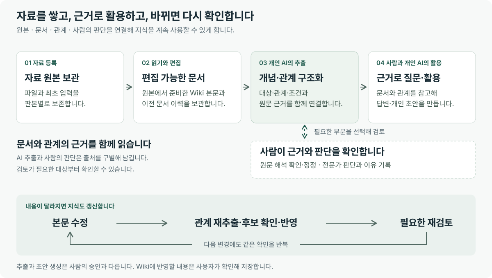

# LLM Wiki 이해하기

LLM Wiki는 **문서와 문서에서 추출한 지식, 사람이 남긴 판단을 함께 관리하고 업무에 활용하는 공동 지식 공간**입니다. 자료를 찾아 읽는 일부터 질문의 근거 확인, 필요한 내용의 수정, 바뀐 지식의 재검토까지 이어지도록 만드는 것을 목표로 합니다.

이름의 LLM은 글을 읽고 질문에 답하는 언어 모델을, Wiki는 기록을 함께 축적하고 계속 고쳐 나가는 문서 공간을 뜻합니다. LLM Wiki에서는 문서 본문에 담긴 대상·관계·조건을 구조화해 문서 읽기와 AI 대화에 연결합니다.

처음 접하는 사용자와 도입을 검토하는 팀을 위한 소개입니다. 아래의 현재 기능은 2026년 11월 7일 개발본을 기준으로 설명합니다.

## 전체 흐름을 한눈에 보기

핵심 흐름은 **자료 축적 → 지식 구조화 → 근거 확인과 활용 → 명시적인 수정과 갱신**입니다. 원본 보관, 문서 저장, 관계 추출, 사람의 검토는 각각 자신의 상태를 가집니다.

## 왜 이런 지식 공간이 필요한가

업무 자료에는 절차, 정의, 조건, 예외, 담당자의 판단이 함께 들어 있습니다. 시간이 지나면 같은 주제의 문서가 늘고 내용이 바뀌며, 누군가에게 물어 확인한 설명도 대화 속에 흩어집니다.

다음과 같은 질문에 답하려면 문서를 찾는 것에 더해 근거와 맥락을 살펴야 합니다.

- 이 절차는 어떤 조건에서 적용되는가?
- 이 용어는 이 문서에서 어떤 뜻으로 쓰였는가?
- AI의 설명은 어느 문장의 어떤 내용을 근거로 했는가?
- 이 의견은 원문에 있는 내용인가, 담당자가 별도로 정한 업무 판단인가?
- 본문을 수정한 뒤에도 예전 관계와 판단을 그대로 사용해도 되는가?

LLM Wiki는 이런 확인을 도우면서, 확인한 내용을 다음 업무와 다음 대화에서 다시 활용하는 흐름을 지향합니다. 축적한 자료를 누가 어떤 범위에서 읽고 고칠 수 있는지도 작업 공간의 권한으로 관리합니다.

## 무엇을 함께 관리하는가

### 자료의 출발점인 원본

원본은 업로드한 파일이나 처음 붙여넣은 텍스트입니다. 어떤 자료에서 지식이 시작되었는지 확인할 수 있도록 원본과 그 판본을 보관합니다.

예를 들어 PDF를 등록한 뒤 Wiki 문장을 고쳐도 처음 등록한 PDF는 그대로 남습니다. 원래 파일의 표나 배치를 확인해야 할 때 원본과 대조할 수 있습니다.

### 읽고 고치는 Wiki 문서

Wiki 문서는 앱에서 읽고 편집하는 Markdown 본문입니다. Markdown은 제목·목록·표 등을 글로 표현하는 문서 형식이며, 사용자는 앱에서 본문을 읽고 수정할 수 있습니다.

파일의 문자를 읽어 본문을 준비하고, 이 본문이 지식 추출의 근거가 됩니다. 문서를 저장할 때는 수정 전 전체 문서를 이력으로 남깁니다. 파일 변환에서 읽지 못한 부분이 있으면 그 범위를 확인해야 합니다.

### 대상과 의미를 연결하는 온톨로지

온톨로지는 문서에 등장하는 대상과 그 관계를 이름·속성·조건·근거와 함께 정리한 구조입니다. 앱의 지도는 이 구조를 탐색하는 한 가지 방법입니다.

아래의 연습용 문장을 보겠습니다.

> 요청을 접수하면 담당자가 내용을 확인한다. 필수 정보가 없으면 담당자가 보완을 요청한다.

이 문장을 구조화할 때 보존해야 할 의미는 다음과 같습니다.

| 살펴볼 요소 | 예시에서 읽을 내용 |
| --- | --- |
| 대상 | 요청, 담당자, 필수 정보 |
| 행동과 관계 | 요청 접수, 내용 확인, 보완 요청 |
| 조건 | 필수 정보가 없는 경우 |
| 순서와 맥락 | 접수한 내용을 확인하고, 필요한 정보가 빠졌을 때 보완 요청 |
| 근거 | 이 내용을 말하는 원문과 그 문서 판본 |

“담당자가 보완을 요청한다”만 남기면 언제 요청하는지 빠집니다. 조건과 근거까지 함께 보관해야 이후 질문에서도 의미를 확인할 수 있습니다. AI가 만든 관계는 원문을 해석한 결과이므로 중요한 부분은 실제 인용과 대조합니다.

### 사람이 확인한 해석과 업무 판단

사람은 AI의 해석이 원문에 맞는지 검토하고, 잘못 읽은 관계나 조건을 바로잡을 수 있습니다. 필요하면 별도의 업무 의견도 이유와 함께 기록합니다.

| 구분 | 예시 | 지식에 남겨야 할 것 |
| --- | --- | --- |
| 원문 내용 | “필수 정보가 없으면 보완을 요청한다.” | 원문 위치와 판본 |
| 원문 해석 정정 | AI가 빠뜨린 “필수 정보 없음” 조건을 복원 | 대상 주장, 원문 근거, 정정 이유 |
| 별도의 업무 판단 | “이 업무에서는 보완 요청 전에 담당자가 연락한다.”라는 의견 | 전문가 의견이라는 출처와 이유·적용 범위 |

이 구별을 유지해야 다음 사용자가 문서에 적힌 내용과 사람이 추가한 의견을 이해할 수 있습니다. 검토는 필요한 대상에 수행합니다. 사람이 확인하기 전의 결과도 미검토 상태를 표시한 채 탐색할 수 있습니다.

## 실제로 어떤 방식으로 동작하는가

### 자료를 등록하고 본문을 준비한다

사용자가 파일을 선택하거나 텍스트를 붙여넣으면 원본을 보관합니다. 파일 형식에 맞춰 문자를 읽고 편집 가능한 Wiki 본문을 준비합니다. 스캔 자료에는 문자 인식이 필요할 수 있습니다.

이 단계에서는 내용을 읽지 못한 부분과 저장한 결과를 확인합니다. 변환 완료는 자료의 모든 의미를 정확하게 읽었다는 판단과는 구별합니다.

### AI가 문서의 개념과 관계를 추출한다

선택한 개인 AI 실행기는 작업의 원문과 추출 규칙을 받아 대상·관계·속성·조건을 정리합니다. 결과에는 어떤 본문을 읽었는지와 원문 근거를 연결합니다.

저장 조건과 인용·구조를 검사한 뒤 결과를 보관합니다. 이 검사는 저장할 수 있는 결과인지 확인하는 절차이며, 해석의 의미가 모두 정확하다는 승인을 대신하지 않습니다.

### 필요한 부분을 사람이 확인한다

사용자는 문서를 읽거나 지도를 탐색하며 원문 인용과 조건을 살펴봅니다. 중요한 주장은 검토함에서 승인·수정·보류·반려하고 이유를 남길 수 있습니다.

기존 지식과의 관련성도 후보로 확인할 수 있습니다. 같은 이름이나 AI의 관련 제안만으로 개체가 자동 병합되거나 전문가 판단으로 확정되지는 않습니다.

### 질문에 필요한 근거를 읽고 답변한다

사용자가 질문하면 AI는 허용된 문서와 지식에서 필요한 근거를 찾아 답변에 활용합니다. 사용자는 답변의 근거를 열어 인용, 원문 위치, 사용한 자료를 확인합니다.

예를 들어 “예시 운영 안내에서 보완을 요청하는 조건은 무엇인가?”라고 물으면 “필수 정보가 없는 경우”라는 답과 그 문장을 함께 확인하는 식입니다. 실제 답변에서는 무엇을 읽었는지, 일부만 읽었는지, 인용이 있는지를 살펴봅니다.

### 결과를 활용하고 필요한 내용을 갱신한다

답변을 복사하거나 파일로 내려받고 개인 초안으로 다듬을 수 있습니다. 공유 문서를 바꾸려면 검토한 내용을 대상 문서의 본문 편집에서 명시적으로 저장합니다.

본문을 바꾸면 기존 관계가 이전 본문을 근거로 한 상태가 될 수 있습니다. 현재 본문으로 관계를 다시 추출하고 새 후보와 이전 결과를 비교한 뒤 반영합니다. 과거 판단은 기록으로 보존하며 새 결과에 적용할지는 현재 근거에서 다시 확인합니다.

## 앱과 서버와 개인 AI는 무엇을 맡는가

| 구성 | 맡는 일 |
| --- | --- |
| 데스크톱 앱 | 문서·지도·근거를 보여 주고 편집·검토·질문을 시작하며 작업 상태를 표시합니다. |
| 공동 서버 | 작업 공간의 자료·원본·문서 이력·추출 지식·검토 기록과 접근 권한을 관리합니다. |
| 개인 AI 실행기 | 사용자의 PC에 설치하고 로그인한 Codex CLI 또는 Claude Code CLI를 통해 AI 작업을 실행합니다. |

앱은 자료를 읽고 저장할 때 서버의 업무 기능을 사용합니다. 개인 AI 실행기는 작업에 따라 서버 API와 MCP라는 도구 연결로 허용된 규칙·근거·저장 기능을 이용합니다. 사용자는 앱에서 작업을 시작하고 결과를 확인합니다.

공동 서버에 로그인하는 계정과 개인 AI의 로그인은 별개입니다. AI를 사용할 PC에는 선택한 CLI를 먼저 설치해야 합니다. 실행기를 개인 PC에서 시작하더라도 필요한 입력이 선택한 AI 서비스에 전달될 수 있으므로, 이를 모델 전체가 오프라인에서 동작한다는 의미로 이해하지 않습니다.

공유 Wiki와 개인 작업의 범위도 구별합니다. 문서에 접근할 수 있는 사람의 범위와 대화·개인 초안의 소유 범위는 같지 않을 수 있습니다. 개인 답변을 내려받았다고 공유 문서가 바뀌는 것은 아닙니다.

## 어떤 가치를 추구하는가

### 설명과 근거를 함께 확인할 수 있는 지식

어떤 결론을 사용할 때 그 결론이 어느 자료와 조건에서 나왔는지 확인할 수 있어야 합니다. LLM Wiki는 문서·판본·인용·판단 기록을 연결해 사용자가 그 이유를 살펴보도록 합니다.

인용이 있다는 사실만으로 답변의 모든 결론이 맞다고 보장되지는 않습니다. 근거를 열어 실제 의미를 대조할 수 있는 것이 중요한 기준입니다.

### 사람의 판단이 출처와 함께 남는 협업

업무에는 문서의 사실과 사람의 해석·정책 판단이 함께 필요합니다. 각각의 출처와 이유를 남겨 다음 사용자가 어떤 내용을 어떤 기준으로 적용했는지 이해하도록 합니다.

### 다음 업무에서 다시 찾을 수 있는 축적

대화나 AI 세션이 바뀌어도 허용된 자료와 적용 가능한 판단을 다시 찾아 활용하는 경험을 지향합니다. 근거 있는 문서를 쌓고 고치는 활동이 다음 질문과 결과물의 출발점이 되도록 합니다.

### 바뀐 내용을 다시 확인할 수 있는 현재성

문서가 바뀌면 이전 관계와 판단도 다시 살펴야 합니다. 본문·추출·검토가 어떤 기준에 연결되어 있는지 확인하고 필요한 재추출과 재검토로 이어지도록 합니다.

화면의 “최신”은 현재 기준과의 일치를 뜻합니다. 사실의 정확성을 모두 검증했다는 뜻으로 사용하지 않습니다.

### 고치면서도 출발점과 이력이 남는 운영

원본과 수정 전 문서, 과거 판단을 보존해 변경의 이유를 추적할 수 있도록 합니다. 여러 사용자가 같은 문서를 수정할 때도 최신 본문과 내 변경을 비교하며 반영합니다.

## 현재 어떤 기능을 제공하는가

| 필요한 일 | 현재 앱에서 사용하는 기능 | 함께 확인할 점 |
| --- | --- | --- |
| 자료를 모으고 찾기 | 파일·텍스트 등록, 원본 보관, 이름·내용 검색 | 변환의 미독 범위와 조회한 범위 |
| 본문을 정리하고 고치기 | 문서 읽기·편집, 변경 비교, 전체 이력과 판본 복원 | 편집 대상은 Wiki 본문이며 원본 파일은 별도로 보관 |
| 내용의 구조를 살펴보기 | 개념·문서 검색, 온톨로지 지도, 관계·속성·조건과 원문 문맥 | 처음 불러온 지도가 전체 관계를 포함하지 않을 수 있음 |
| 해석과 의견을 관리하기 | 검토함, 원문 근거 정정, 전문가 의견, 판단 이력과 되돌림 | 원문에 따른 정정과 별도 업무 판단의 구별 |
| 지식에 질문하고 결과 만들기 | 근거 기반 대화, 자료 첨부, 선택한 공개 검색어의 웹 검색, 개인 초안 | 첨부와 Wiki 등록, 개인 초안과 공유 문서 저장의 구별 |
| 결과를 파일로 활용하기 | Markdown·텍스트·Word·PDF·Excel·PowerPoint 내보내기 | 해당 환경에 표시되는 형식과 내려받은 파일의 내용 |
| 작업을 이어서 확인하기 | AI 세션, 지난 기록, 개별 작업 중단, 연결·계정 사용량 확인 | 실행 종료와 저장 완료, 창 숨김과 앱 종료의 구별 |

현재 문서 간 대응과 변경 영향의 일부 기능은 서버 API와 MCP에 있으며, 별도 앱 메뉴로 제공하지 않습니다. 개인 결과물 화면에서도 Wiki 직접 반영 버튼은 제공하지 않으므로 검토한 내용을 문서 편집에서 저장합니다.

## 어떤 사용 경험으로 발전시키려는가

제품이 지향하는 방향은 **한 번 확인한 업무 지식이 다음 질문·판단·문서 수정으로 이어지는 순환**입니다.

| 지향하는 경험 | 사용자가 얻고자 하는 가치 |
| --- | --- |
| 필요한 자료와 관련 맥락을 함께 찾기 | 여러 문서를 다시 읽으며 시작점을 찾는 부담 줄이기 |
| 답변의 원문과 사람의 판단을 함께 살펴보기 | 결과를 적용할 때 이유와 조건을 설명하기 |
| 검토한 내용과 수정 기록을 다시 활용하기 | 대화가 바뀌어도 확인한 지식에서 이어서 작업하기 |
| 바뀐 본문과 이전 판단의 차이를 살펴보기 | 오래된 기준을 그대로 적용할 가능성 줄이기 |
| 결과물을 만들고 필요한 내용을 다시 축적하기 | 일회성 답변이 문서와 지식의 개선으로 이어지게 하기 |

이 방향은 위에서 설명한 현재 기능을 연결하고 개선해 가려는 목적입니다. 모든 자료의 자동 통합, 모든 판단의 자동 검증, 모든 변경의 무인 반영을 제공한다는 약속이나 확정된 개발 일정은 아닙니다.

## 이런 업무에서 활용할 수 있다

- **업무 인수인계:** 절차와 조건을 읽고 질문하며 원문과 함께 설명을 확인합니다.
- **여러 자료의 비교:** 문서별 용어와 적용 조건을 찾아 공통점·차이와 근거를 정리합니다.
- **보고서와 정리 자료 작성:** 필요한 지식을 질문하고 답변의 근거를 확인한 뒤 파일로 활용합니다.
- **전문가 지식 정리:** 원문 해석의 정정과 별도 업무 의견을 구별해 이유와 함께 남깁니다.
- **지속적인 문서 관리:** 본문을 고치고 이전 판본을 비교하며 관계와 판단의 재확인으로 연결합니다.

가장 먼저 해 볼 일은 작은 자료 하나로 이 흐름을 경험하는 것입니다. **예시 운영 안내**를 등록해 본문을 읽고, 관계의 조건을 살펴보고, 질문의 근거를 확인한 뒤 문장을 수정해 갱신 과정을 따라가 보세요.

## 사용을 시작하려면

화면에서 무엇을 눌러야 하는지는 [화면 가이드](guide/index.html), 설치·연결·기능별 상세 절차는 [사용자 가이드](USER_GUIDE.md)에서 확인할 수 있습니다. 앱에서는 로그인 화면 또는 사이드바의 **사용자 가이드**를 엽니다.
