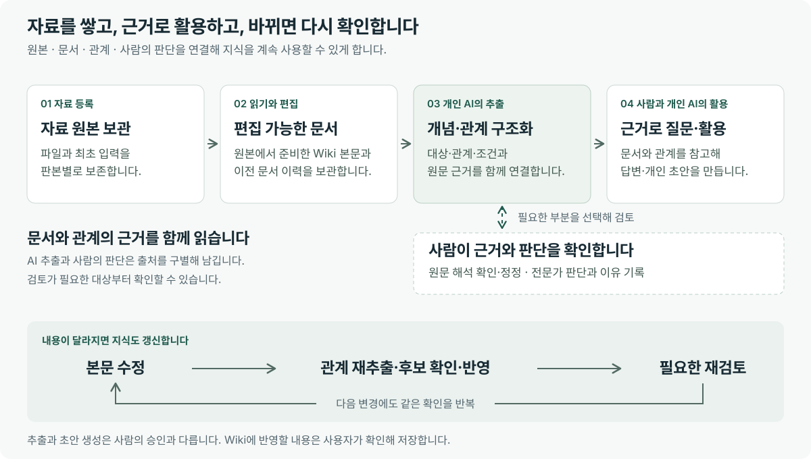

# LLM Wiki 이해하기

LLM Wiki는 **팀의 자료를 모으고, AI에게 근거를 물으며, 확인한 내용을 계속 고쳐 쓰는 공동 지식 공간**입니다. 파일 원본과 편집 가능한 문서, 문서에서 추출한 개념·관계, 사람이 남긴 판단을 연결해 관리합니다.

예를 들어 새 담당자가 “어떤 경우에 보완을 요청해야 하나요?”라고 물으면, 팀의 운영 안내를 근거로 답변을 받고 해당 문장을 열어 확인할 수 있습니다. 조건이 잘못 적혀 있다면 문서를 고치고, 바뀐 본문으로 관계를 다시 추출해 다음 질문에 활용합니다. 이처럼 **자료 등록 → 근거 있는 질문 → 확인과 수정 → 다시 활용**이 이어지도록 돕습니다.

이 문서는 처음 접하는 사용자와 도입을 검토하는 팀을 위한 소개입니다. **2026년 11월 23일 저장소의 개발본 기준**이며, 설치한 앱과 서버 버전에 따라 보이는 기능이 다를 수 있습니다. 버튼과 설정 순서는 [사용자 가이드](USER_GUIDE.md)에서 확인하세요.

## 이런 업무에서 활용할 수 있다

| 하고 싶은 일 | LLM Wiki에서 하는 일 | 확인할 결과 |
| --- | --- | --- |
| 업무 인수인계 | 절차 문서를 등록하고 조건·예외·담당자를 질문 | 답변과 근거 문장 |
| 여러 자료 비교 | 문서별 정의와 적용 조건을 찾아 차이를 질문 | 어떤 자료에서 나온 설명인지 구별된 비교 |
| 보고서·정리 자료 작성 | 저장된 지식을 질문하고 필요한 파일 생성을 요청 | 근거를 확인하고 내려받을 결과물 |
| 전문가 지식 축적 | AI 해석을 바로잡거나 별도 업무 의견을 이유와 함께 기록 | 원문 해석과 전문가 판단의 출처 |
| 문서 유지 관리 | 본문을 수정하고 이전 판본과 비교한 뒤 관계 재추출 | 새 본문, 변경 이력, 다시 검토할 관계 |

작은 운영 안내나 자주 묻는 질문 문서 하나로 시작하면 이 흐름을 익히기 쉽습니다. 질문할 자료의 이름과 확인할 조건을 함께 적으면 답변의 범위를 정하는 데 도움이 됩니다.

## 전체 흐름을 한눈에 보기

자료를 등록하면 원본 보관, 본문 준비, 관계 추출이 순서대로 진행됩니다. **문서가 저장된 상태와 관계 추출이 끝난 상태는 따로 확인**합니다. 작업 화면에서 어느 단계까지 끝났는지 보고, 저장된 본문부터 읽거나 필요한 처리를 이어갈 수 있습니다.

## 무엇을 함께 관리하는가

| 구성 | 무엇인가 | 사용자가 확인하는 것 |
| --- | --- | --- |
| **원본** | 업로드한 파일 또는 처음 붙여넣은 텍스트 | 처음 받은 자료와 원본 판본 |
| **Wiki 문서** | 앱에서 읽고 고치는 Markdown 본문 | 현재 내용과 수정 전 전체 문서 이력 |
| **온톨로지** | 문서의 개념·관계·속성·조건을 근거와 함께 정리한 구조 | 어떤 대상이 어떤 조건에서 연결되는지 |
| **사람의 판단** | 원문 해석에 대한 검토와 별도의 전문가 의견 | 판단한 이유, 출처, 적용 범위와 이력 |

PDF에서 만든 Wiki 문장을 수정해도 업로드한 PDF는 그대로 남습니다. 본문을 수정하면 관계를 다시 추출할 수 있고, 이전 본문을 읽고 남긴 판단은 재검토할 수 있도록 보존합니다.

### 온톨로지는 어떤 도움을 주는가

온톨로지는 문서의 의미를 찾아볼 수 있도록 구조화한 것입니다. 앱의 **온톨로지** 화면에서는 개념과 관계를 지도나 목록으로 탐색하고 원문 근거를 엽니다.

다음은 연습용 문장입니다.

> 요청을 접수하면 담당자가 내용을 확인한다. 필수 정보가 없으면 담당자가 보완을 요청한다.

| 문장에서 읽을 요소 | 예시 |
| --- | --- |
| 대상 | 요청, 담당자, 필수 정보 |
| 행동과 관계 | 담당자가 내용을 확인하고 보완을 요청함 |
| 조건 | 필수 정보가 없는 경우 |
| 순서와 맥락 | 접수한 내용을 확인한 뒤 필요한 정보가 빠졌는지 판단 |
| 근거 | 이 문장이 있는 문서, 위치, 본문 판본 |

“담당자가 보완을 요청한다”라는 관계에 **“필수 정보가 없는 경우”**가 함께 남아야 적용 조건을 확인할 수 있습니다. AI가 정리한 결과를 열어 이 조건이 보존되었는지 원문과 대조하는 것이 검토의 한 예입니다.

### 원문 해석과 전문가 판단은 어떻게 다른가

| 남기려는 내용 | 하는 일 |
| --- | --- |
| AI가 원문의 “필수 정보가 없으면” 조건을 빠뜨림 | 원문을 근거로 해석을 정정합니다. |
| 담당자가 “우리 업무에서는 보완 요청 전에 연락하자”는 의견을 추가함 | 전문가 의견으로 이유와 적용 범위를 남깁니다. |
| 운영 안내 자체의 절차가 바뀜 | 문서 본문을 수정하고 관계를 다시 추출합니다. |

이 구별 덕분에 다음 사용자는 문서에 적힌 내용과 사람이 추가한 업무 판단을 함께 이해할 수 있습니다. 필요한 주장부터 검토하며, 미검토 결과는 상태를 확인하면서 탐색할 수 있습니다.

## 실제로 어떤 방식으로 동작하는가

### 1. 자료를 등록하고 본문을 읽는다

**문서 → 문서 등록**에서 파일을 선택하거나 텍스트를 붙여넣습니다. 파일의 문자를 읽어 Wiki 본문을 준비하고, 원본과 함께 보관합니다. PDF·문서·표·슬라이드·이미지는 형식과 환경에 따라 읽지 못한 부분이 있을 수 있으므로 변환 기록과 본문을 확인합니다. 지원 형식과 준비 조건은 [자료 등록 안내](USER_GUIDE.md#자료-등록하기)를 따릅니다.

등록 뒤에는 **작업**의 상세 화면에서 변환·문서 저장·관계 추출 진행을 확인합니다. 실패하거나 일부만 완료된 경우에도 보관된 원본과 결과를 확인한 뒤 표시되는 다음 행동을 선택할 수 있습니다.

### 2. 관계와 원문 근거를 살펴본다

개인 AI가 본문과 추출 규칙을 읽고 개념·관계·조건을 정리합니다. 결과에는 어떤 본문을 읽었는지와 원문 근거가 연결됩니다. **온톨로지**에서 의미를 살펴보고, 중요한 해석은 **검토함**에서 승인·수정·보류·반려하며 이유를 남깁니다.

결과가 저장되었다는 것은 구조와 인용 등의 저장 검사를 통과했다는 뜻입니다. 해석의 정확성은 실제 원문과 비교해 확인합니다. 같은 이름의 개념이나 관련 후보도 근거를 살펴 판단합니다.

### 3. 질문하고 답변의 근거를 확인한다

**AI 채팅**에서 “예시 운영 안내에서 보완을 요청하는 조건을 원문 인용과 함께 알려 줘”처럼 질문합니다. AI는 접근이 허용된 자료를 찾아 답변에 활용합니다. 추가 정보가 필요하면 질문 카드가 나타나며, 선택하거나 직접 입력한 답을 보내면 원래 요청을 이어갑니다.

답변에서는 근거를 열어 사용한 문서·인용·조건을 확인합니다. 읽은 범위가 부족하거나 인용이 없으면 문서와 질문 범위를 더 구체적으로 지정합니다. [질문과 근거 확인 안내](USER_GUIDE.md#ai-채팅으로-질문하기)에 조작 순서가 있습니다.

### 4. 결과를 활용하고 지식을 갱신한다

답변을 읽고 복사하거나, 파일 생성을 요청해 준비된 결과물을 내려받습니다. 템플릿을 선택하면 등록한 양식과 작성 지침을 활용합니다. 별도로 저장한 AI 결과는 Markdown 개인 초안으로 다듬을 수 있습니다. 파일을 만들거나 개인 초안을 저장한 뒤에는 공유 Wiki에 반영할 내용을 별도로 확인합니다.

공유 본문은 대상 문서의 편집에서 저장합니다. 저장 후 **관계 재추출**로 새 후보를 만들고 비교·반영하며, 이전 판단은 현재 근거에서 다시 살펴봅니다. 문서 수정·새 관계 반영·사람의 검토는 각각의 완료 상태가 있습니다.

## 앱과 서버와 개인 AI는 무엇을 맡는가

| 구성 | 맡는 일 | 시작 전에 준비할 것 |
| --- | --- | --- |
| **데스크톱 앱** | 문서·지도·근거를 보여 주고 편집·질문·검토와 작업 확인을 연결 | 사용할 PC의 LLM Wiki 앱 |
| **공동 서버** | 작업 공간의 자료·이력·추출 결과·검토 기록과 접근 권한 관리 | 서버 주소, 계정, 사용할 작업 공간의 배정 |
| **개인 AI** | 본문 준비·관계 추출·질문·결과물 생성 등의 AI 작업 실행 | 같은 PC에 Codex CLI 또는 Claude Code CLI 설치와 로그인 |

서버 로그인과 개인 AI 로그인은 따로 진행합니다. 가입 후 공간 배정을 기다리는 안내가 나오면 운영 담당자에게 배정을 요청합니다. 문서 조회·편집에는 해당 공간의 권한이, AI 기능에는 개인 AI 연결도 필요합니다.

개인 PC에서 실행을 시작해도 작업에 필요한 입력은 선택한 AI 서비스로 전달될 수 있습니다. 사용할 자료의 범위를 정할 때 이 점을 함께 확인하세요. 대화·개인 초안의 범위와 작업 공간의 공유 문서 범위도 구별됩니다.

## 현재 어떤 기능을 제공하는가

| 메뉴·진입점 | 할 수 있는 일 |
| --- | --- |
| **문서** | 파일·텍스트 등록, 이름·내용 검색, 원본과 Wiki 열람, 본문 편집·비교·판본 복원, 휴지통과 복원 |
| **온톨로지** | 개념·문서 검색, 지도·관계·속성·조건과 원문 문맥 탐색 |
| **검토함** | 원문 해석 검토·정정, 전문가 의견, 판단 이력 확인과 되돌림 |
| **AI 채팅** | 근거 기반 질문, 자료 첨부, 웹 검색 선택, 추가 질문에 답하기, 결과물 생성 |
| **템플릿** | 양식 파일과 작성 지침 등록, 채팅에서 선택해 활용 |
| **작업** | 이 기기의 문서 처리 진행·실패·부분 완료 확인, 결과 열기와 필요한 재시도 |
| **작업 → AI 실행 기록** | 실행 중 AI 작업과 지난 질문·분석 기록 확인, 개별 실행 중단 |
| **설정** | 서버·계정·작업 공간, 개인 AI 연결·사용량, 테마와 실행 환경 확인 |

파일 결과는 해당 환경에서 제공되는 Markdown·텍스트·Word·PDF·Excel·PowerPoint 형식으로 활용할 수 있습니다. 일반 질문의 모든 답변에 내려받기 메뉴가 생기는 것은 아니므로 필요한 경우 파일 생성을 요청합니다.

문서 간 대응과 변경 영향의 일부 기능은 서버 API·MCP에서 제공하며, 별도 앱 메뉴로 제공하지 않습니다. 개인 결과물 화면의 Wiki 직접 반영 버튼도 현재 제공하지 않습니다. 자세한 기능 경계는 [현재 앱의 제공 범위](USER_GUIDE.md#현재-앱의-제공-범위-알아두기)를 참고하세요.

## 사용할 때 기억할 세 가지

- **답변의 근거와 조건을 확인합니다.** 인용이 있어도 결론이 그 의미를 정확히 반영하는지는 살펴야 합니다. 일부만 읽은 결과와 미검토 상태도 확인합니다.
- **변경은 확인한 대상에 저장합니다.** 원본, Wiki 본문, 개인 초안은 각각 보관됩니다. 문서를 삭제할 때도 Wiki와 등록 원본을 구별해 선택하고 휴지통에서 복원할 수 있습니다.
- **본문이 바뀌면 관계와 판단도 다시 살펴봅니다.** 화면의 “최신”은 현재 기준과의 일치를 뜻합니다. 과거 판단은 보존하며 새 결과에 자동 승인으로 옮기지 않습니다.

## 사용을 시작하려면

1. [시작 설정](USER_GUIDE.md#시작-설정하기)에서 서버·작업 공간과 개인 AI를 연결합니다.
2. [연습용 텍스트](USER_GUIDE.md#텍스트를-붙여넣어-등록하기)를 등록하고 본문과 관계를 확인합니다.
3. 보완 요청의 조건을 질문하고, 근거를 연 뒤 본문을 수정해 갱신 과정을 따라갑니다.

화면 위치는 [화면 가이드](guide/index.html), 상세 절차와 오류 해결은 [사용자 가이드](USER_GUIDE.md)에서 볼 수 있습니다. 앱의 로그인 화면과 사이드바에 있는 **사용자 가이드**에서도 열 수 있습니다.
