# 처음부터 따라하는 Windows 서버 설치

Windows 노트북 한 대를 서버로 만들고, 집 밖의 PC에서도 같은 자료에 접속하는 안내서입니다. 2026년 10월 26일의 프로젝트 코드에 맞췄습니다.

**읽기 쉬운 파일:** [PDF 한 파일](../output/pdf/WSL2_SERVER_GUIDE.pdf) · [브라우저 보기](WSL2_SERVER_GUIDE.html)

## 00 시작 전에: 이번에 만들 구성

서버 노트북에만 WSL2와 Ubuntu를 설치합니다. Ubuntu 안에서 **FastAPI와 MCP를 함께 제공하는 서버 하나**를 실행하고, Cloudflare Tunnel로 고정 HTTPS 주소를 연결합니다. 집 안과 집 밖에서 같은 주소를 사용합니다.

| 구분 | 하는 일 | 이번 안내의 기준 |
| --- | --- | --- |
| 서버 노트북 | 데이터를 보관하고 요청을 받음 | Windows 11 + Ubuntu-24.04 + Python 3.12 이상 |
| 작업 PC | Electron 앱으로 자료를 보고 개인 AI로 분석 | Windows를 기준으로 설명. 서버용 WSL은 필요 없음 |
| HTTPS 주소 | 외부 PC에서 서버를 찾아가는 주소 | 본인이 관리하는 도메인의 `wiki` 하위 주소 |
| 개인 토큰 | 서버에 접속하는 개인 열쇠 | 사용자별 값. Cloudflare 로그인과 별개 |

**이번에 끝까지 확인할 목표:** 서버 준비 → 개인 인증 준비 → 로컬 API/MCP 확인 → 고정 외부 주소 → 다른 PC 인증 → Windows 자동 시작 → 재부팅 후 외부 재접속입니다.

현재 코드에는 통합 FastAPI/MCP, 설치·진단 도구와 Electron 연결 화면이 있습니다. 실제 대상 Windows/WSL2에서의 설치·부팅·집 밖 접속은 이 문서를 작성한 환경에서 시험하지 않았습니다. 각 단계의 완료 기준을 자신의 PC에서 확인해야 합니다. 예전 안내의 “FastAPI 미구현” 설명은 현재 코드에 맞춰 고쳤습니다.

집 밖 연결은 기존 가이드의 **Cloudflare 고정 Tunnel** 경로 하나로 설명합니다. 별도의 Caddy 인증서·공유기 포트 전달·WSL IP 고정 설정을 이 절차에 섞지 않습니다. Cloudflare가 HTTPS 요청을 중계하므로 그 경유 방식이 자료의 운영 조건에 맞는지 먼저 확인합니다. 서버 로컬 LLM은 설치하지 않습니다.

## 01 준비물과 내 설정표

**어디서:** 아직 명령을 입력하지 않습니다. 아래 표를 먼저 확인합니다.

1. Windows 11 노트북의 전원 어댑터와 인터넷을 연결합니다. Windows 관리자 계정으로 로그인할 수 있어야 합니다.
2. 현재 프로젝트 코드가 있는 Mac 또는 배포용 코드 사본을 준비합니다. 코드와 기존 자료·인증 파일은 서로 다른 대상입니다.
3. Cloudflare 계정과 본인이 관리하는 도메인을 준비합니다. 도메인이 없으면 13단계의 안내에 따라 먼저 준비합니다. `example.com`은 연습용 표기이며 실제 접속 주소로 사용할 수 없습니다.
4. 집 밖 연결을 확인할 작업 PC와 휴대전화 핫스폿을 준비합니다. 처음에는 서버와 같은 와이파이에서 진행해도 됩니다.
5. 기존 자료를 옮길 경우 보존 사본을 담을 보호된 외장 저장장치도 준비합니다.

| 기록할 항목 | 이 문서의 예시 | 내 실제 값 |
| --- | --- | --- |
| Ubuntu 배포판 이름 | `Ubuntu-24.04` | __________________ |
| Ubuntu 사용자 이름 | `wiki` | __________________ |
| Ubuntu 프로젝트 위치 | `/home/wiki/llm-wiki` | __________________ |
| 자료 루트 | `/home/wiki/llm-wiki/data` | __________________ |
| 접근 정책 파일 | `/home/wiki/llm-wiki/.local/tenancy/access.json` | __________________ |
| 작업 공간 / 관점 | `personal` / `all` | __________________ |
| 실제 외부 주소 | `wiki.example.com` | __________________ |
| Tunnel 이름 | `llm-wiki` | __________________ |

처음 설치한다면 Ubuntu 사용자 이름을 `wiki`로 만들면 뒤의 예시를 그대로 사용할 수 있습니다. 이미 Ubuntu를 쓰고 있다면 계정을 새로 만들려고 초기화하지 말고 실제 이름으로 경로와 자동 시작 인수를 바꿉니다. 이 설정표에는 토큰·비밀번호·인증서 내용을 적지 않습니다.

**완료 기준:** Ubuntu 이름·경로와 사용할 도메인을 구분할 수 있습니다. 도메인 준비가 늦어져도 12단계까지는 먼저 진행할 수 있습니다.

## 02 세 가지 창을 구분하는 법

**어디서:** Windows 바탕화면과 이 안내서를 함께 봅니다.

| 안내에 적힌 위치 | 여는 방법 | 여기서 입력하는 예 |
| --- | --- | --- |
| 서버 Windows 관리자 PowerShell | 시작 메뉴에서 PowerShell 검색 → 관리자 권한으로 실행 | `wsl --install ...` |
| 서버 Ubuntu | 시작 메뉴에서 Ubuntu 24.04 검색 → 실행 | `sudo apt update` |
| 작업 PC PowerShell | 다른 PC에서 PowerShell 실행. 별도 표시가 없으면 일반 창 | `py -3.13 ...` |

**복사하는 법:** 코드 상자의 내용만 복사합니다. 상자 위의 위치 설명과 `PS C:\...>`·`wiki@...$` 같은 프롬프트는 입력하지 않습니다. 여러 줄 명령은 중간의 `\`나 PowerShell의 역따옴표를 빼지 말고 전체를 붙여넣습니다. 역따옴표는 작은따옴표와 다른 문자입니다.

명령을 붙여넣은 뒤 Enter를 누릅니다. 명령이 끝나면 새 입력 줄이 나타납니다. 서버·터널 실행은 계속 대기하는 프로그램이므로 입력 줄로 돌아오지 않는 것이 정상입니다. 그 창을 닫거나 Ctrl+C를 누르면 수동 실행이 끝납니다.

Ubuntu의 `sudo`는 관리자 작업을 요청합니다. **Ubuntu를 만들 때 정한 비밀번호**를 입력합니다. 입력 중 글자·별표가 보이지 않아도 그대로 입력하고 Enter를 누릅니다.

**막히면:** `sudo`가 인식되지 않으면 PowerShell에 Ubuntu 명령을 입력했을 가능성이 큽니다. `wsl`이 인식되지 않는 Ubuntu 창에서는 해당 Windows 명령을 PowerShell로 옮겨 실행합니다.

## 03 서버 노트북의 절전부터 설정

**어디서:** 서버 노트북의 Windows 설정.

1. 시작 → 설정 → 시스템 → 전원 및 배터리로 이동합니다.
2. 화면·절전 시간 제한 항목을 엽니다. Windows 버전에 따라 “화면, 절전 및 최대 절전 시간 제한”으로 보일 수 있습니다.
3. **전원 연결 시 장치를 절전 모드로 전환**을 **안 함**으로 설정합니다. 화면 끄기는 원하면 유지해도 됩니다. 화면이 꺼지는 것과 서버가 잠드는 것은 다릅니다.
4. 시작 메뉴에서 “덮개”를 검색해 **덮개를 닫으면 수행되는 작업 선택**을 엽니다. 찾기 어렵다면 제어판 → 하드웨어 및 소리 → 전원 옵션에서 들어갑니다.
5. 전원 연결 상태의 덮개 동작을 운영 조건에 맞춥니다. 닫아 두고 쓸 계획이면 **아무 것도 안 함**을 선택하고 변경 내용을 저장합니다. 통풍구를 막지 않는 위치에 둡니다.

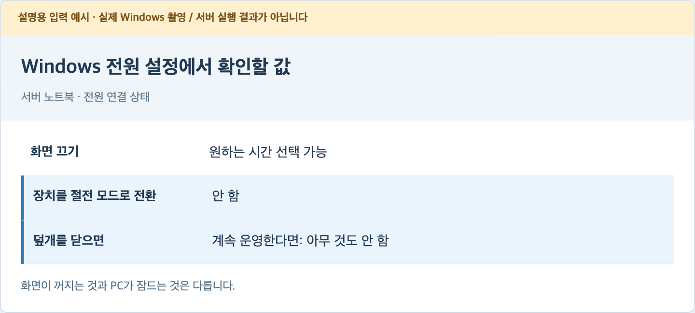

이 이미지는 항목을 설명하기 위한 구성 예시입니다. 실제 Windows 캡처가 아닙니다. 회사에서 관리하는 PC는 조직 정책 때문에 일부 설정이 잠겨 있을 수 있습니다.

**완료 기준:** 화면을 잠근 상태에서도 노트북이 절전으로 들어가지 않도록 전원 연결 설정을 확인했습니다. 실제 덮개·재부팅 검사는 마지막에 다시 합니다.

공식 참고: [Windows 11 전원 설정](https://support.microsoft.com/en-au/windows/experience/power-battery/power-settings-in-windows-11).

## 04 관리자 PowerShell 열기와 WSL 설치

**어디서:** 서버 Windows. 이 단계에는 관리자 PowerShell을 사용합니다.

1. Windows 키를 누르고 `PowerShell`을 입력합니다.
2. 검색 결과에서 **관리자 권한으로 실행**을 선택합니다. 사용자 계정 컨트롤이 나오면 실행할 프로그램을 확인하고 예를 누릅니다.
3. 열린 창에 다음을 입력해 설치할 수 있는 배포판 이름을 확인합니다.

```powershell
wsl --list --online
```

4. 목록에 `Ubuntu-24.04`가 있는지 확인하고 다음을 실행합니다. 이미 설치한 배포판이 있으면 새 설치 전에 06단계의 목록부터 확인합니다.

```powershell
wsl --install -d Ubuntu-24.04
```

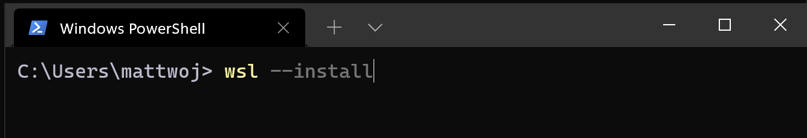

원본 화면의 명령은 `wsl --install`입니다. **우리 명령은 `-d Ubuntu-24.04`까지 포함**합니다. 기본 Ubuntu 버전이 바뀌어도 안내서의 기준 환경을 선택하기 위해서입니다.

5. “다시 시작해야 한다”는 안내가 나오면 작업 중인 다른 파일을 저장하고 Windows를 재부팅합니다.
6. 재부팅 후 처음 설치한 **같은 Windows 계정**으로 로그인합니다.

**완료 기준:** 설치가 끝났거나, 재부팅 후 Ubuntu 초기 설정을 진행할 수 있습니다.

**막히면:** `0x80370102` 등 가상화 관련 오류가 나오면 작업 관리자 → 성능 → CPU에서 가상화 상태를 확인합니다. 사용 안 함이면 제조사 안내에 따라 BIOS/UEFI 가상화를 준비해야 합니다. 이미 쓰는 Ubuntu를 삭제하거나 `wsl --unregister`로 해결하지 않습니다. 다운로드가 멈추면 인터넷·Windows 업데이트와 [WSL 설치 문제 해결](https://learn.microsoft.com/en-us/windows/wsl/troubleshooting#installation-issues)을 확인합니다.

공식 참고: [Microsoft WSL 설치](https://learn.microsoft.com/en-us/windows/wsl/install), [Ubuntu의 버전 지정 설치](https://ubuntu.com/wsl/docs/stable/howto/install-ubuntu-wsl2/).

## 05 Ubuntu 사용자 만들기

**어디서:** 서버의 Ubuntu 창.

1. 시작 메뉴에서 `Ubuntu`를 검색해 **Ubuntu 24.04**를 엽니다. 설치 직후 자동으로 열린 창이 있다면 그 창에서 계속합니다.
2. `Enter new UNIX username` 또는 사용자 이름 질문이 나오면 아래 이름을 입력합니다.

```text
wiki
```

3. 새 비밀번호를 묻는 줄에 Ubuntu용 비밀번호를 입력합니다. 표시되지 않아도 정상입니다.
4. 다시 입력하라는 줄에 같은 비밀번호를 한 번 더 입력합니다.

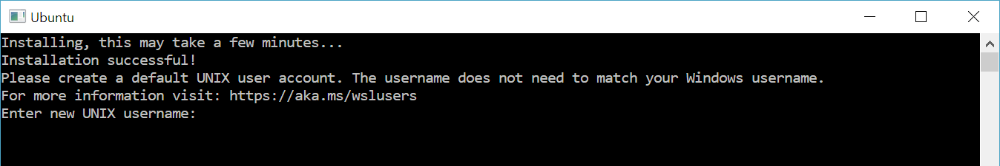

원본의 사용자 이름은 다른 예시입니다. Windows 계정 이름을 바꿀 필요는 없습니다. 이 문서의 `wiki`는 Ubuntu 안의 사용자 이름입니다.

5. 초기 설정이 끝나 새 입력 줄이 보이면 아래 명령을 한 줄씩 실행합니다.

```bash
whoami
pwd
```

**정상 결과:** 첫 명령은 `wiki`, 두 번째는 보통 `/home/wiki`를 보여줍니다. 이미 만든 다른 계정을 사용한다면 그 이름을 01단계의 설정표에 적습니다.

**막히면:** 비밀번호 확인이 다르다고 나오면 두 번 입력하는 과정을 다시 합니다. 사용자 설정이 이미 끝난 창이라면 생성 질문이 안 나오는 것이 정상입니다. 기존 배포판을 재설치하지 않습니다.

## 06 WSL 버전과 Ubuntu 버전 확인

**어디서:** 먼저 서버 PowerShell. 일반 창으로도 조회할 수 있습니다.

```powershell
wsl --update
wsl --version
wsl -l -v
```

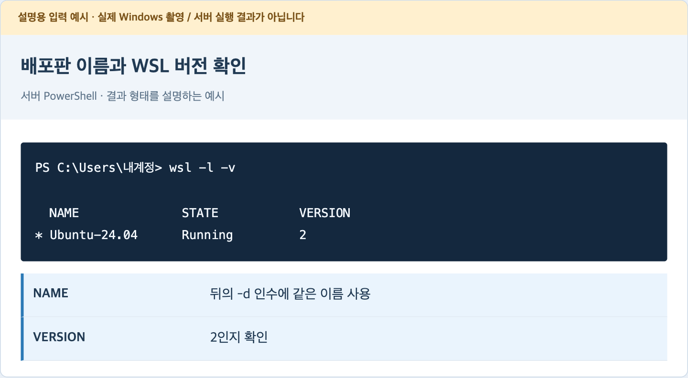

표의 `NAME`은 뒤의 자동 시작에 입력할 배포판 이름이고 `VERSION`은 `2`여야 합니다. `Stopped`는 그 순간 꺼져 있다는 뜻이므로 오류가 아닙니다. 앞의 별표는 기본 배포판 표시입니다.

목록의 버전이 `1`이면 **해당 배포판의 기존 자료를 보존한 뒤** 관리자 PowerShell에서 다음 변환을 진행합니다. 이미 `2`이면 생략합니다.

```powershell
wsl --set-version Ubuntu-24.04 2
```

**이어서 Ubuntu에서** 아래를 입력합니다.

```bash
cat /etc/os-release
```

`VERSION_ID="24.04"`를 확인합니다. `wsl --version`의 버전은 WSL 프로그램 버전이고 이 Ubuntu 버전과 다른 값입니다.

**완료 기준:** 실제 배포판 이름을 적었고 WSL2·Ubuntu 24.04임을 확인했습니다. 기존 배포판 이름이 다르면 그 이름을 계속 사용합니다.

## 07 프로젝트 코드를 서버로 가져오기

**어디서:** 코드가 있는 Mac → 서버 Windows 파일 탐색기 → 서버 Ubuntu 순서입니다.

### 코드가 있는 Mac에서

1. Finder에서 프로젝트 폴더 `/Users/jong-yu/Projects/LLM Wiki`를 엽니다. Finder의 이동 → 폴더로 이동에서 경로를 붙여넣어도 됩니다.
2. **Mac의 터미널**을 열고 아래 명령을 입력합니다. `core`·`tools` 폴더, requirements 두 파일과 **`.agent/ontology_semantics.md` 한 파일**을 같은 상대 경로로 묶습니다. `.agent` 전체는 포함하지 않습니다.

```sh
cd "/Users/jong-yu/Projects/LLM Wiki"
WIKI_CODE_EXPORT="$(mktemp -d "${TMPDIR:-/tmp}/llm-wiki-code.XXXXXX")"
zip -rq "$WIKI_CODE_EXPORT/llm-wiki-code.zip" \
  core tools requirements.txt requirements.lock .agent/ontology_semantics.md
open "$WIKI_CODE_EXPORT"
```

3. 열린 새 폴더의 `llm-wiki-code.zip`을 사용합니다. 기존 압축 파일을 덮어쓰지 않습니다. 이 묶음은 서버와 진단 도구용 코드이며 기존 업무 데이터는 10단계에서 따로 다룹니다.
4. USB 등으로 서버 Windows에 옮겨 다운로드 폴더에 둡니다. 마우스 오른쪽 → **모두 압축 풀기**를 누릅니다. 푼 결과에 `core`·`tools`·requirements 두 파일과 `.agent/ontology_semantics.md`가 있는지 확인합니다.

`.venv`는 Mac용 설치 환경이므로 복사하지 않습니다. `.local`의 정책·토큰이나 실제 `data`를 일반 코드 압축에 섞지 않습니다. Electron 앱을 소스에서 개발 실행하려면 `app`도 별도로 필요하지만 서버 실행에는 필요하지 않습니다.

### 서버 Ubuntu에서 폴더 만들기

```bash
mkdir -p "$HOME/llm-wiki"
cd "$HOME/llm-wiki"
explorer.exe .
```

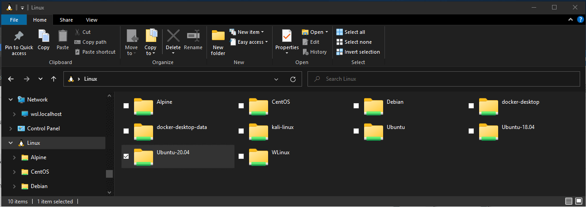

5. 열린 탐색기 창은 Ubuntu의 프로젝트 폴더입니다. Windows에서 풀어 놓은 코드 묶음 전체를 이 창 안으로 복사합니다. `.agent` 폴더에는 위 의미 지침 한 파일만 있어야 합니다. 압축을 푼 바깥 폴더 하나를 다시 넣어 `llm-wiki/llm-wiki/core`가 되지 않게 합니다.
6. Ubuntu 창으로 돌아와 확인합니다.

```bash
pwd
ls
test -f core/runtime/http_cli.py && echo "서버 코드 확인됨"
test -f requirements.lock && echo "설치 목록 확인됨"
test -f .agent/ontology_semantics.md && echo "규약 의미 지침 확인됨"
```

**정상 결과:** 위치가 `/home/wiki/llm-wiki`이고 확인 문구 세 개가 나옵니다. `/mnt/c/...`가 보이면 아직 Windows 다운로드 폴더입니다. 위 Ubuntu 폴더로 옮긴 뒤 진행합니다. 의미 지침이 빠지면 서버가 시작되더라도 새 분석 규약 발행은 실패합니다.

**새 분석 전 관리자 확인:** 처음 설치하거나 생성 지침을 갱신했다면 [규약 발행·명시 허용 절차](domains/analysis/RULESET_ROLLOUT.md)를 따릅니다. 코드 복사만으로 기존 규약은 바뀌지 않습니다. 사용하지 않은 버전의 `ontology.md`와 이번 `.agent/ontology_semantics.md`의 SHA256을 대조하고, 명시 허용·필요한 기본값 전환 뒤 서버에 `--ruleset-root`·`--ruleset-policy`를 함께 지정합니다. 클라이언트가 받은 규약과 새 작업의 고정 입력도 같은 revision인지 확인합니다. 기존 작업의 구 규약·결과는 보존하며 전환은 해당 절차의 명시 rebase를 따릅니다.

**막히면:** `No module named tools`는 대개 위치나 폴더 복사 문제입니다. `cd "$HOME/llm-wiki"` 후 `ls -a`로 코드 묶음과 `.agent`를 다시 확인합니다.

## 08 Ubuntu에 Python 설치

**어디서:** 서버 Ubuntu.

```bash
sudo apt update
sudo apt install -y python3 python3-venv curl ca-certificates nano
python3 --version
```

1. 첫 명령은 설치 가능한 프로그램 목록을 새로 받습니다. 비밀번호를 요청하면 Ubuntu 비밀번호를 입력합니다.
2. 두 번째 명령은 Python과 가상환경 도구, 다운로드·편집 도구를 설치합니다.
3. 마지막 줄에서 **Python 3.12 이상**인지 확인합니다. Ubuntu 24.04의 기본 Python을 기준으로 설명합니다.

**정상 결과:** `Python 3.12.x`처럼 표시되고 설치가 오류 없이 끝납니다. `x`의 세부 숫자는 같을 필요가 없습니다.

**막히면:** 다운로드 이름을 찾지 못하면 인터넷·DNS를 먼저 확인하고 `sudo apt update`를 다시 확인합니다. `dpkg` 잠금은 다른 업데이트가 진행 중일 수 있으므로 끝날 때까지 기다립니다. 잠금 파일부터 지우지 않습니다. Python이 3.10이라면 06단계에서 Ubuntu 버전을 다시 확인합니다.

서버에는 Windows용 Python을 따로 설치하지 않아도 됩니다. **작업 PC의 Windows용 Python**은 19단계에서 필요할 때 별도로 준비합니다.

## 09 프로젝트 설치와 첫 진단

**어디서:** 서버 Ubuntu. 반드시 프로젝트 폴더에서 실행합니다.

```bash
cd "$HOME/llm-wiki"
python3 -B -m tools.setup_runtime --role server
```

설치기는 이 폴더 안의 `.venv`에 Python 패키지를 설치합니다. 터미널에 설치 로그가 나오는 동안 기다립니다. 창을 닫지 않습니다. 이미 사용 가능한 `.venv`가 있으면 검사해서 재사용하며 기존 자료를 지우지 않습니다.

끝난 뒤 아래를 실행합니다.

```bash
.venv/bin/python -B -m tools.runtime_doctor --skip-ai
.venv/bin/python -B -m core.runtime.http_cli --help
```

**정상 결과:** 진단의 `python_supported`가 `true`, 의존성 항목의 `status`가 `ok`입니다. `--skip-ai` 때문에 AI는 `not_run`, 아직 주소를 주지 않아 연결도 `not_run`이어도 정상입니다. `http_cli --help`는 `--access-config`와 `--tenant-root` 등의 사용법을 보여줍니다.

**막히면:** `.venv/bin/python`이 없으면 앞의 설치가 완료되지 않은 것입니다. 설치 오류의 마지막 부분을 확인합니다. “server requires Linux/local filesystem” 등의 오류면 `/mnt/c`에 코드를 둔 것은 아닌지 07단계를 확인합니다. `.venv`나 설치 잠금을 일괄 삭제하지 않습니다.

**완료 기준:** 서버에 필요한 코드·Python·패키지가 준비되었습니다. 아직 서버를 실행한 상태는 아닙니다.

## 10 인증과 데이터: 내 경우를 먼저 선택

**어디서:** 서버 Ubuntu. 기존 자료가 있는지를 먼저 구분합니다.

| 내 상황 | 진행할 곳 | 알아둘 점 |
| --- | --- | --- |
| 설치·외부 연결을 빈 서버에서 먼저 연습 | 11단계 | 새 `owner` 사용자에게 읽기 권한만 준비. 기존 Mac 자료는 건드리지 않음 |
| 기존 Mac의 위키·이력·인증을 그대로 옮김 | 부록 A를 먼저 확인 | 전체 보존·경로·권한·규약 대조가 필요. 새 정책으로 바꾸지 않음 |

**개인 토큰은 서버 접속용 열쇠입니다.** Ubuntu 비밀번호, Windows 비밀번호, Cloudflare 로그인, Tunnel 자격 증명과 각각 다릅니다. `access.json`에는 토큰의 원문 대신 해시와 사용자 권한이 들어 있습니다. 개인 토큰 파일은 각 사용자가 보호합니다.

이 안내서의 처음 설치 경로는 **빈 서버의 읽기 연결**을 완성하는 순서입니다. 등록·AI 분석 저장·전문가 수정은 별도 권한과 분석 규약이 필요합니다. 읽기 연결 성공만으로 그 권한을 자동 추가하지 않습니다. 기존 운영 사용자의 읽기 전용 정책도 이전 때문에 바꾸지 않습니다.

기존 자료를 옮긴다면 서버 명령의 `--access-config`, `--tenant-root`, 규약을 사용했다면 `--ruleset-root`·`--ruleset-policy`의 **실제 기존 값**을 기록합니다. 모르면 기존 담당자와 위치를 확인하고 부록 A의 보존 순서부터 진행합니다. 추측한 폴더를 기존 자료 위에 합치지 않습니다.

## 11 빈 서버의 개인 인증 준비

**어디서:** 서버 Ubuntu. **기존 자료·기존 정책을 이전하는 사람은 이 단계를 건너뜁니다.**

이번 프로젝트에는 새 서버의 사용자·토큰을 발급하는 설치 화면이 아직 없습니다. 아래는 빈 연습 서버에 최소 설정을 만드는 일회성 예시입니다. `data`나 `.local/tenancy`가 이미 있으면 중단하며 덮어쓰지 않습니다.

1. 아래 코드 전체를 Ubuntu에 붙여넣습니다. 첫 줄부터 마지막 `PY`까지 한 번에 복사합니다.

```bash
cd "$HOME/llm-wiki"
.venv/bin/python - <<'PY'
import hashlib, json, os, secrets
from pathlib import Path
from core.modules.access.policy import AccessPolicy

root = Path.cwd()
data = root / "data"
private = root / ".local" / "tenancy"
if data.exists() or private.exists():
    raise SystemExit("중단: 기존 data 또는 인증 폴더가 있습니다. 이전/기존 설정을 확인하세요.")
os.umask(0o077)
for p in [data / "personal" / "wiki", data / "personal" / "_history", private / "credentials"]:
    p.mkdir(parents=True, mode=0o700)
token = secrets.token_urlsafe(32)
policy = {
    "version": 1,
    "tenants": {"personal": {"profiles": {"all": {"domain": None, "viewpoint": None}}}},
    "users": {"owner": {
        "token_sha256": hashlib.sha256(token.encode("ascii")).hexdigest(),
        "memberships": {"personal": {"permissions": ["read"],
            "profiles": ["all"], "default_profile": "all"}}
    }}
}
config = private / "access.json"
with config.open("x", encoding="utf-8") as f:
    json.dump(policy, f, ensure_ascii=False, indent=2)
token_path = private / "credentials" / "owner.token"
with token_path.open("x", encoding="ascii") as f:
    f.write(token + "\n")
AccessPolicy(config, data).validate()
print("준비 완료: personal / all / owner / read")
print("토큰 위치:", token_path)
print("토큰 원문은 화면에 출력하지 않았습니다.")
PY
```

2. 준비 완료 문구와 파일 위치가 나오는지 확인합니다. 토큰 자체를 안내서·채팅·로그에 복사하지 않습니다.
3. 권한 숫자만 확인합니다. 아래 명령은 토큰 내용을 출력하지 않습니다.

```bash
stat -c '%a %n' .local/tenancy/access.json .local/tenancy/credentials/owner.token
```

**정상 결과:** 두 파일 앞에 `600`이 표시됩니다. 초기화 코드를 두 번 실행해서 “기존 폴더가 있습니다”가 나오는 것은 보호 동작입니다. 폴더를 삭제해서 재실행하지 않습니다.

**다음:** 서버 내부 진단에는 `owner.token`을 사용합니다. 다른 PC로 토큰을 전달하는 방법은 20단계에 있습니다. 이 토큰에 쓰기 권한은 없습니다.

## 12 통합 서버를 수동 실행하고 확인

**어디서:** 서버 Ubuntu. 이 창을 **서버 창 A**라고 부릅니다.

```bash
cd "$HOME/llm-wiki"
.venv/bin/python -B -m core.runtime.http_cli \
  --access-config "$HOME/llm-wiki/.local/tenancy/access.json" \
  --tenant-root "$HOME/llm-wiki/data" \
  --port 8766 --lock-timeout 5
```

기존 자료를 이전했다면 위 두 경로를 확정한 실제 경로로 바꿉니다. 분석 규약을 이전한 경우 `--ruleset-root`와 `--ruleset-policy`도 **둘 다** 추가합니다. 규약 없이 시작할 수는 있지만 AI 분석 준비까지 끝난 것은 아닙니다.

**정상 결과:** 오류로 종료되지 않고 입력 줄로 바로 돌아오지 않습니다. 현재 서버는 경고 수준 로그를 사용하므로 **정상이어도 화면이 조용할 수 있습니다.** 다음 B 창의 실제 인증 진단으로 기동을 확인합니다. 이 창은 닫지 않습니다. 별도 FastAPI 프로세스와 MCP 프로세스를 두 개 켜는 방식이 아닙니다.

### 두 번째 Ubuntu 창에서 확인

시작 메뉴에서 Ubuntu를 한 번 더 열거나 Windows Terminal의 새 Ubuntu 탭을 엽니다. 이 창을 **작업 창 B**라고 부릅니다.

```bash
curl -i http://127.0.0.1:8766/api/v1/access-context
```

`401 Unauthorized`가 나오면 **인증 없이 보낸 요청을 서버가 거부하면서 응답한 것**입니다. 서버의 입구 확인은 되었지만 로그인 성공을 뜻하지 않습니다.

이어서 실제 개인 인증과 MCP를 함께 확인합니다.

```bash
cd "$HOME/llm-wiki"
.venv/bin/python -B -m tools.runtime_doctor \
  --skip-ai --server http://127.0.0.1:8766 \
  --token-file "$HOME/llm-wiki/.local/tenancy/credentials/owner.token" \
  --tenant personal --profile all
```

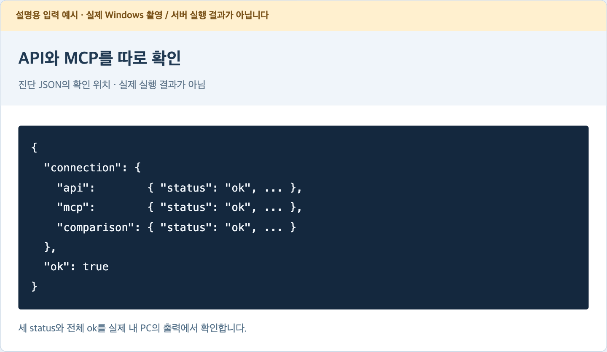

**확인할 값:** `connection.api.status`, `connection.mcp.status`, `connection.comparison.status`가 모두 `ok`이고 전체 `ok`가 `true`여야 합니다. 빈 서버의 문서가 없는 것은 정상입니다. `write_test: not_run`, `backend_identity: not_available`은 현재 진단 범위의 표시입니다.

**막히면:** 연결 거부는 A 창의 종료·잘못된 포트부터 확인합니다. `401`은 토큰/정책의 사용자 일치, `403`은 허용 공간·관점을 확인합니다. `/health`나 `/docs`를 열어 검사하지 않습니다. 현재 서버에는 별도 `/health`가 없고 문서 UI도 비활성화돼 있습니다.

## 13 외부 주소에 사용할 도메인 준비

**어디서:** 서버 Windows의 웹 브라우저. [Cloudflare 대시보드](https://dash.cloudflare.com/)를 엽니다.

고정 주소에는 본인이 관리하는 도메인이 필요합니다. 예를 들어 실제 소유한 도메인이 `my-notebook.net`이라면 서버 주소는 `wiki.my-notebook.net`처럼 정합니다. **도메인 등록 비용과 Cloudflare 서비스 요금은 별개**이므로 선택 화면의 현재 조건을 확인합니다.

### 이미 Cloudflare에서 Active인 도메인이 있다면

Domains에서 해당 도메인을 눌러 상태를 확인합니다. 활성 상태이면 14단계로 넘어갑니다. `wiki`라는 DNS 이름을 이미 쓰고 있다면 기존 서비스를 덮지 말고 사용하지 않는 하위 이름을 선택합니다.

### 다른 업체에서 산 도메인이 있다면

1. Cloudflare 계정을 만들고 이메일 확인을 마칩니다. Domains → **Onboard a domain** 또는 도메인 추가를 누릅니다.
2. `https://`와 `wiki.`를 뺀 **기본 도메인**을 입력합니다. 예시는 `my-notebook.net`입니다.
3. 요금제 화면에서 필요한 계획을 고릅니다. 일반적인 시작에는 Free 계획을 검토할 수 있지만 화면의 최신 조건을 확인합니다.
4. 검색된 DNS 레코드를 원래 DNS 목록과 대조합니다. 기존 홈페이지·메일의 MX/TXT 등을 지우지 않습니다.
5. 기존 도메인이면 **DNSSEC와 등록업체의 DS 기록**도 기존 운영자와 확인합니다. 기존 DNSSEC가 활성화된 채 네임서버만 바꾸면 이름 조회가 실패할 수 있습니다. [공식 전체 DNS 이전 절차](https://developers.cloudflare.com/dns/zone-setups/full-setup/setup/#33-turn-off-dnssec)에 따라 기존 DNSSEC·DS를 정리하고 변경하며, Active가 된 뒤 Cloudflare의 DNSSEC를 다시 설정합니다. 이 부분의 현재 상태를 모르면 기존 운영자/등록업체와 먼저 확인합니다.
6. Cloudflare가 지정한 네임서버 이름을 확인합니다. **도메인을 구매한 업체**에 로그인해 네임서버 설정을 그 값으로 변경합니다. 업체마다 버튼 이름이 달라 “네임서버/Nameservers/DNS 서버” 항목에서 찾습니다. 기존 서비스가 있으면 해당 운영자와 대조한 후 변경합니다.
7. Cloudflare로 돌아와 상태가 **Active**가 될 때까지 확인합니다. 설정 전파에는 시간이 걸릴 수 있으며 분 단위로 반드시 끝난다고 가정하지 않습니다.

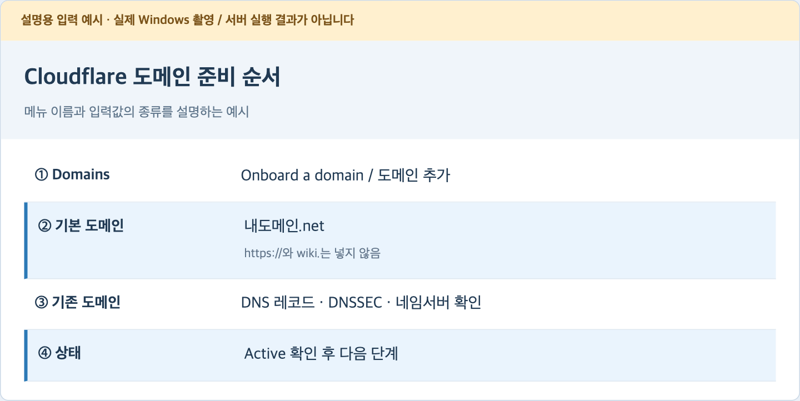

### 도메인이 없다면

도메인 등록업체에서 소유할 도메인을 준비합니다. 예를 들어 [Cloudflare의 공식 도메인 등록 절차](https://developers.cloudflare.com/registrar/get-started/register-domain/)를 따라 계정 로그인 → Domain Registration/도메인 등록 → 이름 검색 → 등록 가능 여부와 **구매·갱신 가격** 확인 → 본인 정보와 결제 확인 → 등록 순서로 진행할 수 있습니다. 결제는 이 문서를 읽는 것으로 이루어지지 않으며 실제 조건을 보고 본인이 결정합니다. 이미 등록한 이름을 다시 구매하지 않습니다. 등록 완료 후 이 단계의 Active 상태를 확인합니다.

기존 도메인의 하위 주소를 받아 쓰는 경우에는 DNS 변경 권한과 함께 **다음 로그인 단계에서 해당 Cloudflare 도메인을 선택할 계정 권한**도 받아야 합니다. 소유하지 않은 `example.com`으로 다음 단계를 실행해도 내 주소가 만들어지지 않습니다. 임시 Quick Tunnel은 고정 주소 대신 장기 운영에 사용하지 않습니다.

**완료 기준:** 내가 관리할 수 있는 Active 도메인과 사용하지 않는 하위 이름을 정했습니다. 공식 참고: [Cloudflare 도메인 등록 절차](https://developers.cloudflare.com/fundamentals/manage-domains/add-site/).

## 14 Ubuntu에 cloudflared 설치

**어디서:** 서버 Ubuntu의 작업 창 B. 서버 창 A는 그대로 둡니다.

`cloudflared`는 서버와 Cloudflare 사이를 연결하는 프로그램입니다. 이 문서에서는 **Windows용이 아니라 Ubuntu용**을 설치합니다. 이미 설치했다면 `cloudflared --version`·`command -v cloudflared`로 확인하고 중복 설치하지 않습니다.

처음 설치할 때는 아래 명령을 순서대로 실행합니다. 현재 Cloudflare의 Debian 공통 안정 저장소 방식을 사용합니다.

```bash
sudo mkdir -p --mode=0755 /usr/share/keyrings
curl -fsSL https://pkg.cloudflare.com/cloudflare-main.gpg \
  | sudo tee /usr/share/keyrings/cloudflare-main.gpg >/dev/null
```

```bash
echo 'deb [signed-by=/usr/share/keyrings/cloudflare-main.gpg] https://pkg.cloudflare.com/cloudflared any main' \
  | sudo tee /etc/apt/sources.list.d/cloudflared.list
sudo apt update
sudo apt install -y cloudflared
cloudflared --version
command -v cloudflared
```

**정상 결과:** 버전과 `/usr/bin/cloudflared` 같은 절대 경로가 표시됩니다. 경로는 자동 시작 파일을 만들 때 사용합니다. 서명 키·저장소 파일이 기존에 있으면 이전 설정을 확인한 뒤 갱신하며, 다른 저장소를 무심코 덮어쓰지 않습니다.

**막히면:** GPG/서명 오류는 [공식 패키지 안내](https://pkg.cloudflare.com/)의 최신 키를 확인합니다. 서명 검사를 끄거나 `trusted=yes`로 넘기지 않습니다. 이 문서의 명령은 2026-10-26 확인 기준입니다.

## 15 Cloudflare 로그인과 Tunnel 만들기

**어디서:** 서버 Ubuntu의 작업 창 B와 Windows 브라우저.

```bash
cloudflared tunnel login
```

1. 브라우저가 열리면 Cloudflare에 로그인합니다. 안 열리면 Ubuntu에 출력된 로그인 URL을 Windows 브라우저 주소창에 붙여넣습니다. 로그인 URL을 다른 사람에게 전달하지 않습니다.
2. 13단계에서 준비한 실제 도메인을 선택하고 이 연결을 승인합니다.
3. Ubuntu에 인증 파일을 저장했다는 결과가 나오는지 확인합니다. 보통 `~/.cloudflared/cert.pem`입니다. 파일 내용은 공유하지 않습니다.

이어서 새 Tunnel을 만듭니다. **같은 이름의 Tunnel이 이미 있다면 새로 만들지 말고 그 소유·기존 사용 여부를 확인**합니다.

```bash
cloudflared tunnel create llm-wiki
cloudflared tunnel list
```

**정상 결과:** `llm-wiki`와 UUID가 보입니다. UUID는 `xxxxxxxx-xxxx-xxxx-xxxx-xxxxxxxxxxxx` 형태의 식별자입니다. 출력에 나온 자격 증명 파일의 위치도 기록합니다. 보통 `/home/wiki/.cloudflared/UUID.json`입니다.

Tunnel은 만들어졌지만 아직 서버로 트래픽을 전달하는 상태는 아닙니다. 다음 단계에서 주소·내부 포트를 연결하고 실제 실행해야 합니다.

**막히면:** 인증서 경로를 못 찾으면 `sudo cloudflared ...`로 바꾸지 말고 로그인한 Ubuntu 사용자와 홈 폴더를 확인합니다. 이 절차는 일반 `wiki` 사용자로 진행합니다. 공식 참고: [로컬 관리 Tunnel 만들기](https://developers.cloudflare.com/cloudflare-one/networks/connectors/cloudflare-tunnel/do-more-with-tunnels/local-management/create-local-tunnel/).

## 16 Tunnel 설정 파일 작성

**어디서:** 서버 Ubuntu의 작업 창 B.

먼저 편집기를 엽니다. 기존 파일이 있으면 덮어쓰기 전에 내용을 확인하고 별도 이름으로 보존합니다. 처음 설치한 경우에는 새 파일입니다.

```bash
nano "$HOME/.cloudflared/config.yml"
```

아래 내용을 넣습니다. **`실제-UUID` 두 곳**과 **`wiki.내도메인` 한 곳**을 13·15단계에서 확인한 값으로 바꿉니다. Ubuntu 계정명이 다르면 `/home/wiki`도 바꿉니다. 아래 표기는 설명용이므로 바꾸기 전에는 실행할 수 없습니다.

```yaml
tunnel: 실제-UUID
credentials-file: /home/wiki/.cloudflared/실제-UUID.json
ingress:
  - hostname: wiki.내도메인
    service: http://127.0.0.1:8766
    originRequest:
      httpHostHeader: 127.0.0.1:8766
  - service: http_status:404
```

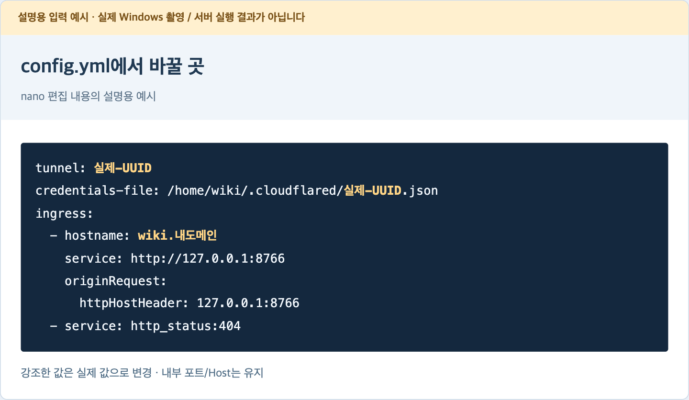

**nano에서 저장:** Ctrl+O → 파일명이 보이면 Enter → Ctrl+X. Ctrl은 누른 상태에서 O 또는 X를 함께 누른다는 뜻입니다. 저장하지 않고 나왔다면 다시 열어 확인합니다.

설정 파일의 들여쓰기는 Tab 대신 스페이스를 사용합니다. `httpHostHeader`는 현재 서버의 Host 보호 검사와 맞추기 위한 값이므로 유지합니다. 마지막 404 규칙도 남깁니다. 개인 서버 토큰은 이 파일에 넣지 않습니다.

```bash
chmod 700 "$HOME/.cloudflared"
chmod 600 "$HOME/.cloudflared/config.yml"
cloudflared tunnel --config "$HOME/.cloudflared/config.yml" ingress validate
```

자격 증명 `UUID.json`과 `cert.pem`도 본인만 읽을 수 있게 보호합니다. 파일명은 실제 UUID로 확인한 뒤 해당 파일에만 `chmod 600`을 적용합니다.

**완료 기준:** 입력한 실제 hostname·UUID·파일 경로가 맞고 설정 검사가 성공합니다. `httpHostHeader`는 외부 Origin을 자동 허용하는 설정이 아닙니다. 공식 참고: [Tunnel 구성 파일](https://developers.cloudflare.com/cloudflare-one/networks/connectors/cloudflare-tunnel/do-more-with-tunnels/local-management/configuration-file/), [Host 설정](https://developers.cloudflare.com/cloudflare-one/networks/connectors/cloudflare-tunnel/configure-tunnels/origin-parameters/#httphostheader).

## 17 DNS에 고정 주소 연결

**어디서:** 서버 Ubuntu 작업 창 B, 이후 Cloudflare 브라우저.

아래의 `wiki.내도메인`을 정한 실제 주소로 바꿔 실행합니다. 명령에는 `https://`나 `/mcp`를 붙이지 않습니다.

```bash
cloudflared tunnel route dns llm-wiki wiki.내도메인
```

1. 명령이 성공하면 Cloudflare 대시보드 → 해당 도메인 → DNS → Records를 엽니다.
2. 이름이 `wiki`인 CNAME 레코드와 Tunnel UUID의 `.cfargotunnel.com` 대상이 생성됐는지 확인합니다.
3. 같은 이름의 기존 A/AAAA/CNAME 때문에 오류가 나면 그 레코드가 쓰이는 곳부터 확인합니다. 삭제부터 하지 말고, 비어 있는 다른 하위 이름을 쓸 경우 설정 파일의 hostname도 함께 맞춥니다.

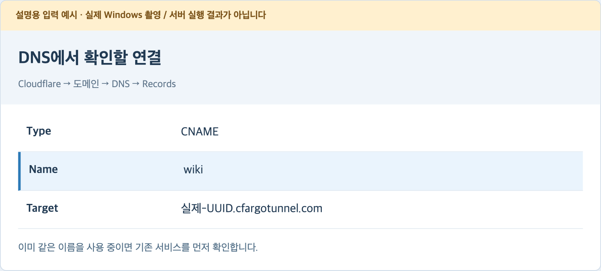

**완료 기준:** 내가 선택한 하위 주소가 Tunnel로 연결됩니다. DNS를 만들었다고 서버 실행까지 끝난 것은 아닙니다. 다음 단계에서 터널을 켭니다.

공식 참고: [Tunnel의 DNS 연결](https://developers.cloudflare.com/cloudflare-one/networks/connectors/cloudflare-tunnel/routing-to-tunnel/dns/).

## 18 터널을 수동 실행하고 외부 입구 확인

**어디서:** 서버 Ubuntu 작업 창 B. 서버 창 A의 통합 서버가 계속 실행 중이어야 합니다.

```bash
cloudflared tunnel --config "$HOME/.cloudflared/config.yml" run llm-wiki
```

**정상 결과:** 연결 등록 로그가 나오고 프로그램이 계속 실행됩니다. 등록 로그의 표현은 버전에 따라 다를 수 있습니다. 아직 이 창도 닫지 않습니다.

서버 Windows 또는 다른 PC의 브라우저에서 다음 **실제 주소**를 엽니다.

```text
https://wiki.내도메인/api/v1/access-context
```

주소창의 연결이 HTTPS로 열리고 `unauthenticated` 또는 401 오류가 보이면 **외부에서 인증 입구까지 도달한 것**입니다. 로그인 성공이나 자료 저장 성공은 아닙니다. 주소 루트 `/`에 완성된 웹사이트가 나오는 제품이 아니므로 API 주소로 확인합니다.

**막히면:** `502`는 터널이 내부 서버에 닿지 못할 때 확인할 증상입니다. 창 A와 `http://127.0.0.1:8766`을 다시 확인합니다. “Tunnel 연결 없음” 계열 화면은 창 B와 Tunnel 이름·자격 증명·인터넷부터 확인합니다. DNS 오류는 13·17단계로 돌아갑니다.

**인증서 경고:** 무시해서 넘기지 말고 Cloudflare → 도메인 선택 → **SSL/TLS → Edge Certificates**에서 Universal 인증서가 **Active**인지 확인합니다. 도메인의 Active와 인증서의 Active는 별도입니다. 발급이 대기 중이면 상태·DNS 검증 문제를 먼저 확인합니다. [공식 인증서 상태 확인](https://developers.cloudflare.com/ssl/edge-certificates/universal-ssl/enable-universal-ssl/#verify-your-certificate-is-active)을 참고합니다.

휴대전화 브라우저로도 같은 API 입구를 볼 수 있습니다. 개인 토큰을 URL 뒤에 붙이지 않습니다. 실제 인증은 다음 단계의 작업 PC 진단으로 확인합니다.

## 19 다른 Windows PC에 진단 환경 준비

**어디서:** 서버 노트북이 아닌 **접속할 작업 PC**.

1. Python 공식 [Windows 다운로드](https://www.python.org/downloads/windows/)에서 Python **3.13 계열의 최신 유지보수 버전**을 찾아 **Windows installer (64-bit)**를 받습니다. ARM PC라면 ARM64 설치 파일을 선택합니다. 시스템 종류는 Windows 설정 → 시스템 → 정보에서 확인합니다. `embeddable package`·소스 압축 파일은 선택하지 않습니다. 프로젝트는 3.12 이상을 지원하며, 이 작업 PC 예시는 3.13을 사용합니다.
2. 받은 설치 파일을 열어 Python launcher를 포함해 설치합니다. 첫 화면의 **Install Now** 또는 사용자 지정 설치에서 `py launcher` 항목을 확인합니다. 이미 사용할 3.13이 있으면 중복 설치 대신 아래 확인부터 합니다. Ubuntu의 Python과 세부 버전을 같게 만들 필요는 없습니다.
3. PowerShell을 닫았다 다시 열고 실행합니다.

```powershell
py -3.13 --version
```

4. 파일 탐색기에서 `C:\LLM-Wiki` 폴더를 만듭니다. 07단계의 코드 묶음 전체와 `.agent/ontology_semantics.md` 한 파일을 같은 상대 경로로 복사합니다. 서버의 `.venv`나 `data`를 복사하지 않습니다.
5. 작업 PC PowerShell에서 설치합니다.

```powershell
cd C:\LLM-Wiki
py -3.13 -B -m tools.setup_runtime --role personal
```

**정상 결과:** `C:\LLM-Wiki\.venv\Scripts\python.exe`가 준비되고 설치가 끝납니다. 이 PC는 서버를 실행하지 않습니다. WSL2도 필요하지 않습니다.

**막히면:** `py`가 인식되지 않으면 설치기의 launcher 포함 여부와 새 PowerShell 창을 확인합니다. `No suitable Python runtime`은 `py -3.13`으로 선택할 3.13이 없는 상태입니다. 기존 launcher의 버전 목록은 `py -0p`로 확인합니다. Python install manager를 사용하는 경우에는 공식 안내의 `py list`·`py install 3.13` 경로로 해당 버전을 준비할 수 있습니다. 공식 참고: [Python Windows 사용 안내](https://docs.python.org/3.13/using/windows.html).

## 20 개인 토큰을 작업 PC에 보호 저장

**어디서:** 토큰 전달은 본인의 보호된 경로로, 저장 명령은 작업 PC PowerShell에서 진행합니다.

빈 서버를 만든 경우 토큰은 서버 Ubuntu의 `.local/tenancy/credentials/owner.token` 안에 있습니다. 기존 서버를 이전했다면 **자기 사용자에게 발급된 토큰**을 사용합니다. 다른 사용자의 토큰을 공동으로 배포하지 않습니다.

1. 서버 토큰을 직접 확인해야 한다면 Ubuntu에서 `nano "$HOME/llm-wiki/.local/tenancy/credentials/owner.token"`을 엽니다. 본인 화면에서만 확인하고 출력·로그·일반 메신저로 공유하지 않습니다.
2. 처음 만든 빈 연습 서버라면 서버와 작업 PC를 본인 앞에 두고, 아래 작업 PC 명령으로 토큰 입력 프롬프트를 먼저 띄웁니다. 서버의 nano 화면에 보이는 **한 줄 전체를 작업 PC 프롬프트에 직접 입력**하는 방법을 기본으로 삼습니다. 영문 대소문자·숫자·`_`·`-`를 정확히 구분합니다. 기존 사용자는 자기 토큰을 본인이 정한 보호 전달 방식으로 준비합니다. 새 사용자에게 기존 토큰을 공용으로 배포하지 않고 별도 토큰과 정책을 준비해야 합니다.
3. 작업 PC PowerShell에서 아래 명령을 실행합니다. `--token-file`은 **새 보호 폴더와 새 파일**입니다. 이미 쓰는 파일에 덮어쓰지 않습니다.

```powershell
cd C:\LLM-Wiki
& .\.venv\Scripts\python.exe -B -m tools.protect_client_token `
  --token-file "$env:USERPROFILE\LLM-Wiki-Private\server.token"
```

4. 토큰 입력을 요청하면 원문만 입력하고 Enter를 누릅니다. 입력값이 화면에 나타나지 않는 것이 정상입니다. `Bearer `나 따옴표를 붙이지 않습니다.

**정상 결과:** 새 보호 파일 저장이 성공합니다. 도구는 Windows 개인 ACL을 적용합니다. 일반 파일 탐색기로 공개 폴더에 저장한 파일과 구분합니다. 이 명령은 토큰을 발급하는 명령이 아니라 이미 받은 값을 보호 저장하는 명령입니다.

**막히면:** 기존 파일 거부는 덮어쓰기 방지입니다. 기존 토큰이 맞는지 확인하고 그대로 사용하거나, 새 이름의 보호 폴더로 저장합니다. ACL 오류를 해결하려고 공개 폴더로 우회하지 않습니다. 서버 창의 편집기를 닫을 때는 내용을 수정하지 않았다면 저장하지 않고 나옵니다.

## 21 작업 PC에서 실제 API·MCP 인증 확인

**어디서:** 작업 PC PowerShell. 서버의 A·B 두 창은 계속 켜 둡니다.

아래 주소를 13단계에서 정한 **실제 HTTPS 기본 주소**로 바꿉니다. `/mcp`나 `/api/v1`을 주소 뒤에 덧붙이지 않습니다. 진단 도구가 각각의 경로를 사용합니다.

```powershell
cd C:\LLM-Wiki
& .\.venv\Scripts\python.exe -B -m tools.runtime_doctor `
  --skip-ai --server "https://wiki.내도메인" `
  --token-file "$env:USERPROFILE\LLM-Wiki-Private\server.token" `
  --tenant personal --profile all
```

**완료 기준:** 아래 세 항목이 모두 `ok`이고 전체 `ok`가 `true`입니다.

| 확인 위치 | 의미 |
| --- | --- |
| `connection.api` | 실제 개인 인증으로 일반 API를 읽음 |
| `connection.mcp` | MCP SDK 초기화와 인증된 `access_context`를 읽음 |
| `connection.comparison` | 두 경로의 주체·소속·현재 정책·선택 관점을 비교함 |

`--skip-ai`는 개인 AI를 실행하지 않고 서버 연결을 먼저 확인하기 위한 옵션입니다. 따라서 CLI 로그인이나 모델 사용 가능성까지 검증한 결과는 아닙니다.

**막히면:** API만 `ok`이고 MCP가 실패하면 기본 주소·정확한 `/mcp` 경로·응답 대신 로그인 HTML이 오는지 확인합니다. Cloudflare Access의 별도 로그인 보호를 임의로 얹으면 현재 Bearer 진단만으로 통과하지 않을 수 있습니다. 외부 Origin을 보내는 브라우저 기반 MCP 클라이언트는 현재 서버가 403으로 거부할 수 있습니다. 현재 Python 진단·개인 실행기 경로로 먼저 검사하고, 보호 기능을 꺼서 해결하지 않습니다.

## 22 집 밖 연결을 실제로 확인

**어디서:** 작업 PC. 서버 노트북은 원래 인터넷에 그대로 연결해 둡니다.

1. 작업 PC를 서버와 같은 와이파이에서 끊습니다.
2. 휴대전화의 핫스폿 등 **다른 인터넷**에 작업 PC를 연결합니다. 서버 노트북까지 핫스폿으로 옮길 필요는 없습니다.
3. 브라우저의 API 입구를 다시 열어 HTTPS 응답을 확인합니다.
4. **21단계의 인증 진단 명령을 같은 고정 주소로 다시 실행**합니다.
5. API·MCP·비교 항목이 모두 성공했는지 기록합니다. 같은 와이파이에서만 성공한 결과를 집 밖 접속 성공으로 표시하지 않습니다.

**완료 기준:** 다른 네트워크의 작업 PC가 같은 주소와 자신의 토큰으로 접속했습니다. 서버의 공인 IP나 공유기 포트 전달을 별도로 입력하지 않습니다. Tunnel이 서버에서 Cloudflare로 나가는 연결을 이용합니다.

**막히면:** 공용/회사 네트워크가 Tunnel 통신이나 접속 도메인을 막을 수 있습니다. 우선 휴대전화 핫스폿으로 환경을 나눠 확인하고, 회사 보안 정책을 우회하지 않습니다. 밖에서만 실패하면 DNS·인증서·해당 네트워크를, 안팎 모두 실패하면 서버 A·터널 B를 먼저 확인합니다.

## 23 자동 시작용 서버 실행 파일 만들기

**어디서:** 서버 Ubuntu. 작업 창을 하나 더 열어도 됩니다. 아직 수동 A·B는 유지합니다.

로그 폴더를 준비하고 편집기를 엽니다. 같은 파일이 기존에 있다면 먼저 별도 사본을 보존하고 내용을 대조합니다.

```bash
cd "$HOME/llm-wiki"
mkdir -p .local/logs
chmod 700 .local .local/logs
nano .local/start-server.sh
```

아래 내용을 넣고 Ctrl+O → Enter → Ctrl+X로 저장합니다. `$HOME`은 실행하는 Ubuntu 사용자의 홈을 뜻하므로 그대로 둡니다.

```bash
#!/usr/bin/env bash
set -euo pipefail
umask 077
cd "$HOME/llm-wiki"
mkdir -p .local/logs
exec .venv/bin/python -B -m core.runtime.http_cli \
  --access-config "$HOME/llm-wiki/.local/tenancy/access.json" \
  --tenant-root "$HOME/llm-wiki/data" \
  --port 8766 --lock-timeout 5 \
  >> .local/logs/server.log 2>&1
```

기존 이전 경로·규약 쌍을 사용하는 경우 12단계에서 검증한 **같은 실행 인수**를 이 파일에도 반영합니다. 경로만 예시로 되돌리지 않습니다.

```bash
chmod 700 .local/start-server.sh
bash -n .local/start-server.sh
```

**완료 기준:** 구문 검사에서 오류가 출력되지 않습니다. 이 검사는 아직 서버 실행 성공 검사가 아닙니다. `exec`는 실제 서버가 종료될 때 Windows 작업도 종료될 수 있도록 전경 실행을 이어줍니다.

## 24 터널 실행 파일 만들고 수동 창 정리

**어디서:** 서버 Ubuntu.

먼저 실행 파일의 실제 위치를 확인합니다.

```bash
command -v cloudflared
nano "$HOME/llm-wiki/.local/start-tunnel.sh"
```

아래 `/usr/bin/cloudflared`가 앞의 결과와 다르면 그 실제 절대 경로로 바꿉니다. 저장 방법은 앞과 같습니다.

```bash
#!/usr/bin/env bash
set -euo pipefail
umask 077
cd "$HOME/llm-wiki"
mkdir -p .local/logs
exec /usr/bin/cloudflared tunnel \
  --config "$HOME/.cloudflared/config.yml" run llm-wiki \
  >> .local/logs/tunnel.log 2>&1
```

```bash
chmod 700 "$HOME/llm-wiki/.local/start-tunnel.sh"
bash -n "$HOME/llm-wiki/.local/start-tunnel.sh"
```

**이제 수동 실행을 끝냅니다.** A 창에서 Ctrl+C, B 창에서 Ctrl+C를 눌러 서버·터널을 종료합니다. 다음 조회는 다른 창에서 실행합니다.

```bash
ss -ltnp 'sport = :8766'
pgrep -af 'core.runtime.http_cli|cloudflared tunnel'
```

포트 조회에 `LISTEN`이 남지 않고 기존 두 프로세스가 종료됐는지 확인합니다. 다른 용도의 서버가 보이면 무조건 종료하지 말고 담당을 확인합니다.

**수동 스크립트 시험:** 새 창에서 `bash "$HOME/llm-wiki/.local/start-server.sh"`, 다른 창에서 `bash "$HOME/llm-wiki/.local/start-tunnel.sh"`를 실행합니다. 로그를 파일로 보내므로 화면이 조용해도 정상일 수 있습니다. 21단계 진단을 다시 확인한 뒤 두 창에서 Ctrl+C로 종료하고 포트가 비었는지 확인합니다. 이제 작업 스케줄러를 만들 준비가 됐습니다.

## 25 작업 스케줄러: 새 작업 열기

**어디서:** 서버 Windows. Ubuntu를 설치한 **같은 Windows 계정**으로 진행합니다.

1. Win+R을 누릅니다.
2. `taskschd.msc`를 입력하고 Enter를 누릅니다.
3. 왼쪽 **작업 스케줄러 라이브러리**를 선택합니다.
4. 오른쪽 작업 메뉴 또는 라이브러리의 우클릭 메뉴에서 **작업 만들기 / Create Task**를 누릅니다.

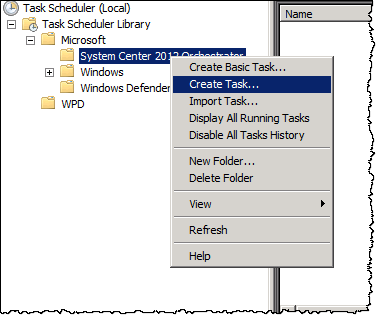

기본 작업 만들기 대신 여러 탭을 직접 설정하는 **작업 만들기**를 사용합니다. 그림은 구버전 영문 화면이라 모양이 달라도 항목 이름을 기준으로 찾습니다. 그림의 기존 Microsoft 작업이나 다른 하위 폴더를 수정하지 않습니다.

이번에는 두 작업을 만듭니다. 먼저 **LLM Wiki Server**, 같은 과정을 한 번 더 반복해 **LLM Wiki Tunnel**을 만듭니다. 한 작업에 동작 두 개를 이어 붙이지 않습니다. 첫 번째 서버가 계속 실행되면 다음 동작으로 넘어가지 않을 수 있기 때문입니다.

## 26 작업 스케줄러: 일반 탭

**어디서:** 서버 Windows의 “작업 만들기” → 일반 / General.

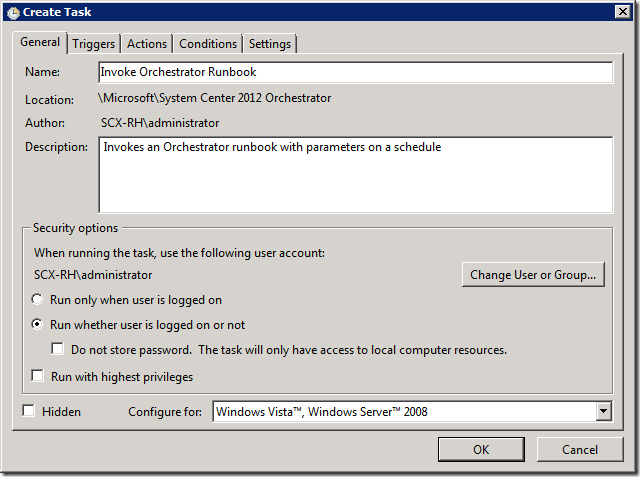

| 화면 항목 | 첫 작업 | 두 번째 작업 |
| --- | --- | --- |
| 이름 / Name | `LLM Wiki Server` | `LLM Wiki Tunnel` |
| 실행 사용자 | Ubuntu를 설치한 Windows 계정 | 같은 계정 |
| 로그온 옵션 | 로그인 전에도 쓸 경우 “사용자의 로그온 여부에 관계없이 실행” | 같은 옵션 |

1. 이름을 입력합니다. 위 그림의 다른 작업 이름을 복사하지 않습니다.
2. 보안 옵션의 계정이 현재 Ubuntu를 설치한 계정인지 확인합니다. `SYSTEM`으로 바꾸면 사용자별 Ubuntu를 찾지 못할 수 있습니다.
3. 자동 로그인하지 않아도 켜져야 하므로 위 로그온 옵션을 선택합니다. 저장할 때 **Windows 계정의 비밀번호**를 요청할 수 있습니다. Windows Hello PIN·Ubuntu 비밀번호와 구분합니다.
4. 현재 일반 사용자 권한으로 WSL과 스크립트에 접근할 수 있어야 합니다. 최고 권한 실행을 연결 오류 해결용으로 무조건 켜지 않습니다.

**막히면:** 비밀번호 없이 로그인하는 계정 등으로 저장이 거부되면 해당 계정의 예약 작업 자격 증명을 먼저 준비해야 합니다. “로그온할 때만 실행”으로 시험할 수는 있지만 **로그인 전 자동 시작을 완성한 것으로 기록하지 않습니다.**

## 27 작업 스케줄러: 트리거 탭

**어디서:** 트리거 / Triggers → 새로 만들기 / New.

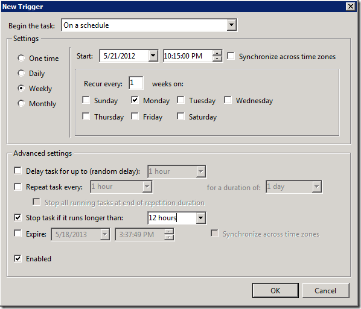

**그림 안의 주간 예약은 그대로 쓰지 않습니다.** 맨 위 `Begin the task`를 바꿉니다.

1. **작업 시작 / Begin the task:** **시스템 시작 시 / At startup**.
2. **작업 지연:** 예를 들어 30초. Windows와 네트워크가 준비될 여유를 줍니다. 네트워크가 더 늦게 준비되면 재시작 설정과 실제 로그로 확인합니다.
3. **사용 / Enabled:** 체크합니다.
4. 고급 설정의 **다음 시간 이상 실행되면 중지** 항목이 체크돼 있으면 해제합니다. 서버를 12시간 뒤 멈추게 두지 않습니다.
5. 확인을 눌러 트리거 목록에 시스템 시작 시 항목이 생겼는지 확인합니다.

**완료 기준:** 매주/매일 예약이 아니라 **시스템 시작 시**입니다. **로그온할 때 / At log on**은 사용자가 로그인해야 실행되므로 다른 조건입니다.

## 28 작업 스케줄러: 동작 탭

**어디서:** 동작 / Actions → 새로 만들기 / New → 프로그램 시작.

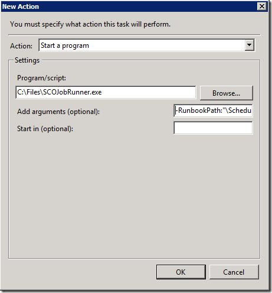

그림의 `SCOJobRunner.exe`는 다른 프로그램입니다. 아래 값으로 설정합니다.

**프로그램/스크립트** 칸에는 두 작업 모두 다음만 입력합니다.

```text
C:\Windows\System32\wsl.exe
```

**LLM Wiki Server의 “인수 추가”** 칸:

```text
-d Ubuntu-24.04 -u wiki --exec /bin/bash /home/wiki/llm-wiki/.local/start-server.sh
```

**LLM Wiki Tunnel의 “인수 추가”** 칸:

```text
-d Ubuntu-24.04 -u wiki --exec /bin/bash /home/wiki/llm-wiki/.local/start-tunnel.sh
```

배포판 이름과 계정·경로는 01·06단계의 실제 값으로 맞춥니다. “시작 위치”는 비워 둡니다. 스크립트 안에서 프로젝트 폴더로 이동합니다. 프로그램 칸에 인수까지 전부 합쳐 넣지 않습니다.

**완료 기준:** 두 작업의 차이는 이름과 실행할 `.sh` 파일입니다. 이 단계의 `wiki`는 Ubuntu 사용자이며 일반 탭의 Windows 사용자와 다른 항목입니다.

## 29 작업 스케줄러: 조건 탭

**어디서:** 조건 / Conditions.

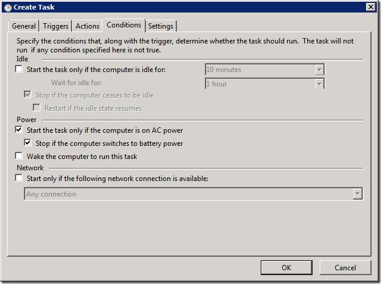

1. **컴퓨터가 유휴 상태인 경우에만 시작**이 켜져 있으면 끕니다. 사용자가 PC를 쓰고 있다는 이유로 서버 시작이 미뤄지지 않게 합니다.
2. 서버는 전원 어댑터 연결을 기본 운영 조건으로 둡니다. 배터리에서도 계속 실행해야 한다면 **AC 전원에서만 시작**과 **배터리로 전환되면 중지** 조건을 해제합니다.
3. 특정 네트워크에 연결될 때만 실행하는 제한이 설정돼 있다면 운영할 네트워크와 맞는지 확인합니다. 이름을 잘못 지정해 시작이 영구히 대기하지 않게 합니다.
4. 03단계의 Windows 절전·덮개 설정도 다시 확인합니다. 작업 조건을 바꿔도 Windows 자체의 절전을 막는 설정이 되는 것은 아닙니다.

**완료 기준:** 유휴/전원 조건 때문에 작업이 예상과 다르게 멈추지 않도록 값을 정했습니다. 노트북의 배터리 지속 시간이나 발열 문제를 이 설정이 해결하는 것은 아니므로 실제 운용 조건에서 확인합니다.

## 30 작업 스케줄러: 설정 탭과 저장

**어디서:** 설정 / Settings.

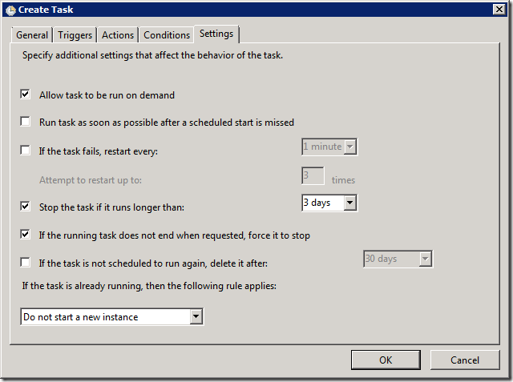

| 항목 | 설정할 값 |
| --- | --- |
| 요청 시 작업 실행 허용 | 켬. 우클릭 실행 시험에 사용 |
| 실패하면 다시 시작 | 켬. 첫 설정 예: **1분 간격·3회**. 실제 운영 조건에 맞춰 조정 |
| 다음 시간 이상 실행되면 중지 | **해제**. 그림의 3일 제한을 그대로 두지 않음 |
| 이미 실행 중이면 | **새 인스턴스를 시작하지 않음** |

1. 위 값을 설정하고 확인을 누릅니다.
2. Windows 계정 비밀번호 요청이 나오면 해당 계정의 비밀번호로 저장합니다.
3. 25~30단계를 한 번 더 반복해 **LLM Wiki Tunnel** 작업을 만듭니다. 서버 작업을 복사했다면 이름과 `start-tunnel.sh` 인수를 반드시 바꿉니다.
4. 목록에 작업 두 개가 있는지 확인합니다.

**완료 기준:** 서버와 터널이 서로 다른 작업으로 저장돼 있고 두 작업 모두 시스템 시작 시·시간 제한 없음·중복 실행 안 함 조건입니다. 실패 재시도 횟수를 모두 소진하면 계속 실행된다고 보장할 수 없으므로 로그 확인과 외부 접속 점검이 필요합니다.

공식 참고: [작업 스케줄러 실행 시간 제한](https://learn.microsoft.com/en-us/windows/win32/taskschd/tasksettings-executiontimelimit). 참고 화면은 [Microsoft 공식 블로그](https://techcommunity.microsoft.com/blog/systemcenterblog/using-windows-task-scheduler-to-invoke-scheduled-runbooks/345922)의 2012년 영문 화면입니다.

## 31 작업 두 개를 직접 실행해서 확인

**어디서:** 서버 Windows 작업 스케줄러, 이어서 작업 PC.

1. 24단계에서 수동 A·B와 시험 스크립트를 모두 종료했는지 확인합니다.
2. **LLM Wiki Server**를 우클릭 → 실행합니다.
3. **LLM Wiki Tunnel**을 우클릭 → 실행합니다.
4. 정상적으로 계속 실행하는 작업은 목록에서 **실행 중**으로 남을 수 있습니다. 완료를 기다리는 일회성 작업이 아닙니다. 새 터미널 창이 안 보이는 것도 백그라운드 실행 방식에서는 정상입니다.
5. 서버 Ubuntu에서 로그를 확인합니다.

```bash
tail -n 40 "$HOME/llm-wiki/.local/logs/server.log"
tail -n 40 "$HOME/llm-wiki/.local/logs/tunnel.log"
```

6. 서버 로그가 비어 있어도 경고·오류가 없으면 정상일 수 있습니다. 터널 로그의 연결 상태와 함께 **작업 PC에서 21단계의 실제 HTTPS API/MCP 진단**을 실행해 판단합니다.

**완료 기준:** 작업의 실행 중 표시와 함께 **실제 외부 인증 진단도 성공**합니다. 작업 상태만으로 완료라고 판단하지 않습니다.

**막히면:** 즉시 종료되는 작업은 배포판·사용자·스크립트 경로·비밀번호·설치 패키지를 확인합니다. 로그 파일이 아예 없으면 스크립트까지 도착하지 못했을 수 있습니다. `Address already in use`는 기존 수동 서버와의 중복을 확인합니다. 기존 프로세스를 확인하지 않고 새 서버를 계속 띄우지 않습니다.

## 32 재부팅·로그인 전·집 밖 재접속 시험

**어디서:** 서버 Windows와 다른 네트워크의 작업 PC.

1. 다른 작업 파일을 저장하고 서버 노트북을 재부팅합니다.
2. **서버 Windows에 아직 로그인하지 않습니다.** 인터넷 연결을 위해 Windows 로그인이 필요한 환경이면 그 조건도 별도로 해결해야 합니다.
3. 작업 PC는 핫스폿 등 다른 네트워크에서 21단계 명령으로 접속합니다. 30초 지연과 실제 네트워크 준비 시간을 감안해 확인합니다.
4. 성공하면 서버에 로그인해 두 작업의 상태와 마지막 실행 시간을 확인합니다. 터널의 연결 로그와 서버 오류 유무를 봅니다. 서버 시작 문구가 반드시 기록된다고 가정하지 않습니다.
5. 서버를 잠그거나 계획한 대로 덮개를 닫은 상태에서도 잠시 뒤 외부 진단을 다시 합니다.

| 시험 | 내 결과 |
| --- | --- |
| 같은 와이파이에서 API·MCP 인증 | 성공 / 실패 / 미실행 |
| 다른 네트워크에서 API·MCP 인증 | 성공 / 실패 / 미실행 |
| Windows 재부팅 후 로그인 전 | 성공 / 실패 / 미실행 |
| 잠금·덮개 조건에서 | 성공 / 실패 / 미실행 |

**완료 기준:** 위 조건에서 실제 성공을 확인한 항목만 완료로 기록합니다. Linux의 `systemctl enable`이나 Windows의 작업 등록만으로 이 시험을 대신할 수 없습니다. `wsl --shutdown`은 서버·터널을 포함한 WSL 작업을 종료하므로 운영 중 점검 명령으로 무심코 실행하지 않습니다.

## 33 Electron 앱에 같은 주소 연결

**어디서:** 각 작업 PC의 Electron 앱. 실제 배포된 앱과 해당 OS의 준비 상태를 먼저 확인합니다.

1. 앱의 **서버 연결**을 엽니다.
2. 서버 기본 주소에 `https://실제하위주소`를 입력합니다. 21단계에서 검증한 값과 같아야 합니다.
3. **내 개인 서버 토큰**을 입력합니다. Cloudflare 로그인 비밀번호나 Tunnel의 JSON을 넣지 않습니다.
4. 연결을 확인하고 허용된 작업 공간 `personal`, 관점 `all`을 선택합니다. 기존 정책을 사용하면 실제 허용 목록에서 고릅니다.
5. 원하면 **이 PC에 연결을 보호 저장**을 선택합니다. 재시작 시 서버의 현재 인증·권한을 다시 확인하는 방식입니다.
6. **문서 목록 보기**로 들어갑니다. 빈 연습 서버는 목록이 비는 것이 정상입니다. 기존 자료를 검증 이전했다면 해당 자료를 확인합니다.

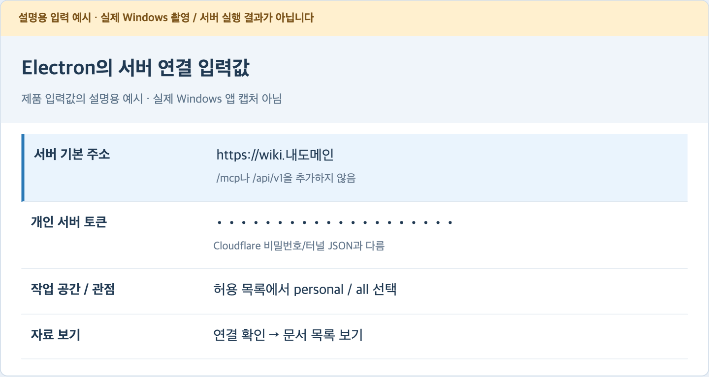

이 이미지는 입력 위치와 값의 종류를 설명하는 예시이며 실제 Windows 제품 캡처가 아닙니다. 현재 앱 구현의 연결 동선은 [앱 실행 안내](../app/README.md#서버-연결)를 따릅니다. Windows 설치 파일·실행 환경·서명·실기기 검증은 별도 배포 결과를 확인해야 하므로 파일명을 만들어서 안내하지 않습니다.

**CLI 없이 자료 읽기:** 서버가 준비되고 앱 인증이 되면 저장 자료 조회와 개인 AI 실행은 별개입니다. **새 분석:** 개인 Python 환경·본인 AI 로그인·[서버 규약의 발행·허용](domains/analysis/RULESET_ROLLOUT.md)과 해당 쓰기 권한을 준비해야 합니다. 서버 노트북에 로컬 LLM을 설치할 필요는 없습니다.

**저장이 막히면:** 읽기 전용 연습 정책에서는 원본 등록·Wiki 저장·분석 저장이 거부되는 것이 정상입니다. 사용자별 허용 작업을 정해 관리자가 정책을 준비하고 실제 저장 영수증·전체 이력을 확인한 후 사용합니다. 화면의 연결 성공을 자료 저장 성공으로 확대하지 않습니다.

## 34 평소 시작·중지·로그 관리

**평소 사용:** 서버 노트북의 전원·인터넷을 유지합니다. 자동 시작 검증이 끝났다면 매번 이 채팅에서 서버를 실행해 달라고 요청할 필요가 없습니다. 작업 PC에서는 같은 HTTPS 주소로 접속합니다.

**잠깐 중지:** 새로운 분석·저장 요청을 먼저 멈추고 서버 상태를 확인합니다. 작업 스케줄러의 해당 두 작업을 끝낸 뒤 실제 프로세스·8766 수신 포트도 확인합니다. 작업을 끝냈다고 Ubuntu 자식 프로세스까지 종료됐다고 추측하지 않습니다.

**자동 재부팅 시작까지 멈추기:** 두 작업을 사용 안 함으로 바꿉니다. 이것은 다음 부팅을 막는 설정이고 현재 실행 중인 프로세스 종료와는 별도입니다. 다시 운영할 때 사용으로 바꾸고 수동 실행·외부 진단을 확인합니다.

**로그 확인:** 31단계의 `tail`을 사용합니다. 로그 파일이 계속 커지므로 크기와 보존 기간을 정합니다. 재시작할 때만 잘리는 임시 로그가 아니며, 장기 운영 전에는 logrotate 등 별도 회전 설정이 필요합니다. 토큰·인증서 원문을 로그에 추가하지 않습니다.

**업데이트:** 기존 코드·의존성 목록·실제 실행 인수와 데이터 보존 사본을 확보합니다. 기존 작업을 중지한 뒤 검토한 코드 배포본과 lock을 적용하고 설치기·내부/외부 진단을 확인합니다. 새 코드만 복사했다고 발행된 분석 규약의 호환까지 보장되는 것은 아닙니다. 규약 전환은 별도 관리 절차를 따릅니다.

**백업:** `data` 전체와 접근 정책, 발행 규약·허용 정책/이력, 필요한 보호 자격을 구분해 보존합니다. 같은 노트북 안의 사본만으로 끝내지 않습니다. 최신 성공 저장 이후의 자료를 예전 복사본으로 덮어쓰지 않습니다. 자세한 이전 확인은 부록 A를 따릅니다.

## 35 안 될 때: 어디부터 확인할지

오류가 나면 마지막으로 성공한 단계를 기준으로 한 군데씩 확인합니다. 모든 창을 닫고 설정을 처음부터 지우는 방식으로 해결하지 않습니다.

| 보이는 현상 | 먼저 확인할 것 | 돌아갈 단계 |
| --- | --- | --- |
| `sudo` 인식 안 됨 | Ubuntu 명령을 PowerShell에 썼는지 | 02 |
| `No module named tools` | 프로젝트 위치, core/tools와 requirements·의미 지침 파일의 배치 | 07 |
| Python 버전 거부 | Ubuntu 버전·Python 3.12 이상인지 | 06~09 |
| 8766 연결 거부 | 서버 A/예약 작업·서버 로그·포트 | 12, 31 |
| 인증 없이 401 | 입구 응답은 정상. 토큰을 쓰는 실제 진단 필요 | 12, 21 |
| 인증 진단도 401 | 토큰 원문·사용자 정책 hash·전달 대상 일치 | 10, 20 |
| 403 권한 거부 | 허용 tenant/profile/행동·Origin | 21, 33 |
| 421 또는 Host 거부 | Tunnel의 httpHostHeader 값 | 16 |
| YAML 들여쓰기 오류 | Tab·공백·마지막 404 규칙 | 16 |
| Tunnel 생성 중 이름 중복 | 기존 Tunnel 소유·사용 여부 | 15 |
| DNS 기록 생성 거부 | 같은 이름의 기존 A/AAAA/CNAME | 17 |
| HTTPS 502 | Tunnel 뒤 내부 서버가 켜져 있는지 | 12, 18 |
| Tunnel 연결 없음 화면 | 터널 프로세스·자격 증명·네트워크 | 15, 18, 31 |
| 앱 대신 로그인 HTML | Cloudflare Access 등 별도 인증이 추가됐는지 | 21 |
| 앱 연결은 되지만 등록/저장 거부 | 해당 쓰기 권한·규약/개인 실행 환경 | 33 |
| 재부팅 후에만 안 됨 | Windows 계정/비밀번호·트리거·절전·로그 | 26~32 |
| 서버 창은 껐는데 포트가 남음 | 실제 자식 프로세스·중복 실행 | 24, 31 |

**오류를 전달할 때:** 실행한 단계 번호, 어느 PC/어느 창인지, 토큰을 가린 오류 문구, 성공했던 마지막 단계를 알려줍니다. 토큰·`cert.pem`·Tunnel JSON·개인 키의 원문은 첨부하지 않습니다.

## 부록 A 기존 자료를 옮길 때 지켜야 할 순서

이 부록은 기존 데이터를 삭제하거나 새 연습 정책으로 교체하는 절차가 아닙니다. **기존 소속·권한·workspace ID·원장 전체를 유지**하면서 서버 위치를 옮기는 절차입니다. 실제 경로가 다르면 정한 값으로 대조합니다.

### A-1 현재 위치와 실행 조건 기록

현재 서버의 실행 설정에서 다음을 확인합니다. `.local/tenancy`에 모두 있을 것이라고 추측하지 않습니다.

| 실제 인수/항목 | 보존할 대상 |
| --- | --- |
| `--tenant-root` | 그 루트 아래 전체 자료. 현재 표준은 `data/<workspaceId>` |
| `--access-config` | 사용자·tenant·권한·관점·토큰 hash 정책 파일 |
| 각 개인 토큰 파일 | 해당 사용자에게만 보호 전달. 정책 파일과 별개 |
| `--ruleset-root` | 발행된 모든 규약 ID·버전·manifest와 구성 파일 전체 |
| `--ruleset-policy` | 허용/철회/기본값 정책 파일과 `<정책파일명>.history/` 전체 |
| 코드 배포본 | 해당 규약 검증 지문과 맞는 같은 코드 및 requirements.lock |

규약 인수 둘 다 없었다면 “현재 규약 미설정”으로 기록합니다. 없던 규약을 이전했다고 표시하거나 옛 릴리스를 수정해 새 검증기에 맞추지 않습니다.

### A-2 쓰기 중지와 별도 보존 사본

1. 원래 서버에 새 저장·분석·정책 변경 요청이 들어오지 않게 정합니다. 실행 중인 작업과 성공 영수증을 확인합니다.
2. 현재 서비스의 실제 프로세스를 중지하고 잠금/저장이 진행 중이 아닌 상태를 확인합니다.
3. 원본과 별개인 보호 저장 위치에 전체 보존 사본을 만듭니다. Finder에서 숨김 파일을 보려면 Cmd+Shift+.를 사용합니다.
4. 자료는 최신 `wiki`만 골라 복사하지 않습니다. `_history`, `_reviews`, `_sources`, `_registrations`, 그래프·개인 기록 등 **해당 자료 루트 전체**를 보존합니다. 비서비스 백업을 새 서비스의 tenant로 섞지 않습니다.

### A-3 새 Ubuntu 경로에 복사하고 대조

1. Windows 다운로드/USB 경로에 임시로 둔 자료를 WSL의 Linux 파일시스템 안 새 경로로 복사합니다. 서비스 위치를 `/mnt/c`로 정하지 않습니다.
2. 정책·규약·자격은 `data` 루트 밖에 둡니다. 개인 토큰·정책은 0600, 비공개 폴더는 0700 등 실제 실행 사용자가 필요한 범위로 보호합니다. 기존 트리에 재귀 chmod를 일괄 적용하지 않습니다.
3. 파일 개수만 비교하지 말고 원본·전체 이력·원장·불변 원본의 파일 바이트/hash를 비교합니다. 기존 전환 점검 도구의 현재 옵션을 확인합니다.

```bash
cd "$HOME/llm-wiki"
.venv/bin/python -B -m tools.transition_check --help
```

4. 원래 자료의 `revision`, 그래프·검토 상태와 사용자 귀속을 새 서버의 개인 인증 읽기로 대조합니다. 권한 거부·읽기 실패·잘린 검사 결과를 통과로 처리하지 않습니다.
5. 12·23단계의 실행 인수를 실제 새 경로로 맞춥니다. 규약 인수는 쌍으로 지정합니다. 이후 외부 진단과 실제 문서 조회를 다시 합니다.
6. 작업 PC의 연결을 검증된 새 주소로 바꾸고 이전 서버를 같은 자료의 별도 쓰기 대상으로 재사용하지 않습니다.

**복구 기준:** 새 서버에서 성공한 쓰기가 생겼다면 옛 복사본으로 덮어쓰지 않습니다. 최신 자료·원장·실패 증거를 보존하고 복구 범위를 정합니다. 실제 이전 담당자가 경로/범위·검사 결과를 확인한 후 전환하며, 이 문서가 실제 자료 이전 완료를 대신하지 않습니다.

## 부록 B 주소·인증·용어 빠른 찾기

| 항목 | 의미 / 예 |
| --- | --- |
| 기본 주소 | `https://wiki.내도메인` - 앱·진단 입력값 |
| 일반 API 입구 | 기본 주소 + `/api/v1/access-context` |
| MCP | 기본 주소 + `/mcp` - MCP 클라이언트가 통신. 브라우저 페이지가 아님 |
| 내부 주소 | `http://127.0.0.1:8766` - 같은 Ubuntu 안에서만 사용 |
| tenant/workspace | 자료를 구분하는 안정된 공간 ID. 예: `personal` |
| profile | 조회할 허용 관점. 예: `all`. 비밀 접근 경계를 대신하지 않음 |
| 개인 토큰 | 사용자용 서버 열쇠. URL·문서·로그에 넣지 않음 |
| Tunnel UUID | Cloudflare 연결 식별자. 개인 서버 토큰과 다름 |
| `.venv` | 그 OS에서 설치한 프로젝트용 Python 환경 |
| 401 / 403 | 인증 실패 / 권한 또는 Origin 거부를 각각 확인 |

**이 안내의 대안:** `tools.server_deployment`는 명시 인증서·Caddy·systemd 배포 묶음도 생성합니다. 이 문서의 Cloudflare/전경 작업 경로와 다른 구성입니다. 해당 방식을 쓸 때는 [README 배포 묶음](../README.md#서버-배포-묶음과-사전-점검)의 입력·보존·현장 검증을 따르며 두 방식을 중복 등록하지 않습니다.

## 출처와 화면의 구분

명령은 이 저장소의 `core.runtime.http_cli`, `tools.setup_runtime`, `tools.runtime_doctor`, `tools.protect_client_token`과 관련 계약을 확인해 작성했습니다. 서버 운영 방향은 [D-048](domains/platform/DECISIONS.md#d-048--서버-노트북의-wsl2와-electron-중앙-저장-2026-10-25), 배포 준비 도구는 [D-059](domains/platform/DECISIONS.md#d-059--데스크톱-실행-브리지와-명시-서버-배포-준비-2026-10-25)를 따릅니다.

Microsoft WSL 화면 3장은 [공식 환경 설정 문서](https://learn.microsoft.com/en-us/windows/wsl/setup/environment)와 [공식 저장소](https://github.com/MicrosoftDocs/WSL)에서 가져왔으며 원본 이미지의 픽셀을 바꾸지 않았습니다. 저장소의 [CC BY 4.0](https://github.com/MicrosoftDocs/WSL/blob/main/LICENSE)을 따릅니다. 작업 스케줄러 화면 6장은 [Microsoft System Center 공식 블로그](https://techcommunity.microsoft.com/blog/systemcenterblog/using-windows-task-scheduler-to-invoke-scheduled-runbooks/345922)의 구버전 영문 참고 화면입니다. 그림 속 계정·프로그램·주간 예약·시간 제한을 우리 입력값으로 사용하지 않습니다.

전원·배포판 확인·진단·Cloudflare 도메인/DNS·설정·앱 연결 이미지는 이 안내를 위한 **설명용 입력 예시**입니다. 실제 Windows 촬영이나 설치 성공 기록으로 표시하지 않습니다. 파일별 원본 URL·구분·hash는 [화면 자료 목록](assets/screenshots/SOURCES.json)에 있습니다. 공식 사이트의 메뉴·배포판·요금·버전은 바뀔 수 있으므로 이 안내의 확인일과 각 공식 링크를 함께 봅니다.

가이드 파일을 바꿨다면 `docs/render_server_guide.py`로 브라우저 보기와 PDF를 다시 생성하고, 실제 페이지 표시와 명령 누락을 확인합니다. 문서 변환 검사를 실제 WSL2 설치·DNS 변경·인증·두 PC 시험으로 대신 기록하지 않습니다.
