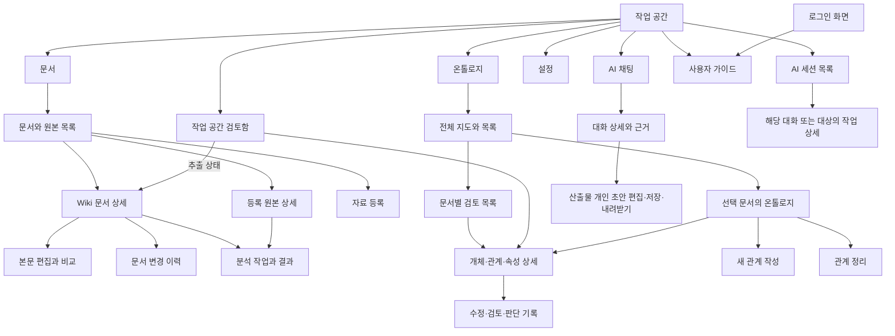

# LLM Wiki 화면 구조와 이동 IA

2026-10-29 화면 이동 정리, 2026-10-31 현행 기능 범위 보정. 1절은 적용 전 조사 기록이며, 7절은 실제 제품 주소입니다. 업무 모달11곳을 페이지 또는 화면 안 영역으로 옮겼습니다. 현재 표현·배치·상태·접근성의 최종 기준은 [UI RULES](RULES.md), 구현·검증 근거와 미실행 범위는 [작업 기록](HISTORY.md)을 따릅니다. 이 문서는 주소·대상·복귀 계약을 소유하며 초기 시안의 기능 범위를 현재 지원으로 확대하지 않습니다.

핵심 방향은 **대상을 열면 상세 화면, 작성·검토를 시작하면 그 대상의 작업 화면**으로 이동하는 것입니다. 모든 업무 화면은 주소와 돌아갈 위치를 갖습니다. 원본·문서·관계의 열람과 생성·수정·검토에 앱 모달을 사용하지 않습니다.

## 1. 적용 전 구조에서 확인한 문제

최초 조사 당시 상위 메뉴는 문서, 문서 간 관계, 온톨로지, AI 채팅이며 설정은 별도 진입점이었습니다. 등록된 페이지는 8개였습니다. 아래 문제는 적용 전 상태이며 현재 동작으로 읽지 않습니다.

| 현재 경로 | 실제 화면 | 이동 문제 |
| --- | --- | --- |
| `/documents` | Wiki와 등록 원본 목록 | Wiki 열기는 상세 페이지, 원본 열기는 모달로 동작이 다름 |
| `/register` | 자료 등록과 처리 진행 | 등록·진행·결과가 같은 주소에 있으며 독립 작업 상세 주소가 없음 |
| `/document?path=…` | Wiki 상세와 본문·원본·이력 | 원본 링크가 해당 원본 대신 전체 문서 목록으로 이동 |
| `/ontology` | 전체 지도, 개체·관계·속성 선택, 검토·추가·정리 | 전달된 `path`를 읽지 않으며 상세·편집 선택도 주소에 없음 |
| `/connections?path=…` | 기준 문서와 문서 간 관계 | 기준 문서 변경이 이전 주소를 교체하고 선택 관계는 화면 내부 상태임 |
| `/chat?conversationId=…` | AI 대화 | 대화를 바꿔도 주소가 바뀌지 않으며 문서에서 진입할 때 문서 범위가 전달되지 않음 |
| `/artifact?artifactId=…` 등 | 산출물·개인 초안과 Wiki 반영 | 독립 페이지는 있으나 산출물·초안·저장 문서의 구분을 이동에 유지해야 함 |
| `/settings` | 서버·계정과 AI 실행 설정 | 현재 업무 모달은 없음 |

재추출 화면의 `/analysis-proposals` 링크는 등록된 경로가 아닙니다. 현재 알 수 없는 모든 경로가 문서 목록으로 전환되므로 잘못된 링크가 일반 화면 이동처럼 보입니다. 앱 업무 모달의 `Dialog` 사용처는 11개이며 5절에서 각각 대체 위치를 지정합니다.

온톨로지는 보관 중인 검토 초안이 있으면 새로 선택한 관계 대신 이전 검토를 다시 여는 분기도 있습니다. 모달을 닫아 초안을 보존하는 동작과 사용자가 지금 선택한 대상을 여는 동작을 분리해야 합니다.

근거: [실제 라우터](../../../app/src/renderer/app/App.tsx), [상위 메뉴](../../../app/src/renderer/app/AppShell.tsx), [온톨로지 진입점](../../../app/src/renderer/pages/ontology/OntologyMapPage.tsx), [채팅 진입점](../../../app/src/renderer/pages/chat/KnowledgeChatPage.tsx), [문서 간 관계 진입점](../../../app/src/renderer/pages/connections/DocumentConnectionsPage.tsx).

## 2. 전체 화면 구조

문서·검토함·온톨로지·AI 채팅과 설정을 유지합니다. 별도 사용자 요청으로 문서 간 관계 메뉴와 진입 링크는 숨기며 해당 구현과 데이터는 보존합니다. 등록·산출물·검토 작업은 대상 화면에서 시작합니다. AI 세션은 사이드바에서 열며 기기 실행과 저장된 질문·분석 기록을 구별하고 해당 대화·작업 상세로 연결합니다. **사용자 가이드**는 로그인 화면과 사이드바 하단에서 앱 안의 `/guide`로 엽니다. 서버 연결 전에도 읽을 수 있으며 로그인 후에는 기존 업무 화면의 초안을 유지합니다. 후속 구현된 다중 실행·사용량·기존 지식 대조의 실제 검증 범위는 HISTORY를 따릅니다.

표의 ‘상세’는 모두 주소가 있는 화면입니다. 넓은 화면에서는 목록이나 지도를 옆에 유지할 수 있지만 배경을 막거나 다른 창 위에 띄우지 않습니다. 좁은 화면에서는 선택한 상세를 본문 전체에 표시하며 같은 주소와 복귀 동작을 사용합니다.

## 3. 화면별 책임

| 화면 | 주요 내용과 행동 | 이동과 완료 위치 |
| --- | --- | --- |
| 문서·원본 목록 | 검색, 필터, Wiki/원본 구분, 자료 등록 | 행을 열면 해당 종류의 상세. 목록 복귀 시 검색·선택·스크롤 유지 |
| 자료 등록 | 파일/텍스트 선택, 입력 확인, 등록, 진행 결과 | 접수된 작업은 해당 작업 상세로 연결. 완료만으로 다른 문서를 자동으로 열지 않음 |
| 등록 원본 상세 | 원본 미리보기·내려받기, 판본, 변환/분석 작업, 생성된 Wiki | 생성 Wiki를 선택하면 정확한 문서 상세. 원본과 변환 본문을 구분 |
| Wiki 문서 상세 | 본문, 원본 연결, 변경 이력, AI 작업 | ‘이 문서의 온톨로지’, ‘이 문서로 질문’에 현재 문서 전달 |
| Wiki 본문 편집 | 제목·태그·설명·본문, 저장 전 비교, 충돌 시 대조 | 저장 성공 시 같은 문서 상세. 초안 보관 후 이동과 명시 폐기 분리 |
| 온톨로지 탐색 | 전체 문서 검색·최근 변경 문서에서 시작, 여러 개념의 연결을 같은 지도에 부분 조회 | 검색/시작점은 필요할 때 열고 지도 선택은 실행 중 보관. 근거·수정·검토는 기존 문서별 상세 주소로 연결([D-103](../knowledge/DECISIONS.md#d-103--전체-문서-검색과-판본-고정-관계-페이지로-시작하는-지도-2026-11-06)) |
| 문서별 온톨로지 | 선택 문서의 지도·관계·속성·후보, 추출 상태 | 문서를 다시 고르는 창 없이 새 관계·검토·정리 시작 |
| 개체 상세 | 개체 정보, 등장 문서와 근거, 관련 관계·속성 | 문서별 개체를 근거 없이 같은 개체로 합치지 않음. 관련 관계 상세로 이동 |
| 관계·속성 상세 | 값, 조건·범위·시점, 출처와 원문, 현재 판단, 변경 기록 | 읽기가 기본. 수정·원문 검토·전문가 판단을 명시적으로 시작 |
| 새 관계 작성 | 대상 문서, 기존 주어/목적어, 관계 의미·한정어, 추가 근거, 이유 | 저장 성공 후 새 관계 상세. 취소/초안 보관 시 진입한 목록·지도 복귀 |
| 관계·속성 수정 및 검토 | 원문과 입력을 나란히 표시, 변경 전후, 이유, 이력·되돌림 | 같은 대상 상세 안의 작업 모드. 원문 근거 정정과 전문가 업무 판단의 권한·저장 의미 유지 |
| 문서별 검토 목록 | 읽은 문서별 현재 주장, 후보, 과거 판단과 상태. 문서 지정 진입은 해당 문서로 제한 | 항목을 선택하면 관계·속성 상세의 검토 모드. 전체 공간의 완전한 검토함으로 표시하지 않음 |
| 작업 공간 검토함 | 불러온 문서들의 미검토·보류·이전 판단·추출 상태, 상태 필터·부분 범위·추가 조회 | 현재 주장은 해당 검토, 이전 판단은 기록, 추출 상태는 문서의 분석 화면으로 연결. 문서별 검토 목록과 별도 진입점 |
| 관계 정리 | 문서 범위, 미리보기, 선택 항목, 이유, 적용 결과·이력·되돌림 | 문서별 온톨로지의 작업 페이지. 문서 전체 자동 삭제로 바꾸지 않음 |
| 문서 간 관계 탐색·상세 | 기존 구현과 데이터 보존, 현재 메뉴·진입 링크 숨김 | 이전 주소의 선택 문서가 있으면 문서 상세, 없으면 문서 목록으로 연결 |
| AI 대화 상세 | 대화 목록, 메시지, 질문 범위, 근거 영역 | 대화 선택 시 주소 갱신. 근거 확인은 화면 안 분할 영역, 원문 열기는 해당 상세 |
| 산출물 개인 초안 | 생성 상태, 읽기·편집·개인 초안 저장, 작성 자료, 충돌/복구, Markdown 내려받기 | 개인 초안 저장과 파일 내보내기를 Wiki 반영으로 표시하지 않음. 원래 대화·실제 자료 링크 유지 |
| AI 세션 목록 | 기기 실행·저장된 질문/분석 기록, 대상, 진행·완료·미확인 상태, 기존 지식 대조 | 선택한 항목의 대화·분석 작업으로 이동. 대조 기록·결과·재실행/중단을 구별하고 권한 오류·일부 조회 유지 |
| 분석 작업 상세 | 원본·문서, 고정 입력, 진행, 저장 결과, 기존 지식 대조·재실행/중단, 실패/미확인 확인 | 대상의 작업 상세에서 결과 확인. 기존 지식 대조에 적용 행동을 추가하지 않음. 추출안의 비교/명시 적용은 별도 `/analysis-proposals` 작업 |
| 설정 | 서버·계정, 연결 상태, AI 실행과 진단 | 탭/섹션에서 편집. 계정/작업 공간 변경 시 접근 범위를 다시 확인 |
| 사용자 가이드 | 실제 화면·조작 위치·단계 이동·확대·CLI 설치 선행 안내·상세 설명 | 앱에 포함한 읽기 전용 안내. 로그인 전후에 접근하며 업무 데이터·개인 AI 실행과 분리 |

현재 독립 관계 추가는 **한 문서의 기존 개체 사이**를 지원합니다. IA에 새 개체 생성, 임의의 문서 간 관계 생성, 전역 일괄 판단 기능을 새로 넣지 않습니다. 원본 한 개에서 여러 Wiki가 파생될 수 있는 연결을 유지합니다.

## 4. 핵심 작업 흐름

### 전문가가 관계를 추가할 때

문서 상세의 ‘이 문서의 온톨로지’ → 문서별 온톨로지 → 새 관계 작성 → ‘전문가 업무 판단’ 선택 → 기존 주어·목적어와 관계·이유 작성 → 저장 → 새 관계 상세입니다.

전체 온톨로지에서 ‘새 관계’를 시작한 경우에는 **같은 작성 페이지의 첫 항목에서 문서를 선택**합니다. 선택 모달을 먼저 띄우지 않습니다. 문서를 바꾸면 종속된 개체·근거 입력의 변경을 화면 안에서 확인하고, 이전 초안을 다른 문서에 자동 적용하지 않습니다.

작성 화면은 상단에 대상 문서, 본문에 관계 입력과 원문 근거 영역, 하단에 저장·초안 보관 후 돌아가기·초안 폐기를 둡니다. 추가 근거에 따라 원문 인용 또는 전문가 판단 이유를 요구합니다. 최신 추출·권한·기존 개체가 없으면 이유와 문서/분석 준비 경로를 같은 화면에 표시합니다. 역할별 조회 관점은 D-083에 따라 PoC에서 제외합니다.

### 기존 관계를 읽고 검토할 때

지도 또는 목록에서 관계 선택 → 관계 상세 → 수정/원문 검토/전문가 판단 중 명시 선택 → 근거 대조와 이유 입력 → 저장 → 같은 관계 상세입니다. 이력 선택·변경 전후 비교·되돌림도 같은 상세의 기록 영역에서 처리합니다. 지도에서 클릭한 즉시 편집 상태로 만들지 않습니다.

### 원본에서 Wiki까지 확인할 때

문서 목록의 원본 선택 → 원본 상세 → 생성된 Wiki 선택 → Wiki 상세입니다. Wiki 상세의 원본 링크는 해당 원본과 판본으로 돌아갑니다. Wiki 없이 원본만 있는 경우에도 원본 상세를 읽을 수 있습니다.

### 재추출하고 결과를 확인할 때

Wiki 상세의 AI 작업에서 실제 지원하는 추출 준비·입력 확인·명시 실행과 결과 확인으로 연결합니다. 추출안의 결과 비교·명시 적용은 `/analysis-proposals`가 담당합니다. `/jobs`의 기존 지식 대조는 결과 확인·검색/대조 재실행·중단이며 추출안 적용과 구별합니다. 작업을 열거나 뒤로 이동하는 행동이 추출을 다시 실행하지 않습니다.

### 문서를 근거로 질문할 때

문서 상세의 ‘이 문서로 질문’ → 해당 문서가 질문 범위에 들어간 새 대화 초안 → 명시 전송 → 답변·근거 확인 → 산출물 개인 초안의 읽기·편집·저장 또는 Markdown 내려받기입니다. 현재 개인 초안 저장을 Wiki 반영으로 표시하지 않습니다. 이동만으로 질문을 실행하지 않으며 근거를 보는 동안 대화 입력과 읽던 위치를 유지합니다.

## 5. 기존 모달 11곳의 대체 위치

| 기존 모달 | 적용한 대체 위치 | 유지할 기능 |
| --- | --- | --- |
| 등록 원본 미리보기 | 등록 원본 상세 페이지 | 미리보기, 판본·무결성 상태, 원본 내려받기 |
| 문서 재추출 | 해당 문서의 분석 준비·작업 상세 | 실행 준비, 고정 기준, 진행, 결과, 비교·적용 |
| 채팅 근거 상세 | 대화의 비차단 근거 영역 | 답변 당시 근거, 관계/후보 구분, 문서 상세 이동 |
| 채팅 대화 목록 | 대화 화면의 목록 영역 | 대화 선택과 주소 일치, 입력 보존 |
| 채팅 개인 초안 안내 | 산출물 생성/편집으로 직접 이동하고 해당 화면에 안내 | 개인 초안의 보관 범위와 제한, 중복 생성 진입 정리 |
| 관계를 추가할 문서 선택 | 새 관계 작성 페이지의 문서 입력 | 사용 가능한 문서와 준비 상태, 빈 상태 안내 |
| 문서별 검토 대상 선택 | 문서별 온톨로지의 검토 목록 | 현재 주장·과거 판단 구분, 검토 대상 선택 |
| 새 관계 추가 | 새 관계 작성 페이지 | 원문/전문가 근거, 한정어, 이유, 초안, 저장 확인 |
| 원문 근거 정정 | 관계·속성 상세의 수정 모드 | 전체 입력, 원문 대조, 기준 판본, 충돌·실패 시 초안 |
| 원문 검토·전문가 판단 | 관계·속성 상세의 검토 모드 | 후보 처리, 판단 이유, 이력, 되돌림 |
| Clean Up | 문서별 관계 정리 페이지 | 미리보기, 명시 선택, 적용·영수증, 이력·전체 선택 되돌림 |

**이 IA의 업무 모달은 0개입니다.** 파일 선택·저장 위치 지정 등 운영체제가 제공하는 창은 이 표와 별개입니다. 짧은 메뉴·선택 상자는 입력 보조로만 사용하고 문서 열람이나 여러 단계 작업을 담지 않습니다. 폐기·되돌림·중단 확인은 해당 행동 옆에 대상을 명시한 확인 영역으로 처리합니다.

좁은 화면의 `AdaptiveWorkspace`는 현재도 모달이 아닌 영역 전환입니다. 이 구조를 유지하되 선택한 상세·근거·목록을 주소 또는 복원 가능한 화면 상태에 연결합니다. 패널의 표시 형식만 바꿔 모달처럼 배경을 막는 구현을 만들지 않습니다.

## 6. 화면 이동 규칙

| 상황 | 정한 동작 |
| --- | --- |
| 항목 열기 | 이름에 맞는 상세로 이동. 원본 열기와 Wiki 열기 모두 상세 진입 |
| 미리보기 | ‘근거 보기’처럼 읽기 보조로 명시한 행동만 화면 안 영역을 열 수 있음. ‘상세 열기’와 구분 |
| 다른 메뉴의 대상 열기 | 문서·개체·관계·대화의 식별자와 작업 공간을 정확히 전달. 대상 화면이 이를 읽어 같은 대상을 표시 |
| 보관 초안과 새 대상 선택 | 선택한 대상을 열고 그 대상의 초안만 복원. 다른 대상의 보관 초안은 별도 표식으로 알려 선택을 가로채지 않음 |
| 상세의 소속 | 상세는 정해진 메뉴에 소속. 현재 메뉴·제목·이동 경로를 일치시키고, 별도로 ‘이전 지도/목록으로’ 제공 |
| 뒤로가기 | 바로 전 화면·대상을 복원. 목록 검색·필터·스크롤, 지도 배율·위치·접힘도 유지 |
| 대화·기준 문서 변경 | 사용자가 다른 대상을 열면 탐색 기록에 추가. 입력 중 검색 문자열 변경은 불필요한 기록을 쌓지 않음 |
| 탭·선택 상태 | 직접 다시 열 필요가 있는 탭, 관계, 근거, 작업, 판본 선택을 주소에 반영. 초안 본문·인증정보는 주소에 넣지 않음 |
| 저장 성공 | 편집은 같은 대상 상세, 신규 관계는 새 관계 상세. 장기 작업 완료·알림은 자동 화면 전환을 하지 않음 |
| 저장 실패·충돌 | 현재 작업 화면과 초안을 유지하고 해결 행동을 표시. 문서 목록으로 보내지 않음 |
| 저장 결과 미확인 | 현재 화면에서 영수증/결과 확인. 다시 저장 버튼으로 중복 요청하지 않음 |
| 미저장 이동 | 같은 계정·공간에서 초안을 보관하고 복귀 시 복원. 명시 폐기만 입력을 버림. 계정·권한이 바뀌면 이전 자료를 표시하지 않음 |
| 없는 대상·잘못된 주소 | ‘대상을 찾을 수 없음’ 또는 ‘이 화면은 제공되지 않음’을 표시하고 이전 위치/목록 링크 제공 |
| 권한·연결 문제 | 기존 접근 경계를 유지하고 이유와 재확인 행동을 표시. 다른 공간이나 임의 문서를 대신 열지 않음 |
| 대상 없음 | 빈 창 대신 필요한 선행 작업과 이동 버튼을 표시. 문서 없음·추출 없음·조회 실패를 구분 |
| 직접 주소 진입 | 이전 화면 정보가 없으면 정해진 상위 목록으로 복귀. 이전 대상이 오래됐으면 상태를 설명하고 현재 목록 선택을 제공 |

방문한 화면은 같은 로그인·서버·공간·권한 범위에서 메모리에 보관합니다. 숨긴 화면은 접근성 트리에서도 제외하고 그 화면의 작업 완료가 현재 화면을 가로채지 않게 합니다. 로그아웃·접근 범위 변경 시 이전 화면·입력·늦은 응답을 현재 표시에서 제거합니다. 범위별 초안 세션·보호 저장의 보존/폐기는 기존 계약을 따르며 이전 초안을 다른 범위에 노출하지 않습니다. 앱 재시작 복원도 기존 보호 저장 계약을 따르며 새 영구 보존 정책을 추가하지 않습니다.

## 7. 실제 화면 주소

기존 주소와 서버 식별자를 유지하며 query로 대상·작업 모드를 명시합니다. 문서는 현재 API의 경로로 식별하고 관계·속성은 문서와 추출 기준을 함께 확인합니다. URL의 대상이나 관점이 접근 권한을 부여하지 않습니다. 아래 값은 주소용으로 인코딩합니다.

| 화면 | 주소 예 |
| --- | --- |
| 문서·원본 목록 / 등록 | `/documents`, `/register` |
| 원본 상세 / Wiki 상세 | `/source?sourceId=…&version=…`, `/document?path=…` |
| Wiki 편집 / 이력 | `/document?path=…&mode=edit`, `/document?path=…&tab=history&historyId=…` |
| 전체 온톨로지 / 문서별 온톨로지 | `/ontology`, `/ontology?path=…` |
| 개체 상세 | `/ontology?path=…&view=detail&document=…&concept=…` |
| 관계·속성 상세 | `/ontology?path=…&view=detail&document=…&claim=…` |
| 새 관계 | `/ontology?view=relation-new` 또는 `/ontology?path=…&view=relation-new&document=…` |
| 수정 / 검토 모드 | 관계·속성 상세에 `&mode=edit` / `&mode=review` |
| 검토 목록 / 관계 정리 | `/ontology?view=reviews`, `/ontology?view=cleanup`에 `path`·`document`로 문서 지정 가능 |
| 작업 공간 검토함 | `/review` |
| 숨긴 문서 간 관계의 이전 주소 | `/connections?path=…` → `/document?path=…`; 문서가 없으면 `/documents` |
| 대화 목록·새 대화 / 대화 상세 | `/chat`, `/chat?conversationId=…` 또는 `threadId=…` |
| 문서에서 질문 / 대화의 근거 영역 | `/chat?document=…`; 대화 주소에 `answer=…&evidence=…` |
| 산출물 / 개인 초안 | `/artifact?artifactId=…` 또는 기존 `draftId`·`questionRunId`; 편집은 `mode=edit` |
| AI 세션 목록 / 필터 | `/sessions`, `?document=…` 또는 `?sourceId=…&sourceVersion=…` |
| AI 세션 지난 기록 | `/sessions/history` (AI 세션 헤더의 "지난 기록" 버튼에서 이동) |
| 문서별 AI 작업·준비 / 작업 상세 / 비교 | `/document?path=…&tab=analysis`, `/jobs?jobId=…`, `/analysis-proposals?document=…&proposalId=…` |
| 저장된 질문 실행 | 대화 주소에 `questionRunId=…` |
| 설정 | `/settings?section=connection`, `/settings?section=ai` |
| 사용자 가이드 | `/guide` (로그인 전에도 접근 가능) |

현재 세션 목록은 저장된 질문과 분석 작업을 각각 대화 상세와 분석 작업 상세로 연결합니다. 산출물·검토 이동은 해당 작업 화면의 기존 연결을 사용합니다. 로그인은 현재 전역 접근 화면을 재사용하되 인증 후 유효한 목적지를 복원하고, 잘못된 목적지는 명시 안내합니다.

| 별도 경로의 화면 | 활성 메뉴와 직접 진입 시 상위 위치 |
| --- | --- |
| 원본 상세·등록·분석 작업·결과 비교 | 문서 메뉴. 직접 진입한 작업은 세션 목록, 비교는 해당 문서의 AI 작업으로 복귀. 원본·문서 링크도 별도로 제공 |
| 개체·관계·속성·작성·검토·정리 | 온톨로지 메뉴. 문서가 있으면 해당 문서별 온톨로지, 없으면 온톨로지 탐색으로 복귀 |
| 작업 공간 검토함 | 검토함 메뉴. 항목의 실제 종류에 따라 정확한 주장 검토·이전 기록·문서 AI 작업으로 이동 |
| 문서 간 관계의 이전 주소 | 숨김 요청에 따라 선택 문서 상세 또는 문서 목록으로 복귀 |
| 산출물·개인 초안 | AI 채팅 메뉴. 생성한 대화가 있으면 해당 대화, 없으면 대화 목록으로 복귀 |
| AI 세션 목록 | 헤더의 전역 화면. 업무 메뉴를 임의 활성화하지 않으며 각 항목의 종류와 대상으로 이동 |
| 설정 | 설정 진입점. 직접 진입 시에도 설정 화면을 유지 |
| 사용자 가이드 | 로그인 전에는 로그인 화면, 로그인 후에는 기존 업무 화면으로 돌아갈 수 있는 안내 진입점 |

판본이 생략된 원본 직접 진입은 현재 판본임을 표시합니다. Wiki·작업·근거에서 연결된 원본을 열 때는 참조 당시 판본을 명시하고, 해당 판본을 찾을 수 없으면 최신 원본으로 조용히 대체하지 않습니다.

기존 `/document?path=…`, `/ontology?path=…`, `/chat?conversationId=…`, `/artifact?…`, `/register` 링크를 유지합니다. `/renewal/*`는 query·fragment를 유지하는 명시 호환 경로입니다. 존재하지 않는 기능 주소는 해당 주소에서 오류와 복귀 링크를 표시합니다.

## 8. 적용 순서와 확인 기준

1. **이동 기준 정리:** 각 화면의 대상·소속·복귀 위치를 정의하고 현재 문서 범위 누락, 대화 주소 불일치, 없는 분석 경로와 무조건 목록 이동을 먼저 수정합니다.
2. **핵심 상세 확보:** 등록 원본 상세, 문서별 온톨로지, 개체·관계·속성 상세를 연결합니다. 기존 상세·폼·검토·이력 구현을 재사용합니다.
3. **업무 모달 이전:** 작성·정정·검토·정리·재추출을 작업 화면으로 이동하고 채팅 목록·근거·안내를 화면 안에 배치합니다. 모달을 제거하기 전에 초안 수명을 화면 밖으로 옮깁니다.
4. **작업 이동 통합:** 분석 작업·결과 비교와 전역 AI 세션의 대상별 이동을 연결합니다. 동시 실행 자체는 기존 별도 범위를 따릅니다.

| 확인 시나리오 | 통과 조건 |
| --- | --- |
| 문서 A에서 온톨로지 진입 | A의 문서 범위와 제목이 보이며 다른 문서/전체 지도에 조용히 바뀌지 않음 |
| 새 전문가 관계 생성 | 문서 선택부터 저장 결과까지 업무 모달 없이 완료. 기존 개체·권한·추출 기준 유지 |
| 관계 수정 중 원문 확인 후 복귀 | 초안·이유·근거·기준 판본과 지도 위치 유지 |
| 관계 상세·후보·속성 검토 | 기존 입력과 판단 구분·이력·되돌림을 모두 사용할 수 있음 |
| 원본과 Wiki 왕복 | 원본의 정확한 판본·파생 Wiki가 유지되며 전체 목록에서 다시 찾지 않음 |
| 대화 A → B → 뒤로가기 | A의 주소·메시지·입력·읽던 위치가 복원됨 |
| 저장 실패·결과 미확인 | 현재 화면 유지, 초안 보존, 결과 확인 전 중복 저장 방지 |
| 좁은 화면에서 상세/근거 열기 | 배경 차단 모달 없이 본문 전환. 뒤로가기로 원래 영역 복귀 |
| 오래된 주장·없는 문서·권한 회수 | 정확한 상태를 표시하고 임의의 최신 주장이나 다른 자료로 바꾸지 않음 |
| 작업 완료·세션 전환 | 현재 화면을 빼앗지 않으며 선택 시 종류에 맞는 대화·분석 작업·산출물·검토로 이동. 실행을 재시작하지 않음 |
| 정리·되돌림·초안 폐기 | 대상과 효과를 화면 안에서 확인하고 명시 실행. 원문·판단 이력 보존 |

제품 적용 후 격리 HTTP/Electron·React fixture로 위 흐름을 검증합니다. 실제 실행 결과·발견한 실패와 보완·미실행 항목은 [작업 기록](HISTORY.md)에 남깁니다. 운영 자료·실제 모델 실행·Windows 배포 검증으로 확대하지 않습니다.

## 9. 구현 근거

- [문서 목록](../../../app/src/renderer/features/browse-document-library/ui/DocumentLibrary.tsx), [등록 원본 상세](../../../app/src/renderer/pages/source/SourceDetailPage.tsx)
- [문서 상세와 원본 이동](../../../app/src/renderer/features/manage-document-content/ui/ManageDocumentContent.tsx)
- [재추출과 비교 링크](../../../app/src/renderer/features/manage-document-content/ui/DocumentExtraction.tsx)
- [온톨로지와 문서 선택](../../../app/src/renderer/features/explore-ontology-map/ui/OntologyMapWorkspace.tsx)
- [새 관계 입력](../../../app/src/renderer/features/explore-ontology-map/ui/OntologyRelationPage.tsx), [정정](../../../app/src/renderer/features/explore-ontology-map/ui/OntologyCorrectionPage.tsx), [검토](../../../app/src/renderer/features/explore-ontology-map/ui/OntologyReviewPage.tsx), [정리](../../../app/src/renderer/features/explore-ontology-map/ui/OntologyCleanupPage.tsx)
- [채팅 목록과 근거 영역](../../../app/src/renderer/features/chat-with-knowledge/ui/KnowledgeChat.tsx)
- [공용 작업 페이지](../../../app/src/renderer/shared/ui/WorkspacePage.tsx), [화면 너비별 영역 전환](../../../app/src/renderer/shared/ui/AdaptiveWorkspace.tsx), [화면 보관](../../../app/src/renderer/app/RetainedWorkspace.tsx)
- [세션 목록](../../../app/src/renderer/features/browse-ai-sessions/ui/AiSessions.tsx), [분석 작업](../../../app/src/renderer/features/browse-ai-sessions/ui/AnalysisJobWorkspace.tsx), [결과 비교](../../../app/src/renderer/pages/analysis/AnalysisProposalPage.tsx)
- [현재 UI 계획](PLAN.md), [전문가 관계 추가의 현재 범위](../reviews/PLAN.md)
