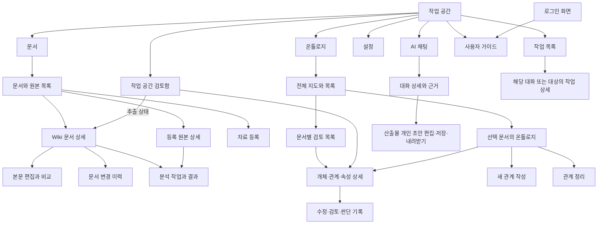
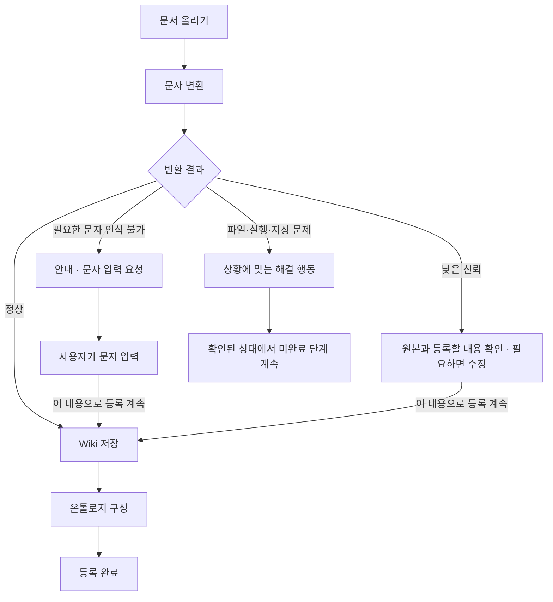
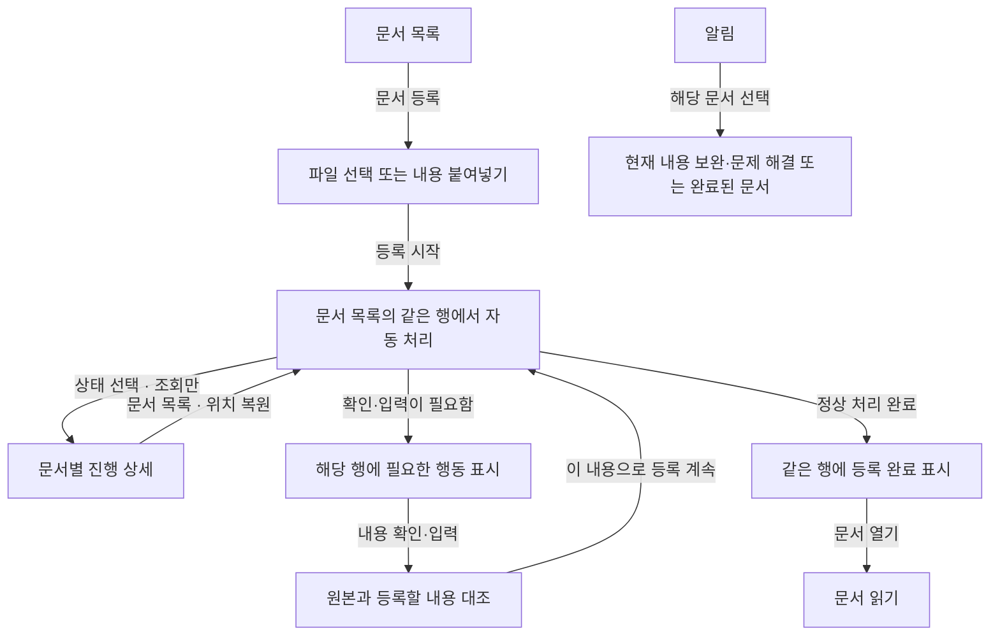

# LLM Wiki 화면 구조와 이동 IA

2026-10-29 화면 이동 정리, 2026-10-31 현행 기능 범위 보정. 1절은 적용 전 조사 기록이며, 7절은 실제 제품 주소입니다. 업무 모달11곳을 페이지 또는 화면 안 영역으로 옮겼습니다. 현재 표현·배치·상태·접근성의 최종 기준은 [UI RULES](RULES.md), 구현·검증 근거와 미실행 범위는 [작업 기록](HISTORY.md)을 따릅니다. 이 문서는 주소·대상·복귀 계약을 소유하며 초기 시안의 기능 범위를 현재 지원으로 확대하지 않습니다.

핵심 방향은 **대상을 열면 상세 화면, 작성·검토를 시작하면 그 대상의 작업 화면**으로 이동하는 것입니다. 모든 업무 화면은 주소와 돌아갈 위치를 갖습니다. 원본·문서·관계의 열람과 생성·수정·검토에 앱 모달을 사용하지 않습니다.

문서 등록의 현재 제품 기준은 사용자 정정을 반영한 [12절](#12-사용자-정정에-따른-문서-등록-기준)입니다. 10절의 종전 제안과 11절의 기존 구현 조사는 새 목표 흐름과 구분합니다.

이 기준을 화면으로 구체화한 새 재설계는 [13절](#13-문서-등록-작업-화면-전면-재설계)입니다. 기존 화면 구조 유지보다 사용자 과업과 필요한 정보의 직접 노출을 우선합니다.

## 1. 적용 전 구조에서 확인한 문제

최초 조사 당시 상위 메뉴는 문서, 문서 간 관계, 온톨로지, AI 채팅이며 설정은 별도 진입점이었습니다. 등록된 페이지는 8개였습니다. 아래 문제는 적용 전 상태이며 현재 동작으로 읽지 않습니다.

| 현재 경로 | 실제 화면 | 이동 문제 |
| --- | --- | --- |
| `/documents` | Wiki와 등록 원본 목록 | Wiki 열기는 상세 페이지, 원본 열기는 모달로 동작이 다름 |
| `/register` | 자료 등록과 처리 진행 | 등록·진행·결과가 같은 주소에 있으며 독립 작업 상세 주소가 없음 |
| `/document?path=…` | Wiki 상세와 본문·원본·이력 | 원본 링크가 해당 원본 대신 전체 문서 목록으로 이동 |
| `/ontology` | 전체 지도, 개체·관계·속성 선택, 검토·추가·정리 | 전달된 `path`를 읽지 않으며 상세·편집 선택도 주소에 없음 |
| `/connections?path=…` | 기준 문서와 문서 간 관계 | 기준 문서 변경이 이전 주소를 교체하고 선택 관계는 화면 내부 상태임 |
| `/chat?conversationId=…` | AI 대화 | 대화를 바꿔도 주소가 바뀌지 않으며 문서에서 진입할 때 문서 범위가 전달되지 않음 |
| `/artifact?artifactId=…` 등 | 산출물·개인 초안과 Wiki 반영 | 독립 페이지는 있으나 산출물·초안·저장 문서의 구분을 이동에 유지해야 함 |
| `/settings` | 서버·계정과 AI 실행 설정 | 현재 업무 모달은 없음 |

재추출 화면의 `/analysis-proposals` 링크는 등록된 경로가 아닙니다. 현재 알 수 없는 모든 경로가 문서 목록으로 전환되므로 잘못된 링크가 일반 화면 이동처럼 보입니다. 앱 업무 모달의 `Dialog` 사용처는 11개이며 5절에서 각각 대체 위치를 지정합니다.

온톨로지는 보관 중인 검토 초안이 있으면 새로 선택한 관계 대신 이전 검토를 다시 여는 분기도 있습니다. 모달을 닫아 초안을 보존하는 동작과 사용자가 지금 선택한 대상을 여는 동작을 분리해야 합니다.

근거: [실제 라우터](../../../app/src/renderer/app/App.tsx), [상위 메뉴](../../../app/src/renderer/app/AppShell.tsx), [온톨로지 진입점](../../../app/src/renderer/pages/ontology/OntologyMapPage.tsx), [채팅 진입점](../../../app/src/renderer/pages/chat/KnowledgeChatPage.tsx), [문서 간 관계 진입점](../../../app/src/renderer/pages/connections/DocumentConnectionsPage.tsx).

## 2. 전체 화면 구조

문서·검토함·온톨로지·AI 채팅과 설정을 유지합니다. 별도 사용자 요청으로 문서 간 관계 메뉴와 진입 링크는 숨기며 해당 구현과 데이터는 보존합니다. 등록·산출물·검토 작업은 대상 화면에서 시작합니다. 개발본에서 문서 등록 진행은 문서 목록의 현재 상태에서 `/documents?taskId=…` 또는 `?jobId=…` 독립 상세로 엽니다. 별도 작업 메뉴를 제거하고 **AI 세션**에서 기존 질문·분석 기록을 유지합니다. `/tasks`의 기존 문서 식별자는 새 주소로 연결하며 기기 실행과 서버 저장 결과를 구별합니다. **사용자 가이드**는 로그인 화면과 사이드바 하단에서 앱 안의 `/guide`로 엽니다. 서버 연결 전에도 읽을 수 있으며 로그인 후에는 기존 업무 화면의 초안을 유지합니다. 후속 구현된 다중 실행·사용량·기존 지식 대조의 실제 검증 범위는 HISTORY를 따릅니다.

표의 ‘상세’는 모두 주소가 있는 화면입니다. 넓은 화면에서는 목록이나 지도를 옆에 유지할 수 있지만 배경을 막거나 다른 창 위에 띄우지 않습니다. 좁은 화면에서는 선택한 상세를 본문 전체에 표시하며 같은 주소와 복귀 동작을 사용합니다.

## 3. 화면별 책임

| 화면 | 주요 내용과 행동 | 이동과 완료 위치 |
| --- | --- | --- |
| 문서·원본 목록 | 검색, 필터, Wiki/원본 구분, 자료 등록 | 행을 열면 해당 종류의 상세. 목록 복귀 시 검색·선택·스크롤 유지 |
| 자료 등록 | 파일/텍스트 선택, 입력 확인, 원본 접수 | 접수 후 문서 목록으로 돌아가 같은 문서의 상태에서 진행 상세를 엶. 완료만으로 다른 문서를 자동으로 열지 않음 |
| 등록 원본 상세 | 원본 미리보기·내려받기, 판본, 변환/분석 작업, 생성된 Wiki | 생성 Wiki를 선택하면 정확한 문서 상세. 원본과 변환 본문을 구분 |
| Wiki 문서 상세 | 본문, 원본 연결, 변경 이력, AI 작업 | ‘이 문서의 온톨로지’, ‘이 문서로 질문’에 현재 문서 전달 |
| Wiki 본문 편집 | 제목·태그·설명·본문, 저장 전 비교, 충돌 시 대조 | 저장 성공 시 같은 문서 상세. 초안 보관 후 이동과 명시 폐기 분리 |
| 온톨로지 탐색 | 전체 문서 검색·최근 변경 문서에서 시작, 여러 개념의 연결을 같은 지도에 부분 조회 | 검색/시작점은 필요할 때 열고 지도 선택은 실행 중 보관. 근거·수정·검토는 기존 문서별 상세 주소로 연결([D-103](../knowledge/DECISIONS.md#d-103--전체-문서-검색과-판본-고정-관계-페이지로-시작하는-지도-2026-11-06)) |
| 문서별 온톨로지 | 선택 문서의 지도·관계·속성·후보, 추출 상태 | 문서를 다시 고르는 창 없이 새 관계·검토·정리 시작 |
| 개체 상세 | 개체 정보, 등장 문서와 근거, 관련 관계·속성 | 문서별 개체를 근거 없이 같은 개체로 합치지 않음. 관련 관계 상세로 이동 |
| 관계·속성 상세 | 값, 조건·범위·시점, 출처와 원문, 현재 판단, 변경 기록 | 읽기가 기본. 수정·원문 검토·전문가 판단을 명시적으로 시작 |
| 새 관계 작성 | 대상 문서, 기존 주어/목적어, 관계 의미·한정어, 추가 근거, 이유 | 저장 성공 후 새 관계 상세. 취소/초안 보관 시 진입한 목록·지도 복귀 |
| 관계·속성 수정 및 검토 | 원문과 입력을 나란히 표시, 변경 전후, 이유, 이력·되돌림 | 같은 대상 상세 안의 작업 모드. 원문 근거 정정과 전문가 업무 판단의 권한·저장 의미 유지 |
| 문서별 검토 목록 | 읽은 문서별 현재 주장, 후보, 과거 판단과 상태. 문서 지정 진입은 해당 문서로 제한 | 항목을 선택하면 관계·속성 상세의 검토 모드. 전체 공간의 완전한 검토함으로 표시하지 않음 |
| 작업 공간 검토함 | 불러온 문서들의 미검토·보류·이전 판단·추출 상태, 상태 필터·부분 범위·추가 조회 | 현재 주장은 해당 검토, 이전 판단은 기록, 추출 상태는 문서의 분석 화면으로 연결. 문서별 검토 목록과 별도 진입점 |
| 관계 정리 | 문서 범위, 미리보기, 선택 항목, 이유, 적용 결과·이력·되돌림 | 문서별 온톨로지의 작업 페이지. 문서 전체 자동 삭제로 바꾸지 않음 |
| 문서 간 관계 탐색·상세 | 기존 구현과 데이터 보존, 현재 메뉴·진입 링크 숨김 | 이전 주소의 선택 문서가 있으면 문서 상세, 없으면 문서 목록으로 연결 |
| AI 대화 상세 | 대화 목록, 메시지, 질문 범위, 근거 영역 | 대화 선택 시 주소 갱신. 근거 확인은 화면 안 분할 영역, 원문 열기는 해당 상세 |
| 산출물 개인 초안 | 생성 상태, 읽기·편집·개인 초안 저장, 작성 자료, 충돌/복구, Markdown 내려받기 | 개인 초안 저장과 파일 내보내기를 Wiki 반영으로 표시하지 않음. 원래 대화·실제 자료 링크 유지 |
| 문서 등록 상태 | `/documents`의 문서명·현재 상태·행동3열, 서버 계보를 묶은 목록/검색 | 상태는 진행 상세, 저장된 문서는 읽기로 이동. 열람으로 실행하거나 오류를 해결 처리하지 않음 |
| 문서 진행 상세 | `/documents?taskId=…` 또는 `?jobId=…`, 문자 변환·Wiki·온톨로지3단계와 현재 작업 | 조회만 복원하고 명시 재개 때 기존 실행 보호를 사용. 미확인은 결과 조회. 저장 본문/실행 기록/원본 열기와 문서 목록 복귀 |
| AI 세션 목록 | 기기 실행·저장된 질문/분석 기록, 대상, 진행·완료·미확인 상태, 기존 지식 대조 | 선택한 항목의 대화·분석 작업으로 이동. 대조 기록·결과·재실행/중단을 구별하고 권한 오류·일부 조회 유지 |
| 분석 작업 상세 | 원본·문서, 고정 입력, 진행, 저장 결과, 기존 지식 대조·재실행/중단, 실패/미확인 확인 | 대상의 작업 상세에서 결과 확인. 기존 지식 대조에 적용 행동을 추가하지 않음. 추출안의 비교/명시 적용은 별도 `/analysis-proposals` 작업 |
| 설정 | 서버·계정, 연결 상태, AI 실행과 진단 | 탭/섹션에서 편집. 계정/작업 공간 변경 시 접근 범위를 다시 확인 |
| 사용자 가이드 | 실제 화면·조작 위치·단계 이동·확대·CLI 설치 선행 안내·상세 설명 | 앱에 포함한 읽기 전용 안내. 로그인 전후에 접근하며 업무 데이터·개인 AI 실행과 분리 |

현재 독립 관계 추가는 **한 문서의 기존 개체 사이**를 지원합니다. IA에 새 개체 생성, 임의의 문서 간 관계 생성, 전역 일괄 판단 기능을 새로 넣지 않습니다. 원본 한 개에서 여러 Wiki가 파생될 수 있는 연결을 유지합니다.

## 4. 핵심 작업 흐름

### 전문가가 관계를 추가할 때

문서 상세의 ‘이 문서의 온톨로지’ → 문서별 온톨로지 → 새 관계 작성 → ‘전문가 업무 판단’ 선택 → 기존 주어·목적어와 관계·이유 작성 → 저장 → 새 관계 상세입니다.

전체 온톨로지에서 ‘새 관계’를 시작한 경우에는 **같은 작성 페이지의 첫 항목에서 문서를 선택**합니다. 선택 모달을 먼저 띄우지 않습니다. 문서를 바꾸면 종속된 개체·근거 입력의 변경을 화면 안에서 확인하고, 이전 초안을 다른 문서에 자동 적용하지 않습니다.

작성 화면은 상단에 대상 문서, 본문에 관계 입력과 원문 근거 영역, 하단에 저장·초안 보관 후 돌아가기·초안 폐기를 둡니다. 추가 근거에 따라 원문 인용 또는 전문가 판단 이유를 요구합니다. 최신 추출·권한·기존 개체가 없으면 이유와 문서/분석 준비 경로를 같은 화면에 표시합니다. 역할별 조회 관점은 D-083에 따라 PoC에서 제외합니다.

### 기존 관계를 읽고 검토할 때

지도 또는 목록에서 관계 선택 → 관계 상세 → 수정/원문 검토/전문가 판단 중 명시 선택 → 근거 대조와 이유 입력 → 저장 → 같은 관계 상세입니다. 이력 선택·변경 전후 비교·되돌림도 같은 상세의 기록 영역에서 처리합니다. 지도에서 클릭한 즉시 편집 상태로 만들지 않습니다.

### 원본에서 Wiki까지 확인할 때

문서 목록의 원본 선택 → 원본 상세 → 생성된 Wiki 선택 → Wiki 상세입니다. Wiki 상세의 원본 링크는 해당 원본과 판본으로 돌아갑니다. Wiki 없이 원본만 있는 경우에도 원본 상세를 읽을 수 있습니다.

### 재추출하고 결과를 확인할 때

Wiki 상세의 AI 작업에서 실제 지원하는 추출 준비·입력 확인·명시 실행과 결과 확인으로 연결합니다. 추출안의 결과 비교·명시 적용은 `/analysis-proposals`가 담당합니다. `/jobs`의 기존 지식 대조는 결과 확인·검색/대조 재실행·중단이며 추출안 적용과 구별합니다. 작업을 열거나 뒤로 이동하는 행동이 추출을 다시 실행하지 않습니다.

### 문서를 근거로 질문할 때

문서 상세의 ‘이 문서로 질문’ → 해당 문서가 질문 범위에 들어간 새 대화 초안 → 명시 전송 → 답변·근거 확인 → 산출물 개인 초안의 읽기·편집·저장 또는 Markdown 내려받기입니다. 현재 개인 초안 저장을 Wiki 반영으로 표시하지 않습니다. 이동만으로 질문을 실행하지 않으며 근거를 보는 동안 대화 입력과 읽던 위치를 유지합니다.

## 5. 기존 모달 11곳의 대체 위치

| 기존 모달 | 적용한 대체 위치 | 유지할 기능 |
| --- | --- | --- |
| 등록 원본 미리보기 | 등록 원본 상세 페이지 | 미리보기, 판본·무결성 상태, 원본 내려받기 |
| 문서 재추출 | 해당 문서의 분석 준비·작업 상세 | 실행 준비, 고정 기준, 진행, 결과, 비교·적용 |
| 채팅 근거 상세 | 대화의 비차단 근거 영역 | 답변 당시 근거, 관계/후보 구분, 문서 상세 이동 |
| 채팅 대화 목록 | 대화 화면의 목록 영역 | 대화 선택과 주소 일치, 입력 보존 |
| 채팅 개인 초안 안내 | 산출물 생성/편집으로 직접 이동하고 해당 화면에 안내 | 개인 초안의 보관 범위와 제한, 중복 생성 진입 정리 |
| 관계를 추가할 문서 선택 | 새 관계 작성 페이지의 문서 입력 | 사용 가능한 문서와 준비 상태, 빈 상태 안내 |
| 문서별 검토 대상 선택 | 문서별 온톨로지의 검토 목록 | 현재 주장·과거 판단 구분, 검토 대상 선택 |
| 새 관계 추가 | 새 관계 작성 페이지 | 원문/전문가 근거, 한정어, 이유, 초안, 저장 확인 |
| 원문 근거 정정 | 관계·속성 상세의 수정 모드 | 전체 입력, 원문 대조, 기준 판본, 충돌·실패 시 초안 |
| 원문 검토·전문가 판단 | 관계·속성 상세의 검토 모드 | 후보 처리, 판단 이유, 이력, 되돌림 |
| Clean Up | 문서별 관계 정리 페이지 | 미리보기, 명시 선택, 적용·영수증, 이력·전체 선택 되돌림 |

**이 IA의 업무 모달은 0개입니다.** 파일 선택·저장 위치 지정 등 운영체제가 제공하는 창은 이 표와 별개입니다. 짧은 메뉴·선택 상자는 입력 보조로만 사용하고 문서 열람이나 여러 단계 작업을 담지 않습니다. 폐기·되돌림·중단 확인은 해당 행동 옆에 대상을 명시한 확인 영역으로 처리합니다.

좁은 화면의 `AdaptiveWorkspace`는 현재도 모달이 아닌 영역 전환입니다. 이 구조를 유지하되 선택한 상세·근거·목록을 주소 또는 복원 가능한 화면 상태에 연결합니다. 패널의 표시 형식만 바꿔 모달처럼 배경을 막는 구현을 만들지 않습니다.

## 6. 화면 이동 규칙

| 상황 | 정한 동작 |
| --- | --- |
| 항목 열기 | 이름에 맞는 상세로 이동. 원본 열기와 Wiki 열기 모두 상세 진입 |
| 미리보기 | ‘근거 보기’처럼 읽기 보조로 명시한 행동만 화면 안 영역을 열 수 있음. ‘상세 열기’와 구분 |
| 다른 메뉴의 대상 열기 | 문서·개체·관계·대화의 식별자와 작업 공간을 정확히 전달. 대상 화면이 이를 읽어 같은 대상을 표시 |
| 보관 초안과 새 대상 선택 | 선택한 대상을 열고 그 대상의 초안만 복원. 다른 대상의 보관 초안은 별도 표식으로 알려 선택을 가로채지 않음 |
| 상세의 소속 | 상세는 정해진 메뉴에 소속. 현재 메뉴·제목·이동 경로를 일치시키고, 별도로 ‘이전 지도/목록으로’ 제공 |
| 뒤로가기 | 바로 전 화면·대상을 복원. 목록 검색·필터·스크롤, 지도 배율·위치·접힘도 유지 |
| 대화·기준 문서 변경 | 사용자가 다른 대상을 열면 탐색 기록에 추가. 입력 중 검색 문자열 변경은 불필요한 기록을 쌓지 않음 |
| 탭·선택 상태 | 직접 다시 열 필요가 있는 탭, 관계, 근거, 작업, 판본 선택을 주소에 반영. 초안 본문·인증정보는 주소에 넣지 않음 |
| 저장 성공 | 편집은 같은 대상 상세, 신규 관계는 새 관계 상세. 장기 작업 완료·알림은 자동 화면 전환을 하지 않음 |
| 저장 실패·충돌 | 현재 작업 화면과 초안을 유지하고 해결 행동을 표시. 문서 목록으로 보내지 않음 |
| 저장 결과 미확인 | 현재 화면에서 영수증/결과 확인. 다시 저장 버튼으로 중복 요청하지 않음 |
| 미저장 이동 | 같은 계정·공간에서 초안을 보관하고 복귀 시 복원. 명시 폐기만 입력을 버림. 계정·권한이 바뀌면 이전 자료를 표시하지 않음 |
| 없는 대상·잘못된 주소 | ‘대상을 찾을 수 없음’ 또는 ‘이 화면은 제공되지 않음’을 표시하고 이전 위치/목록 링크 제공 |
| 권한·연결 문제 | 기존 접근 경계를 유지하고 이유와 재확인 행동을 표시. 다른 공간이나 임의 문서를 대신 열지 않음 |
| 대상 없음 | 빈 창 대신 필요한 선행 작업과 이동 버튼을 표시. 문서 없음·추출 없음·조회 실패를 구분 |
| 직접 주소 진입 | 이전 화면 정보가 없으면 정해진 상위 목록으로 복귀. 이전 대상이 오래됐으면 상태를 설명하고 현재 목록 선택을 제공 |

방문한 화면은 같은 로그인·서버·공간·권한 범위에서 메모리에 보관합니다. 숨긴 화면은 접근성 트리에서도 제외하고 그 화면의 작업 완료가 현재 화면을 가로채지 않게 합니다. 로그아웃·접근 범위 변경 시 이전 화면·입력·늦은 응답을 현재 표시에서 제거합니다. 범위별 초안 세션·보호 저장의 보존/폐기는 기존 계약을 따르며 이전 초안을 다른 범위에 노출하지 않습니다. 앱 재시작 복원도 기존 보호 저장 계약을 따르며 새 영구 보존 정책을 추가하지 않습니다.

## 7. 실제 화면 주소

기존 주소와 서버 식별자를 유지하며 query로 대상·작업 모드를 명시합니다. 문서는 현재 API의 경로로 식별하고 관계·속성은 문서와 추출 기준을 함께 확인합니다. URL의 대상이나 관점이 접근 권한을 부여하지 않습니다. 아래 값은 주소용으로 인코딩합니다.

| 화면 | 주소 예 |
| --- | --- |
| 문서·원본 목록 / 등록 | `/documents`, `/register` |
| 문서 휴지통 | `/documents/trash`. 사이드바 하단에서 진입하며 공통 상단 탐색으로 목록 검색·선택 위치에 복귀 |
| 문서 목록 / 진행 / 내용 확인 | `/documents`, `?taskId=…`, `?jobId=…`, `?workflowId=…` (기존 `/tasks` 주소 호환) |
| 템플릿 목록 / 등록 / 상세·편집 | `/templates`, `/templates?mode=register`, `/templates?templateId=…`와 `mode=edit`. 대상·모드별 초안 보존 |
| 등록 템플릿으로 질문 시작 | `/chat?templateId=…` → 현재 채팅의 템플릿 선택만 적용하고 대화 주소로 정규화. 자동 전송 없음 |
| 원본 상세 / Wiki 상세 | `/source?sourceId=…&version=…`, `/document?path=…` |
| Wiki 편집 / 이력 | `/document?path=…&mode=edit`, `/document?path=…&tab=history&historyId=…` |
| 전체 온톨로지 / 문서별 온톨로지 | `/ontology`, `/ontology?path=…` |
| 개체 상세 | `/ontology?path=…&view=detail&document=…&concept=…` |
| 관계·속성 상세 | `/ontology?path=…&view=detail&document=…&claim=…` |
| 새 관계 | `/ontology?view=relation-new` 또는 `/ontology?path=…&view=relation-new&document=…` |
| 수정 / 검토 모드 | 관계·속성 상세에 `&mode=edit` / `&mode=review` |
| 검토 목록 / 관계 정리 | `/ontology?view=reviews`, `/ontology?view=cleanup`에 `path`·`document`로 문서 지정 가능 |
| 작업 공간 검토함 | `/review` |
| 숨긴 문서 간 관계의 이전 주소 | `/connections?path=…` → `/document?path=…`; 문서가 없으면 `/documents` |
| 대화 목록·새 대화 / 대화 상세 | `/chat`, `/chat?conversationId=…` 또는 `threadId=…` |
| 문서에서 질문 / 대화의 근거 영역 | `/chat?document=…`; 대화 주소에 `answer=…&evidence=…` |
| 산출물 / 개인 초안 | `/artifact?artifactId=…` 또는 기존 `draftId`·`questionRunId`; 편집은 `mode=edit` |
| AI 세션 목록 / 필터 | `/sessions`, `?document=…` 또는 `?sourceId=…&sourceVersion=…` |
| AI 세션 지난 기록 | `/sessions/history` (AI 세션 헤더의 "지난 기록" 버튼에서 이동) |
| 문서별 AI 작업·준비 / 작업 상세 / 비교 | `/document?path=…&tab=analysis`, `/jobs?jobId=…`, `/analysis-proposals?document=…&proposalId=…` |
| 저장된 질문 실행 | 대화 주소에 `questionRunId=…` |
| 설정 | `/settings?section=connection`, `/settings?section=ai` |
| 사용자 가이드 | `/guide` (로그인 전에도 접근 가능) |
| 오류 보고 | `/report` (로그인 후 사이드바 하단; 텍스트 전송과 완료 확인만 제공) |

현재 세션 목록은 저장된 질문과 분석 작업을 각각 대화 상세와 분석 작업 상세로 연결합니다. 산출물·검토 이동은 해당 작업 화면의 기존 연결을 사용합니다. 로그인은 현재 전역 접근 화면을 재사용하되 인증 후 유효한 목적지를 복원하고, 잘못된 목적지는 명시 안내합니다.

| 별도 경로의 화면 | 활성 메뉴와 직접 진입 시 상위 위치 |
| --- | --- |
| 원본 상세·등록·분석 작업·결과 비교 | 문서 메뉴. 직접 진입한 작업은 세션 목록, 비교는 해당 문서의 AI 작업으로 복귀. 원본·문서 링크도 별도로 제공 |
| 개체·관계·속성·작성·검토·정리 | 온톨로지 메뉴. 문서가 있으면 해당 문서별 온톨로지, 없으면 온톨로지 탐색으로 복귀 |
| 작업 공간 검토함 | 검토함 메뉴. 항목의 실제 종류에 따라 정확한 주장 검토·이전 기록·문서 AI 작업으로 이동 |
| 문서 간 관계의 이전 주소 | 숨김 요청에 따라 선택 문서 상세 또는 문서 목록으로 복귀 |
| 산출물·개인 초안 | AI 채팅 메뉴. 생성한 대화가 있으면 해당 대화, 없으면 대화 목록으로 복귀 |
| AI 세션 목록 | AI 세션 메뉴와 실행 기록에서 진입하며 각 항목의 종류와 대상으로 이동 |
| 설정 | 설정 진입점. 직접 진입 시에도 설정 화면을 유지 |
| 사용자 가이드 | 로그인 전에는 로그인 화면, 로그인 후에는 기존 업무 화면으로 돌아갈 수 있는 안내 진입점 |

판본이 생략된 원본 직접 진입은 현재 판본임을 표시합니다. Wiki·작업·근거에서 연결된 원본을 열 때는 참조 당시 판본을 명시하고, 해당 판본을 찾을 수 없으면 최신 원본으로 조용히 대체하지 않습니다.

기존 `/document?path=…`, `/ontology?path=…`, `/chat?conversationId=…`, `/artifact?…`, `/register` 링크를 유지합니다. `/renewal/*`는 query·fragment를 유지하는 명시 호환 경로입니다. 존재하지 않는 기능 주소는 해당 주소에서 오류와 복귀 링크를 표시합니다.

## 8. 적용 순서와 확인 기준

1. **이동 기준 정리:** 각 화면의 대상·소속·복귀 위치를 정의하고 현재 문서 범위 누락, 대화 주소 불일치, 없는 분석 경로와 무조건 목록 이동을 먼저 수정합니다.
2. **핵심 상세 확보:** 등록 원본 상세, 문서별 온톨로지, 개체·관계·속성 상세를 연결합니다. 기존 상세·폼·검토·이력 구현을 재사용합니다.
3. **업무 모달 이전:** 작성·정정·검토·정리·재추출을 작업 화면으로 이동하고 채팅 목록·근거·안내를 화면 안에 배치합니다. 모달을 제거하기 전에 초안 수명을 화면 밖으로 옮깁니다.
4. **작업 이동 통합:** 분석 작업·결과 비교와 전역 AI 세션의 대상별 이동을 연결합니다. 동시 실행 자체는 기존 별도 범위를 따릅니다.

| 확인 시나리오 | 통과 조건 |
| --- | --- |
| 문서 A에서 온톨로지 진입 | A의 문서 범위와 제목이 보이며 다른 문서/전체 지도에 조용히 바뀌지 않음 |
| 새 전문가 관계 생성 | 문서 선택부터 저장 결과까지 업무 모달 없이 완료. 기존 개체·권한·추출 기준 유지 |
| 관계 수정 중 원문 확인 후 복귀 | 초안·이유·근거·기준 판본과 지도 위치 유지 |
| 관계 상세·후보·속성 검토 | 기존 입력과 판단 구분·이력·되돌림을 모두 사용할 수 있음 |
| 원본과 Wiki 왕복 | 원본의 정확한 판본·파생 Wiki가 유지되며 전체 목록에서 다시 찾지 않음 |
| 대화 A → B → 뒤로가기 | A의 주소·메시지·입력·읽던 위치가 복원됨 |
| 저장 실패·결과 미확인 | 현재 화면 유지, 초안 보존, 결과 확인 전 중복 저장 방지 |
| 좁은 화면에서 상세/근거 열기 | 배경 차단 모달 없이 본문 전환. 뒤로가기로 원래 영역 복귀 |
| 오래된 주장·없는 문서·권한 회수 | 정확한 상태를 표시하고 임의의 최신 주장이나 다른 자료로 바꾸지 않음 |
| 작업 완료·세션 전환 | 현재 화면을 빼앗지 않으며 선택 시 종류에 맞는 대화·분석 작업·산출물·검토로 이동. 실행을 재시작하지 않음 |
| 정리·되돌림·초안 폐기 | 대상과 효과를 화면 안에서 확인하고 명시 실행. 원문·판단 이력 보존 |

제품 적용 후 격리 HTTP/Electron·React fixture로 위 흐름을 검증합니다. 실제 실행 결과·발견한 실패와 보완·미실행 항목은 [작업 기록](HISTORY.md)에 남깁니다. 운영 자료·실제 모델 실행·Windows 배포 검증으로 확대하지 않습니다.

## 9. 구현 근거

- [문서 목록](../../../app/src/renderer/features/browse-document-library/ui/DocumentLibrary.tsx), [등록 원본 상세](../../../app/src/renderer/pages/source/SourceDetailPage.tsx)
- [문서 상세와 원본 이동](../../../app/src/renderer/features/manage-document-content/ui/ManageDocumentContent.tsx)
- [재추출과 비교 링크](../../../app/src/renderer/features/manage-document-content/ui/DocumentExtraction.tsx)
- [온톨로지와 문서 선택](../../../app/src/renderer/features/explore-ontology-map/ui/OntologyMapWorkspace.tsx)
- [새 관계 입력](../../../app/src/renderer/features/explore-ontology-map/ui/OntologyRelationPage.tsx), [정정](../../../app/src/renderer/features/explore-ontology-map/ui/OntologyCorrectionPage.tsx), [검토](../../../app/src/renderer/features/explore-ontology-map/ui/OntologyReviewPage.tsx), [정리](../../../app/src/renderer/features/explore-ontology-map/ui/OntologyCleanupPage.tsx)
- [채팅 목록과 근거 영역](../../../app/src/renderer/features/chat-with-knowledge/ui/KnowledgeChat.tsx)
- [공용 작업 페이지](../../../app/src/renderer/shared/ui/WorkspacePage.tsx), [화면 너비별 영역 전환](../../../app/src/renderer/shared/ui/AdaptiveWorkspace.tsx), [화면 보관](../../../app/src/renderer/app/RetainedWorkspace.tsx)
- [세션 목록](../../../app/src/renderer/features/browse-ai-sessions/ui/AiSessions.tsx), [분석 작업](../../../app/src/renderer/features/browse-ai-sessions/ui/AnalysisJobWorkspace.tsx), [결과 비교](../../../app/src/renderer/pages/analysis/AnalysisProposalPage.tsx)
- [현재 UI 계획](PLAN.md), [전문가 관계 추가의 현재 범위](../reviews/PLAN.md)

## 10. 문서 처리 전체 UX 재정의 제안

**대체된 제안:** 이후 사용자 정정 [D-158](DECISIONS.md#d-158--온톨로지까지-하나의-문서-등록과-직접-입력수정-2026-11-24)과 12절을 현재 기준으로 삼습니다. 이 절의 문서 단위 최종 확인·실제 변환 실패 시 승인 차단/복구 등의 제안을 새 요구로 유지하지 않습니다.

2026-11-24 사용자 요청에 따른 조사·제안입니다. 아래는 제품 적용 전이며, 기존 D-154의 쪽별 사용 판단·최종 승인 정책을 변경하려는 부분은 별도 계약 변경이 필요합니다. 현재 구현과 확정된 결정을 소급해서 바꾸지 않습니다.

### 조사에서 확인한 문제

- 정상 등록은 이미 `ImportProcessingSession`과 `core/client/ai/workflow.py`에서 문자 변환 → Wiki 저장 → 관계 추출까지 자동으로 이어진다. 기본 Wiki 저장은 변환 문자의 보존이며 AI의 자유로운 재작성 단계가 아니다.
- 품질 경고가 생기면 로컬 `/tasks?taskId=…`에서 서버 `/tasks?workflowId=…`로 갈라진다. 검수 직접 링크는 있으므로 알림 목록 방문 자체가 필수는 아니지만 안내·상단 경로는 알림에 귀속된다.
- 출시 0.5.0은 경고 N쪽의 개별 사용 확인 후 최종 승인을 요구한다. ‘승인하고 이 PC에서 계속’은 한 버튼인 경우도 있지만 ‘승인만’을 선택하면 다시 실행해야 한다. 보류는 재인식을 예약하지 않으며 해결 수단이 없다.
- 미배포 보정본은 재인식·수정을 제공하지만 수정 저장 → 쪽 사용 확인 → 최종 승인/재개를 유지한다. 실패 복구에는 또 별도의 실행 가능 여부 확인 → 실행이 있다.
- 문자 검수와 추출 관계의 검토(원문 대조·전문가 판단)는 다른 작업이다. 관계가 검토 전이어도 추출·저장이 끝났다면 문서 처리 자체는 완료다.

근거: [자동 처리](../../../app/src/renderer/features/import-document-content/model/ImportProcessingSession.ts), [작업 화면 분기](../../../app/src/renderer/pages/tasks/DocumentTasksPage.tsx), [현재 검수 화면](../../../app/src/renderer/features/review-source-notifications/ui/NotificationWorkflow.tsx), [보정 편집기](../../../app/src/renderer/features/review-source-notifications/ui/PageCorrectionEditor.tsx), [실패 복구 화면](../../../app/src/renderer/features/browse-ai-sessions/ui/AnalysisJobWorkspace.tsx), [개인 실행 순서](../../../core/client/ai/workflow.py), [완료 단계 재사용](../../../core/client/ai/resume.py). 출시 동작은 같은 파일의 `v0.5.0` 태그와 비교했다.

### 한 문서, 한 작업 화면

사용자 목적은 ‘이 문서를 Wiki에 등록하고 관계를 추출한다’로 고정한다. 접수, 문자 보관, 검수, Wiki 생성, 관계 추출은 그 작업의 단계다. 서버의 안정된 작업을 중심으로 로컬 실행·검수 workflow·분석 job을 연결하며, 화면 통합이 기존 저장 모델의 무조건 합병을 뜻하지 않는다.

- 문서 목록·원본 상세·작업 목록·알림은 모두 같은 문서 작업으로 들어간다. 처리 중인 문서를 열면 현재 단계가 나오며 같은 문서를 다시 선택하지 않는다. 기존 링크는 새 작업 맥락으로 해석하고 이전 판본·완료 결과와 혼동하지 않는다.
- 화면 상단에는 문서명, 실제 현재 단계, 필요한 행동 하나를 둔다. `등록 → 문자 변환 → 검수 → Wiki 저장 → 관계 추출`은 이동할 메뉴가 아니라 진행 정보다. 검수 불필요는 ‘확인할 항목 없음’으로 표시하며 사람이 검수했다고 기록하지 않는다.
- 데스크톱 검수는 문제 쪽 색인 + 원본/문자 대조, 좁은 화면은 동일 쪽의 원본/문자 전환으로 구성한다. 현재의 경고 쪽 목록에 더해 전체 원문 탐색과 검색도 제공하는 안이다. 쪽 색인은 작게 유지하고 이유·원문·진단 설명은 선택한 항목에만 표시한다.
- Wiki가 저장되면 관계 추출 중에도 ‘Wiki 보기’를 제공한다. 완료가 다른 화면으로 강제 이동시키지는 않는다. 관계 보기와 전문가 검토는 결과에서 이어지는 별도 행동이다.

### 단계별 행동

| 단계 | 사용자에게 보이는 내용 | 주 행동과 다음 상태 |
| --- | --- | --- |
| 등록 | 파일, 문서명, 저장 대상, Wiki 저장 후 관계 추출까지 진행한다는 범위 | `등록 시작` 1회. 권한·원본 접근·변환 실행기·AI 준비를 미리 검사하고 자동 처리 |
| 문자 변환 | 실제 처리 쪽 수와 현재 작업. 단계 전체의 근거 없는 백분율은 없음 | 정상은 자동 진행. 중단은 실패 원인과 해당 범위 복구 |
| 검수 필요 | 보관된 문자, 확인할 쪽과 이유, 원본, 편집 내용 | 필요한 부분을 수정/재인식한 뒤 `검수 완료하고 Wiki 저장` 1회 |
| Wiki 저장 | 선택한 문자와 고정된 보정을 저장하는 중 | 별도 승인 없이 저장 영수증 확인 후 관계 추출 |
| 관계 추출 | Wiki 저장 완료, 관계 추출 중 | 새 시작 버튼 없이 진행. 실패하면 `관계 추출 다시 시도` |
| 완료 | Wiki와 관계 결과, 관계의 검토 전 여부 | `Wiki 보기`, 보조 `관계 보기` |

처음 준비가 안 됐으면 ‘AI 로그인 필요’ 등 실제 원인을 등록 화면에서 해결하게 한다. 원본만 보관하는 기존 의도가 있다면 명시적으로 구분하고, 관계 추출까지 실행 중인 것처럼 표시하지 않는다. 조회·일반 자동저장·알림 클릭은 실행 의도가 아니다.

### 검수는 내용 편집과 문서 단위 완료

- **본문의 처리 범위와 보관이 확인되고 품질 경고만 있는 경우** 문서 단위로 검수한다. 확인할 쪽은 탐색 색인이며 모든 쪽에 `사용 가능` 버튼을 눌러야 통과하는 체크리스트로 쓰지 않는다. 단어 좌표가 없는 현재 데이터로 특정 단어를 오류로 표시하지 않는다.
- 마지막 동작은 표시한 보고·수정본 전체를 사용해 저장하고 후속 추출을 계속한다는 뜻이다. 수정을 하지 않았어도 현재 문자를 쓰기로 판단했다면 이 동작으로 끝낸다. 수정 → 별도 쪽 승인 → 최종 승인 → 실행을 반복하지 않는다.
- **문서 단위 검수 기록을 방문하지 않은 쪽의 개별 확인 기록으로 위조하지 않는다.** 승인 방식, 고정 보고, 보정 목록, 범위, 주체, 시각을 기록한다. 구버전 앱의 쪽별 승인과 구분하고 오래된 보고·보정은 거부한다. 이는 기존 allUsable 게이트를 숨기는 UI 변경만으로 구현할 수 없는 정책·계약 변경이다.
- 편집 초안은 검수 결과와 별개로 보관하고 이동·재접속 시 복원한다. 저장 중/미저장/저장 실패를 구분한다. `검수 완료`는 미저장 보정을 먼저 확정하고 같은 실행 의도를 이어간다. 검수 저장 후 실행 준비가 실패해도 검수는 보존하고 같은 확인을 다시 요구하지 않는다.
- `다시 인식`은 현재 쪽의 문제를 해결하는 행동이다. 실패 원인·적용 조건이 같은 OCR을 무제한 반복하지 않는다. 방향·언어·배치 등 실제 지원하는 조정과 후보 비교가 필요하며, 개선되지 않으면 직접 편집을 제공한다. 엔진·파라미터 개선은 별도 구현·평가 대상이다.
- 결과를 바꾸지 않는 `보류`는 없앤다. 당장 고치려면 편집/재인식을 쓰고, 떠나려면 `나중에 검수`로 작업을 미완료로 보관한다. 이 선택은 자동 복구·승인·내용 제외를 뜻하지 않는다.
- 실제 미처리 구간·문자 추출 실패·저장 미확인은 문서 단위 검수로 통과시키지 않는다. 원인별 복구가 먼저다. 일부 내용을 빼고 등록하는 기능은 범위·이유·부분 결과 표시를 갖춘 별도 의미 변경이며 이번 기본 경로에 암묵적으로 포함하지 않는다.
- 현재 `review_pages()`만으로 PDF 전체 처리 범위의 완전성을 증명할 수는 없다. 신뢰도, 방향/배치 경고, 실제 미처리, 저장 상태를 분리하는 판정 근거를 구현 전에 정의한다. 정보를 잃는 임의 신뢰도 완화·경고 무시를 설계 전제로 삼지 않는다.

### 중단과 재개

| 상황 | 같은 작업에서 표시할 상태·행동 |
| --- | --- |
| 검수 완료, 같은 PC 실행 가능 | 저장·접수·실행권 검사를 내부에서 처리하고 자동으로 Wiki/관계 단계 진행 |
| 검수 완료, AI 로그인/실행 준비 불가 | `검수 완료 · AI 로그인 필요`. 설정 해결 후 `작업 계속` 1회, 준비 검사와 재개를 한 동작으로 처리 |
| 다른 PC가 실제 실행 중 | 실행 중임을 표시하고 중복 실행하지 않음. 기기를 다시 고르라고 요구하지 않음 |
| 실행 PC 종료 | 종료가 확인되면 저장된 단계와 중단 사실 표시. 통신 단절 등으로 알 수 없으면 ‘실행 상태 확인 중’으로 두고 영수증·실행권부터 확인. 앱 복귀 후 `작업 계속` 1회로 준비 검사와 재개, 필요한 기기 인계를 내부 처리 |
| 실행 가능한 PC가 없음 | `검수 완료 · PC에서 실행 필요`. 서버 기록 보관과 실제 OCR/AI 실행을 구분. 대기 실행기 없는 상태를 자동 재개 예약처럼 설명하지 않음 |
| Wiki 저장 성공, 관계 추출 실패 | Wiki를 바로 제공하고 추출만 다시 시도. 이미 끝난 변환·검수·저장은 반복하지 않음 |
| 저장 응답 유실 | 기존 요청·영수증으로 저장 여부 확인. 확인 중을 새 저장/AI 호출로 바꾸지 않음 |
| 원본·보고·대상·권한 변경 | 바뀐 부분과 필요한 조치 표시. 이전 판단이 유효한 범위와 다시 확인할 범위를 구분 |

PC의 개인 실행기를 서버 알림 저장만으로 대체할 수 없다. 다른 기기에서 검수 후 원래 PC에 자동 실행을 전달하려면 지속 실행 의도·대기 실행기·임대권·취소·중복 방지의 별도 계약이 필요하다. 현행 기능이라고 설명하지 않는다. 화면 진입 자체로 새 모델 실행을 시작하지 않는다.

### 알림의 역할

알림은 ‘검수 필요’, ‘문서 처리 완료’, ‘처리 중단’이 생겼을 때 작업으로 돌아오는 입구다. 읽음 여부·알림 닫기·알림 화면 방문은 처리 조건이 아니다. 같은 작업을 보고 있으면 본문 상태를 갱신하고 별도 알림 확인을 요구하지 않는다. 사용자가 선호한 기본64px 목록은 유지하며 문서명·현재 필요한 행동·시각을 간결하게 보여준다. 서버 이력과 미읽음 보관은 유지한다. 앱 종료 중 즉시 OS 알림과 서버의 사건 보관은 구분한다.

### 외부 조사와 적용 한계

| 공식 근거 | 확인한 패턴 | 이 설계에 적용하는 판단 |
| --- | --- | --- |
| [Adobe Acrobat OCR 오류 수정](https://helpx.adobe.com/acrobat/desktop/create-documents/scan-documents-to-pdfs/fix-scanned-text.html) | 원본과 인식문을 함께 보고 의심 단어를 고치면 다음 항목으로 이동 | 검수 자리에서 문제 해결. Adobe의 단어 단위 검수는 우리 앱의 문서 단위 승인 정책을 직접 입증하지 않음 |
| [Paperless-ngx 기본 사용](https://docs.paperless-ngx.com/usage/) | 수집 후 필요한 OCR과 보관 처리를 연결하고 원본을 보존 | 사용자가 지정한 목적의 자동 단계를 매번 재승인하지 않음. Wiki/관계 정확도 보장의 근거는 아님 |
| [Unstructured 작업 진행](https://docs.unstructured.io/transform/jobs) | 기존 작업을 추적하며 경고 있는 완료와 실패를 구분. 필요한 내용의 누락 여부에 따라 복구 | `partial` 하나로 품질·미처리·저장 실패를 뭉치지 않음. 경고를 무조건 무시하는 근거는 아님 |
| [GOV.UK 알림 배너](https://design-system.service.gov.uk/components/notification-banner/) | 현재 작업에 직접 관련된 정보는 본문에 배치 | 알림함을 필수 업무 단계로 두지 않는 것은 해당 원칙을 확장한 설계 판단 |
| [GOV.UK 최종 확인](https://design-system.service.gov.uk/patterns/check-answers/) | 입력을 보존하고 수정 후 전체 과정을 반복시키지 않으며 실행 결과가 드러나는 버튼 사용 | 검수 완료와 후속 실행을 연결. 긴 문서는 구간 탐색·협업 검토를 추가 검증해야 함 |
| [Apple 진행 표시](https://developer.apple.com/design/human-interface-guidelines/progress-indicators) | 측정 가능한 진행, 일관된 위치, 지연·중단 시 원인과 가능한 행동 제공 | 실제 단계·쪽 수 표시. 중단 상태를 무한 진행 표시로 감추지 않음 |

### 구현 전 확인 기준

정상 문서, 품질 경고가 있는 긴 PDF, 실제 미처리, 재인식 실패, 검수 저장 후 실행 실패, Wiki 성공·관계 실패, 앱 종료·복귀, 다른 PC 실행, 원본/권한 변경을 같은 문서 맥락에서 설명할 수 있어야 한다. 정상 시작 1회와 문서 단위 검수 완료 1회 외 추가 승인은 실제 의미·비용·기기 인계가 바뀔 때만 둔다. 수정 횟수·내용을 읽는 행위는 없애야 할 클릭으로 계산하지 않는다. 320px에서 원본/문자 전환·입력·주 행동이 잘리지 않고, 검수 기록과 고정된 실제 실행 입력이 일치해야 한다.

## 11. 문서 처리 흐름·상태·기능 현행 정리

**기존 구현 조사:** 여기의 권한 분기·승인·기기 계속 절차는 사용자가 요구한 제품 모델이 아닙니다. 이후 정정한 현재 기준은 12절이며, 이 절은 구현 차이를 파악하는 근거로 보존합니다.

2026-11-24 코드 정적 조사입니다. **현행 기능을 파악하는 기준표이며 10절의 변경 제안을 구현된 동작으로 읽지 않습니다.** 로컬 등록/작업의 아래 코드는 `v0.5.0`과 동일합니다. 보정 편집·쪽 재OCR은 현재 개발본에만 있습니다. 운영 문서의 현재 상태나 실제 기기 실행을 조회한 결과는 아닙니다.

### 먼저 구별할 상태의 뜻

| 구분 | 실제 기록 또는 값 | 답하는 질문 |
| --- | --- | --- |
| 처리 단계 | 원본 접수, 변환, 분석 접수, `prepare_wiki`, `extract_ontology` | 지금 어떤 일을 하는가? |
| 변환 결과 | `running/cancelling/complete/partial/failed/cancelled/report_unconfirmed` | 문자를 얼마나 읽었고 어떤 문제가 남았는가? |
| 변환 보고 저장 | `pending/saved/not_submitted/unconfirmed/rejected` | 읽은 문자가 서버에 보관됐다고 확인했는가? |
| 쪽별 판단 | `pending/usable/held` | 사람이 이 쪽의 문자 사용 여부를 판단했는가? |
| 공유 검수·실행 workflow | `review/approved/claimed/running/complete/failed/stopped` | 승인 기록과 후속 실행 연결이 어디까지 왔는가? |
| 분석 job 자체 | `awaiting_cli/claimed/cancelled`; 진행 보고·결과 요약은 별도 | 실행 대기/실행권 확보/취소 여부는 무엇인가? |
| 결과 저장 | 필요한 Wiki·관계별 저장 영수증, 합산 상태 예: `partial/complete/pending_reconcile` | 필요한 산출물이 실제로 저장됐는가? |
| 작업 화면 표시 | `ready/running/failed/partial/review/unconfirmed/complete/stopped` | 여러 기록을 종합해 사용자에게 무엇을 먼저 보여주는가? |
| 알림 | 발생 종류 `approval_required/completed/failed/stopped`, 읽음 `read_at` | 무슨 사건이 발생했고 사용자가 읽었는가? |

위 값은 하나의 순차 enum이 아니다. 화면은 조회 불확실·실행 중·완료 결과 등의 우선순위로 표시를 계산한다. 예를 들어 저장된 Wiki가 있어도 관계 실행 중이면 ‘실행 중’이고, 로컬 프로세스를 중단한 경우와 재개 불가능한 job 취소가 모두 ‘중단’으로 보일 수 있다. 알림의 과거 실패 사건과 현재 workflow의 상태도 같지 않을 수 있다.

### 등록에서 완료까지 현재 순서

1. 파일 또는 붙여넣은 본문을 **원본으로 접수**한다. 전체 처리 권한이 있는 경로는 성공 영수증을 확인한 뒤 로컬 작업을 만든다. 원본 보관 권한 분기는 여기서 끝나며 로컬 처리 작업을 만들지 않는다.
2. MD/TXT·붙여넣기는 별도 문자 변환을 생략한다. PDF 등은 개인 PC에서 변환하고 보고·문자를 서버에 보관한다.
3. 변환 보고가 정상 완료이고 저장이 확인되면 분석 접수로 간다. 저장된 저신뢰 PDF 문자만 남으면 공유 검수로 갈라진다. 실제 미독·변환 실패·저장 미확인은 각 복구 경로에서 멈춘다.
4. 검수 경로는 쪽 판단 → 최종 문자 사용 승인 → PC의 계속 처리로 분석 job을 연결한다. 정상 경로는 이 승인 단계를 거치지 않는다.
5. 접수된 job의 실행 가능성을 확인한다. 새 등록은 가능한 경우 자동 실행하며, 복원/재개는 명시적으로 실행한다.
6. 기본 등록은 고정 문자로 **Wiki를 저장**하고 성공 영수증을 확인한 다음 **AI 관계 추출·검사·저장**을 한다.
7. 요청한 Wiki와 관계의 저장 영수증이 모두 갖춰지면 결과는 완료다. 관계에 대한 사람의 검토 완료는 이 조건에 포함되지 않는다.

### 등록 전 실제 선택과 제약

- 입력 방식은 파일 업로드와 텍스트 붙여넣기다. 붙여넣기는 제목·본문을 받아 Markdown 원본으로 접수한다. 파일은 파일명에서 제목·대상 경로를 만든다. 이름 충돌에는 `취소`와 `번호를 붙여 등록`을 제공한다.
- 일반 등록 버튼은 `등록하고 관계 추출`이며 결과는 Wiki+관계로 고정이다. **‘Wiki만 저장’이나 ‘관계 추출 안 함’ 선택 UI는 없다.** 폼 schema에 남은 `extract` 필드는 실제 사용자 선택을 뜻하지 않는다.
- `원본 보관`은 사용자가 고르는 처리 옵션이 아니라 권한 분기다. 원본 쓰기 권한은 있지만 Wiki 쓰기·관계 쓰기까지 모두 갖추지 못하면 원본만 보관한다.
- OCR 모드·언어 선택 UI는 없고 `auto`, `kor+eng`를 전달한다. 실제 AI 실행 준비 검사는 등록 전에 끝나는 것이 아니라 **분석 접수 후와 실행 직전**에 한다. 등록 화면의 AI 연결 안내는 등록 자체를 막는 사전 검사와 다르다.

### 단계별 기능과 다음 조건

아래 버튼은 현재 `/tasks?taskId=…` 상세와 연결된 공유 검수 화면 기준이다. 예전 등록 진행 컴포넌트에 남은 다른 버튼 이름을 현행 상세의 기능으로 취급하지 않는다. 공통으로 현재 계정·공간 권한과 원본/입력 기준이 유효해야 한다.

| 현재 상황 | 이미 확보된 것 / 자동 처리 | 지금 사용할 기능 | 다음으로 가는 조건 |
| --- | --- | --- | --- |
| 원본 등록 중 | 원본 전송 요청. 아직 접수 확정 전 | 전송 중 입력 잠금 | 원본 영수증 확정 |
| 원본 접수 미확정 | 최초 요청·입력 유지. 새 업로드 자동 반복 없음 | `등록 결과 확인` | 같은 요청의 접수 확인. 조회가 실패해도 최초 요청 유지. 최초 등록의 확정 실패에 제공하는 `다시 시도`와 구분 |
| 원본 보관 후 준비 전 | 원본·로컬 작업 존재. 새 등록이면 자동 시작, 복원은 대기 | `본문 준비 시작` 또는 `분석 접수 준비` | 현재 보고·접수 상태 확인 |
| 문자 변환 중 | 개인 PC에서 원본 다운로드·변환·보고 저장 | `이 기기 변환 중단`, `새로고침` | 변환 종료와 보고 저장 확인 |
| 변환 보고 저장 미확정 | 읽은 문자·로컬 보고가 있을 수 있음. 서버 보관 성공을 단정하지 않음 | `결과 확인` | 동일 보고 영수증 확인. 새 변환은 차단 |
| 실제 미독·변환 실패 | 원본·읽은 문자·이전 시도 보존. 자동 진행 중지 | `다시 변환`, `새로고침` | 새 변환이 후속 입력 조건 충족. **현재는 원본 처음부터 다시 변환** |
| 저장된 저신뢰 PDF 문자 검수 | 원본·보고 존재. 자동 처리 중지 | `문자 검토와 승인` → 원본/문자 대조, 쪽 사용·보류 | 대상 쪽 전부 사용 가능 + 최종 승인 |
| 승인됐지만 실행 전 | 서버에 문자 사용 승인만 존재할 수 있음 | 준비된 PC에서 `이 PC에서 계속` | 실행 준비·실행권·분석 접수 확인 |
| 분석 접수 중/미확정 | 같은 요청 ID로 job 접수·확인 | 미확정이면 `결과 확인` | 기존 job 연결이 확인되어야 실행 가능 |
| job 준비됨 | 원본·변환·등록 입력 연결. 새 등록은 가능한 경우 자동 실행 | 복원/재개는 `실행 가능 여부 확인` → `이 작업 실행` 또는 `이 작업 이어서 실행` | 검사 blockers 없음, 현재 job 판본·실행권 유효 |
| Wiki 저장 중 | 기본 등록은 AI 재작성 없이 고정 입력 문자를 저장 | 실행 기록, 실행 중단/취소 경로 | 본문·기준 판본·권한 확인과 실제 저장 영수증 |
| 관계 추출 중 | Wiki는 이미 보존됨. AI 추출·초안 검사·관계 저장 진행 | 보존된 Wiki 열기, `이 기기의 실행 중단`, `작업 취소 검토` | 입력/규약 검사·저장 검사 통과, 관계 영수증 확보 |
| Wiki 성공·관계 실패 | 성공한 Wiki와 영수증 유지 | 아래 `보존된 결과`에서 Wiki 열기. 실행 가능 여부 확인 후 재개 | 현재 Wiki·근거·설정이 기존 영수증과 일치. 미완료 단계만 실행 |
| 처리 완료 | 요청한 Wiki·관계 저장 완료 | `문서 열기`, `관계 확인`, 원본/이력 확인 | 추가 실행 없음. 관계 검토는 별도 |

### 변환 상태를 정확히 읽는 기준

- `complete`는 보고된 단위가 있고 `unread_ranges`가 없다는 판정이다. 원본 전체의 시각 내용·도식 관계·의미까지 검증했다는 뜻이 아니다. 보고에도 `coverage=reported_units_only`, `original_coverage=not_verified`, `semantic_validation=not_run`을 남긴다.
- `partial`에는 **실제 미처리**와 **보관된 저신뢰 문자**가 함께 들어갈 수 있다. OCR 평균 신뢰도·약한 단어 비율에 의해 본문을 보존하면서 미독 항목을 기록하는 현재 규약 때문이다. 신뢰도는 정확도 비율이 아니다.
- 공유 문자 승인 대상은 모든 미독 항목이 정확히 PDF 쪽의 저신뢰 문자 경고이고, 각 쪽에 비어 있지 않은 하나의 본문 단위가 있으며, 보고와 원본 기준·저장 참조가 맞는 경우다. `remaining source: conversion_checkpoint_read_failed` 같은 항목이 하나라도 섞이면 이 승인 경로가 아니다.
- 방향·배치 등 일반 경고가 있다고 모두 검수 workflow가 생성되는 것은 아니다. `unread_ranges`의 위 조건을 사용한다. 이미지 frame·다른 형식의 일부 변환에도 같은 PDF 검수 기능을 일반화해 설명하지 않는다.
- 변환이 끝났어도 보고 저장은 `unconfirmed/rejected/not_submitted`일 수 있다. `saved`는 서버 영수증의 요청·본문·위치·판본까지 대조한 상태다. 응답이 유실되면 같은 보고를 조회하며 자동으로 새 변환·새 저장을 반복하지 않는다.

### 공유 검수·이어가기의 세부 상태

| 실제 workflow 상태 | 의미 | 가능한 변경 / 멈추는 조건 |
| --- | --- | --- |
| `review` | 쪽별 문자 사용 판단 중 | 쪽 `pending/usable/held` 변경, 마지막 승인. pending·held가 남거나 대상/근거가 달라지면 승인 불가 |
| `approved` | 최종 승인 기록 보관. job 생성·실행과 다름 | 준비된 PC의 계속. 승인 후 쪽 판단·보정 변경 불가 |
| `claimed` | 한 PC가 이어가기를 확보. 접수 확인 중일 수 있음 | 같은 요청의 접수·job 연결. 활성 다른 PC는 중복 실행 불가. 실행 전5분 만료는 조정 시 stopped |
| `running` | 실행권이 사용됐거나 job이 관측됨 | 상태·결과 조회. 중단/취소는 기존 작업 경로. **AI 모델 호출 중임을 보장하는 값은 아님** |
| `complete` | 필요한 결과 저장 완료가 관측됨 | 결과·이력 조회. 새 실행권 확보 거부 |
| `failed` | job 실패 보고 또는 새 실패보고 workflow 생성. 기존 workflow에 대한 기기 실패 알림은 상태 변경과 별개 | 재개 조건이 맞는 승인 workflow만 공유 계속 가능. 기존 성공 결과 보존 |
| `stopped` | 실행 만료·중단·취소 또는 원본/보고 기준 무효 | 원인별로 재개 여부가 다름. 취소 job·blocked_reason 있는 구보고는 재개 불가 |

공유 이어가기는 승인 → 기기 실행권 확보 → 분석 접수 → job 연결 → 개인 CLI 입력 준비 → Wiki/관계 실행으로 구성된다. 승인 이후 여러 내부 호출은 이미 `NotificationService.continue()`가 묶는다. 내부 API 단계 수와 사용자에게 필요한 행동 수는 같은 개념이 아니다.

**현재 기능 불일치:** 공유 화면은 failed/stopped에 공통 계속 버튼을 보여줄 수 있지만 main의 계속 처리는 승인·대상 Wiki·conversion_ref를 요구한다. 일반 TXT 등록이나 승인 없는 실패 알림은 이 경로로 이어갈 수 없으며 기존 로컬 작업/AI 실행 기록 경로가 필요하다. 모든 ‘실패/중단’에 같은 복구 기능이 있다고 정리하면 안 된다. 이는 정적 코드에서 확인한 조건 차이이며 실제 클릭 재현은 이번 조사에서 하지 않았다.

### 쪽 판단과 보정: 출시판과 개발본 구분

| 기능/상태 | 0.5.0 | 현재 미배포 보정 코드 |
| --- | --- | --- |
| `pending` | 아직 사용 판단 전 | 동일. 보정 저장 뒤에도 이 상태로 돌아감 |
| `usable` | 해당 쪽 문자 사용 가능 기록. 최종 승인과 별개 | 현재 선택된 보정 참조를 명시해 확인해야 함 |
| `held` | 보류. 제외·완료·자동 재인식 예약이 아님 | 동일 의미. 해결 편집기로 연결 |
| 쪽 재인식/직접 수정 | 없음 | 있음. 재OCR은 개인 PC의 후보 생성이며 자동 저장하지 않음 |
| 수정 문자 저장 | 없음 | 원보고와 별도의 불변 보정 저장. workflow는 review, 쪽은 pending |
| 최종 승인 | 모든 대상 쪽 usable 필요 | 추가로 표시한 최신 보정 refs 일치 필요. 보정을 표시 못하는 구버전 요청 차단 |
| 승인 후 분석 입력 | 고정 원보고 사용 | 승인된 보정 refs를 job 최초 접수 기록에 고정. 나중의 화면 수정과 섞지 않음 |

개발본도 **수정 저장 ≠ 쪽 사용 확인 ≠ 최종 승인 ≠ 실행 시작**이다. 별도의 `corrected` 상태는 없으며, 원보고 complete/경고를 바꾸거나 보류한 쪽을 자동 제외하지 않는다. 저장 전 보정 초안·재OCR 후보의 앱 종료 후 서버 복원은 현행 기능이 아니다.

### 중단·취소·재시도의 기능 차이

| 상황 | 보존되는 것 | 현재 복구 범위 |
| --- | --- | --- |
| 화면 이동 | 실행·입력/조회 세션 | 화면을 떠나도 실행 취소 아님. 같은 앱의 작업으로 복귀 |
| 변환 중단 | 원본·이미 읽은 단위·시도 | `다시 변환`은 원본 처음부터. 페이지 checkpoint에서 이어 읽는 기능과 다름 |
| 이 기기의 AI 실행 중단 | 서버 job·이미 저장된 결과 | 검사 후 같은 job의 미완료 문서 단계 재개 가능 |
| 작업 취소 | 기존 원본·Wiki·관계·이력 | job 자체 cancelled. **같은 job은 재개 불가** |
| 앱 완전 종료 | 서버 결과와 보호된 로컬 작업 기록 | 다음 실행은 상태 복원. 자동 OCR/AI 재개 없음. 실행권·영수증 확인 후 명시 재개 |
| 다른 PC가 실행 중 | 서버 실행권과 현재 결과 | 조회만. 이 PC가 idle이라는 이유로 재실행하지 않음 |
| 저장/접수 응답 유실 | 최초 요청·본문·저장 증거 | 같은 요청 결과 조회. 미확정이면 새 저장·새 AI 실행 금지 |
| Wiki/규약/실행 설정 변경 | 이전 결과와 고정 근거 | 기존 완료 단계 재사용 검사가 막힐 수 있음. revision만 바꿔 강제 재개하지 않음 |

재개 단위는 Wiki 저장·관계 추출 같은 문서 단계다. 관계 몇 개 또는 AI 토큰 중간 지점부터 이어가는 기능이 아니다. 관계 초안의 수정 가능한 구조 오류는 최초 출력 이후 최대2회 내부 교정하지만 미독·취소·모델 오류·저장 응답 유실을 이 루프로 해결하지 않는다.

### 무엇이 어디에 남는가

| 데이터 | 보관 위치·효과 |
| --- | --- |
| 등록 원본 | 서버의 원본·판본. 재변환/원문 대조의 근거 |
| 변환 보고와 문자 | 서버의 고정 보고/본문. 변환 중 checkpoint·전송 전 보고는 PC에도 존재 |
| 쪽 판단·최종 승인·알림 읽음·공유 실행권 | 서버, 같은 사용자/tenant/profile의 허용 기기에서 공유 |
| 저장된 문자 보정 | 개발본 서버의 별도 불변 보정. 알림 DB에는 참조만 보관 |
| 로컬 작업 목록·시도·재시도 원장 | 해당 PC의 보호 기록. 다른 PC의 같은 로컬 목록으로 자동 복제되는 것은 아님 |
| 등록 전 입력 초안·미저장 보정·재OCR 후보 | 앱 메모리/로컬 처리. 화면 재방문 보존과 앱 종료 후 복원을 구분 |
| Wiki | 서버의 실제 본문과 이전 전체 판본, 저장 영수증 |
| 관계 | 서버 그래프·제출 근거·저장 영수증. 사람의 검토는 별도 기록 |

알림 읽음은 `read_at`만 바꾸며 승인·실행하지 않는다. 서버는 저장 사건/outbox를 보관하고 조회·변경 시 제한된 재조정을 수행한다. 상시 문서 실행 worker는 없으며, 앱의 OS 알림 수집은 실행 중30초 주기다. 앱 완전 종료 중에는 즉시 OS 알림이 오지 않는다. 서버의 사건 보관과 개인 PC의 실행 지속을 같은 기능으로 설명하지 않는다.

### 조사 근거와 남은 확인

- 로컬 단계·버튼·복원: [ImportProcessingSession](../../../app/src/renderer/features/import-document-content/model/ImportProcessingSession.ts), [작업 상태 계산](../../../app/src/renderer/features/browse-document-tasks/model/buildDocumentTaskView.ts), [작업 상세](../../../app/src/renderer/features/browse-document-tasks/ui/DocumentTaskDetail.tsx), [분석 실행 화면](../../../app/src/renderer/features/browse-ai-sessions/ui/AnalysisJobWorkspace.tsx).
- 문자 결과·저장 구분: [변환 보고](../../../core/client/source_conversion_report.py), [변환·저장 영수증 확인](../../../core/client/source_conversion.py), [서버 보고](../../../core/modules/analysis_plans/store.py).
- 승인·쪽 판단·실행 연결: [서버 workflow](../../../core/modules/notifications/store.py), [개인 계속 서비스](../../../app/src/main/backend/NotificationService.ts), [보정 편집기](../../../app/src/renderer/features/review-source-notifications/ui/PageCorrectionEditor.tsx).
- Wiki/관계 완료·재개: [개인 처리 순서](../../../core/client/ai/workflow.py), [완료 단계 재사용](../../../core/client/ai/resume.py), [산출물 저장](../../../core/modules/analysis_results/store.py), [완료 요약](../../../core/modules/analysis_results/repository.py).

이번에는 코드와 계약을 읽었으며 운영 데이터·실제 앱 조작·두 PC 인계·모델 실행으로 상태 전이를 재현하지 않았다. 다음 설계 전에 구분할 것은 ‘표시만 고칠 것’, ‘실제 기능이 없는 것’, ‘승인/취소 정책을 바꿀 것’이다. 위 표를 기준으로 정하며 10절의 편의 기능을 현행 지원으로 간주하지 않는다.

## 12. 사용자 정정에 따른 문서 등록 기준

2026-11-24 사용자 명시 정정에 따른 [D-158](DECISIONS.md#d-158--온톨로지까지-하나의-문서-등록과-직접-입력수정-2026-11-24)입니다. **정의는 확정했고, 제품 구현·배포는 아직 변경하지 않았습니다.**

### 등록의 의미

문서를 올린 사람이 문자 준비, Wiki 저장, 온톨로지 구성까지 하나의 작업으로 끝냅니다. 온톨로지 구성까지 성공해야 ‘등록 완료’입니다. 원본 업로드·문자 보관·Wiki 저장은 그 안의 단계입니다. 문서 등록 권한은 있지만 Wiki 등록 권한은 없다는 분기를 제품 흐름에 두지 않습니다.

### 단순 흐름

### 상태와 기능

| 상태 | 보여줄 내용 | 사용자 행동과 이후 처리 |
| --- | --- | --- |
| 문자 변환 중 | 현재 진행 | 자동 처리 |
| 문자 입력 필요 | 필요한 문자를 인식하지 못한 부분과 입력 영역 | 필요한 내용을 입력하고 `이 내용으로 등록 계속` → Wiki 저장으로 진행 |
| 내용 확인 필요 | 신뢰도가 낮다는 안내와 원본·편집 가능한 등록할 내용 | 수정 여부와 관계없이 `이 내용으로 등록 계속` → Wiki 저장으로 진행 |
| Wiki 저장 중 | 현재 진행 | 완료되면 온톨로지 구성 자동 진행 |
| 온톨로지 구성 중 | 현재 진행 | 완료되면 등록 완료 |
| 등록 완료 | 완료 안내와 저장된 문서 진입 | `문서 열기` |
| 작업 중단 | 완료된 단계·끝내지 못한 단계·확인된 원인 | 상황에 맞는 해결 후 미완료 단계부터 진행 |

`이 내용으로 등록 계속` 뒤에는 별도의 검수 완료·최종 승인·실행 확인을 붙이지 않습니다. 직접 입력으로 해결할 상황에 재OCR 성공을 추가 조건으로 요구하지 않습니다. 원인에 따라 해결 행동은 달라지지만 사용자가 오류를 분류하거나 여러 복구 화면을 찾아다니게 하지 않습니다. 같은 문서에서 해결하고 끝내지 못한 작업부터 이어갑니다. 이미 완료된 작업은 반복하지 않습니다.

### 상황별 해결 행동

사용자가 후속 대화에서 확정한 분류입니다. 앞선 ‘변환 실패는 모두 직접 입력’ 기준을 아래와 같이 구체화합니다. 기능 구현 완료나 아직 없는 자동 이미지 해석 기능을 뜻하지 않습니다.

| 확인된 상황 | 처리 방식 |
| --- | --- |
| 변환문은 있지만 정확성이 낮음 | 변환문을 표시하고 그대로 사용 또는 수정 |
| 원본에 필요한 글자가 있지만 인식하지 못함 | 해당 원본을 표시하고 문자 입력 요청 |
| 실제 빈 페이지 | 입력을 요구하지 않고 정상 처리. 변환 결과가 비었다는 이유만으로 빈 페이지로 단정하지 않음 |
| 그림·도표에 정보가 있음 | 빈 페이지로 건너뛰지 않고 내용 해석·설명 보완. 구체적인 해석 방식과 지원 범위는 구현 전에 확인 |
| 암호화·손상된 파일 | 암호 해제된 파일 또는 정상 파일 요청 |
| 변환 프로그램 오류·시간 초과 | 기존 결과를 보존하고 해당 작업 재시도 |
| 실행 도구가 없거나 고장 남 | 실행 환경 복구 안내 후 재시도 |
| 크기·처리량 한도 초과 | 처리 단위 또는 한도 문제 해결 후 재시도 |
| 변환됐지만 저장 여부가 불명확함 | 기존 저장 결과부터 확인. 문자 변환을 다시 하지 않음 |

앱이 확인 가능한 원인을 바탕으로 ‘무엇이 안 됐는지 + 지금 필요한 행동’을 제시합니다. 원인을 아직 모르면 확인되지 않은 내용을 단정하거나 사용자에게 문자 입력부터 요구하지 않습니다. 원본·읽은 결과·저장 영수증은 보존하며, 기본 등록 단계와 별도 승인 없는 진행 원칙은 유지합니다.

### 화면과 문구

- 현재 상태·안내·변환 문자·입력/수정 영역·다음 행동은 같은 문서 화면의 본문에 바로 둡니다. 주요 기능을 찾으려고 접기 버튼을 여러 번 열거나 알림/승인 화면으로 이동하게 하지 않습니다.
- `이 부분의 문자를 인식하지 못했습니다. 내용을 직접 입력해 주세요.`, `일부 문자가 정확하지 않을 수 있습니다. 그대로 사용하거나 수정해 주세요.`처럼 상황과 행동을 안내합니다. 프로그램 중단에는 문자 입력을 요구하지 않고 재시도 등 해당 행동을 제시합니다. `미독`은 사용자 문구로 쓰지 않습니다.
- 알림은 상태를 알리고 같은 문서로 돌아오는 통로입니다. 알림 읽기·승인·`이 PC에서 진행`은 등록 단계가 아닙니다.
- 내부의 저장 확인·동시 실행 방지·고정 입력·이력 보존은 사용자에게 별도 절차를 요구하지 않고 처리합니다. 기존 데이터를 지우거나 저장 검사를 우회한다는 뜻은 아닙니다.

## 13. 문서 등록 작업 화면 전면 재설계

2026-11-24 사용자가 ‘기존 UI를 유지하려고 노력하지 말고 재설계’하도록 명시 요청한 범위입니다. 이후 실제 서비스 UI를 기준으로 하지 않았다는 지적에 따라 재설계 범위를 바로잡았습니다. 아래는 D-158의 기능을 **기존 서비스의 공통 프레임과 디자인 안에서 새로 구성하는 설계**이며, 모의 자료를 사용하는 대화형 시안과 실제 제품 연결을 구분합니다. 원본 보존·권한 검사·저장 영수증 등 업무 계약은 재사용하고 등록 작업 내부의 카드·패널·이동 경로는 유지 조건으로 삼지 않습니다. 전역 메뉴·로고·색·서체·공통 컨트롤을 임의로 대체하지 않습니다.

실제 화면과 `AppShell.module.scss`, `Button.module.scss`/`_button.scss`, `WorkspaceSwitcher.module.scss`, `BrandMark` 자산, `tokens.json`에서 생성한 CSS를 기준으로 합니다. 펼친 메뉴208px(현재 구현의 접힌 메뉴64px), 헤더52px, 상태줄26px, 패널 간격8px와 실제 테마 색을 사용합니다. 시안은 공통 SCSS를 컴파일해 범위를 제한하고 실제 브랜드 자산을 포함합니다. 대화 내 표시를 위해 앱 전체의 viewport 고정만 내용 높이로 조정하며 React AppShell과 업무 API를 구동한 실제 제품 화면으로 보고하지 않습니다.

### 화면의 중심

한 문서에 하나의 작업면을 둡니다. 문서명은 상단 경로에 한 번 표시하고 본문은 현재 해야 할 일에 맞춰 바뀝니다. 사용자의 후속 지적에 따라 상시 단계 나열과 온톨로지 결과·그래프·결과 탭을 등록 작업면에서 제거합니다. 온톨로지 구성은 내부 완료 조건으로 유지하며 사용자는 문자 확인과 등록 진행·완료만 이 화면에서 다룹니다. 원시 로그, 실행 기기, 접수/승인 영수증, 상태 코드, 같은 뜻의 배지·제목·설명 반복도 제거합니다.

표시하는 작업면은 등록 입력, 문서 목록, 내용 보완, 결과 읽기입니다. 2026-11-25 후속 개선안은 자동 처리·완료와 단순 문제 안내를 위한 전용 화면을 없애고 목록의 같은 문서 행에서 상태와 다음 행동을 표시합니다. 문제 해결에 필요한 입력만 해당 행에 연결합니다. 전역 메뉴·상단 경로·상태줄은 실제 서비스 프레임을 유지하되 등록용 작업 메뉴를 문서에 통합하는 안을14절에서 구분합니다. 문서명은 상단 경로에 표시하며 본문에서 다시 큰 제목으로 반복하지 않습니다. 등록 외 메뉴의 업무 동작은 시안에 연결하지 않습니다.

### 화면별 구성과 기능

| 화면/상태 | 본문에 직접 놓는 것 | 주 행동 | 다음 화면 |
| --- | --- | --- | --- |
| 문서 올리기 | 파일/붙여넣기 선택, 선택 파일 또는 본문, 문서명 | `등록 시작` | 문서 목록의 해당 행에서 자동 처리 |
| 문자 변환 | 목록 행의 현재 상태, 원본 형식에 맞는 처리 단위와 진행 표시 | 정상 진행에는 별도 실행 버튼 없음 | 같은 행의 다음 상태 |
| 낮은 신뢰도 | 짧은 안내, 페이지 탐색, 원본과 편집 가능한 `등록할 내용` | 수정 여부와 관계없이 `이 내용으로 등록 계속` | 현재 내용을 반영하고 Wiki 저장부터 자동 진행 |
| 필요한 문자 인식 불가 | 해당 원본, 보존된 내용, 부족한 부분의 입력 영역 | `이 내용으로 등록 계속` | 필수 입력을 반영해 Wiki 저장 |
| 그림·도표 정보 보완 | 원본 도식과 설명 입력, 사용자 설명임을 구별 | `이 내용으로 등록 계속` | 보완 내용을 분석 입력에 연결 |
| 원본 파일 문제 | 문서 목록 같은 행의 현재 파일·원인 | `파일 바꾸기`에서 바로 선택 | 새 판본을 처리. 취소하면 원본/상태 유지 |
| 실행 환경 문제 | 중단된 단계와 짧은 원인 | 기존 AI 설정으로 연결, 등록 목록에 별도 로그인 폼을 복제하지 않음 | 복구 확인 후 같은 문서의 남은 단계 진행 |
| 처리 한도 | 같은 행의 상태와 전체 자료를 보존하는 처리 범위 | 안전하게 나눌 수 있으면 자동 진행. 설정/선택이 필요한 경우만 실제 조치 | 미완료 작업 재개 |
| Wiki 저장 미확인 | 같은 행에 기존 요청의 저장 결과 조회 중 표시 | 자동 조회. 조회 실패 시에만 `다시 확인` | 기존 요청의 결과에 맞는 다음 단계 |
| Wiki 저장 후 온톨로지 처리 | Wiki 생성 `완료`, 온톨로지 `구성 중`을 별도 열로 표시 | 정상 진행에는 추가 조작 없음. 저장된 문서는 열람 가능 | 온톨로지까지 완료가 확인되면 등록 완료 |
| 온톨로지 중단 | Wiki 생성 `완료`, 온톨로지 `중단`, 확인된 원인 | `온톨로지 재개`, 별도 `문서 열기` | 온톨로지 단계부터 진행 |
| 등록 완료 | 같은 문서 행의 완료 상태와 저장된 문서 진입 | `문서 열기` | 기존 문서 읽기로 명시 이동; 온톨로지 결과를 등록 화면에 복제하지 않음 |

본문 확인과 재시도는 서로 가리지 않습니다. 중단 화면에서 Wiki를 읽어도 재시작 행동은 남아 있습니다. 저장된 결과가 없는 경우에는 결과 링크를 만들지 않습니다. 완료는 Wiki와 온톨로지의 저장이 모두 확인된 때만 표시하고, 온톨로지가 사람에게 검토되었다고 표현하지 않습니다.

### 내용 확인·입력의 조작

- 실제 서비스의 대조 영역·원본 뷰어·공통 컨트롤을 재사용합니다. 후속 사용성 피드백을 반영한 내용 중심 시안은 원본과 `등록할 내용 · 직접 수정`의 넓은2열을 기본으로 합니다. 상시 페이지 목록과 목록 자체의 페이징을 작업면에서 걷어내고 한곳의 페이지 선택 도구로 모읍니다. 원본 확대·너비 맞춤은 같은 뷰어 안에서 실행하며 좁은 화면의 동시 대조도 유지합니다. 사용자에게 제시하는 기준 화면은1280×900 데스크톱입니다.
- 내용 사용·입력 후 계속 등 주 행동은 본문에 직접 둡니다. 현재 AppShell의 좁은 화면 헤더 보조 메뉴로 옮겨 숨기지 않습니다. 모바일에서도 서비스의 접힌 탐색과 본문 전환을 함께 검증합니다.
- PDF에는 ‘페이지’를 사용합니다. 기본 도구는 이전·현재 페이지 선택·다음이며 문서의 절대 페이지 번호와 확인 대상 중 위치를 구별합니다. 현재 페이지 버튼의 작은 선택 창에는 번호 이동과 `확인 필요 / 전체` 탐색 범위만 둡니다. 페이지별 버튼 목록과 목록 자체의 페이지 이동은 두지 않습니다. Escape·바깥 클릭으로 닫을 수 있고 키보드로 닫을 때 시작 버튼으로 초점을 돌립니다. 확인 대상 밖 번호로 이동하면 전체 범위로 전환한 사실을 표시합니다. PPT의 슬라이드·표의 시트 등 다른 원본 단위는 별도 표시합니다.
- 페이지별 사용 가능·보류·완료 배지, 확인 횟수, 저장/승인 버튼을 반복하지 않습니다. 페이지를 옮길 때 입력·커서·원본/편집 스크롤을 유지하고 방문만으로 처리 완료를 기록하지 않습니다. 주 버튼은 수정 전후 모두 `이 내용으로 등록 계속`으로 유지하며 바로 옆에 `수정한 내용을 포함해 문서 전체를 등록합니다`라고 범위를 설명합니다. 이 행동은 원본을 다시 선택하는 것이 아니라 편집 영역의 현재 내용을 반영해 후속 등록을 진행하는 것입니다.
- 확인이 필요한 페이지를 탐색한 뒤 문서 전체의 사용할 내용으로 계속합니다. 필수 입력이 비어 있으면 해당 페이지를 열어 입력 위치를 보여줍니다. 별도의 마지막 승인 화면은 없습니다.
- 문서 목록으로 이동했다 돌아와도 입력을 유지합니다. 입력 중·아직 저장되지 않은 변경·저장된 결과를 혼동하지 않으며, 초안 보관을 사람의 승인이나 분석 실행으로 기록하지 않습니다.
- 처리 중 문서를 열어 읽는 위치는 진행 상태 갱신·완료로 초기화하지 않습니다. 표시 중인 진행 안내는 완료 시 같은 높이의 완료 문구로 바꿔 본문이 위로 이동하지 않게 합니다. 다른 화면으로 이동한 뒤 이미 완료된 문서를 새로 열 때는 이 임시 안내를 반복하지 않습니다. 완료가 다른 문서나 화면으로 강제 이동시키지 않습니다.

### 정보와 밀도

- 문서 목록은 `문서 이름 / 상태 / 행동`의3열로 유지합니다. 상태는 `Wiki 생성 중`, `온톨로지 구성 중`, `온톨로지 중단`처럼 현재 단계 하나를 요약합니다. 상태를 누르면 해당 문서의 진행 상세가 열리고 문자 변환·Wiki 생성·온톨로지를 각각 표시합니다. 변환 이력이 없는 기존 Wiki는 상세에서 문자 변환을 `—`로, 직접 붙여넣기는 `입력 완료`로 구별합니다. 확인된 결과가 없는 단계를 임의로 완료 표시하지 않습니다.
- `Wiki 생성 중 / 온톨로지 대기`, `Wiki 완료 / 온톨로지 구성 중`, `Wiki 완료 / 온톨로지 중단`을 서로 구별합니다. 저장 미확인은 `Wiki 저장 확인 중 / 온톨로지 대기`이며 조회 결과가 확인되기 전까지 완료로 바꾸지 않습니다. 재개 행동도 `문자 변환 재개`, `Wiki 생성 재개`, `온톨로지 재개`처럼 대상을 표시합니다. 온톨로지 결과 화면을 제외하는 원칙이 이 진행 정보까지 숨기는 근거가 되지 않습니다.
- 문서 목록은 기본64px의 조밀한 행으로 문서명·현재 상태·필요한 행동을 구분합니다. 긴 원인·원문·처리 이력은 목록마다 반복하지 않습니다. 상세는 문서명·원본 한 줄·세 단계와 필요한 행동만 표시하고, 원인과 설명은 현재 단계에 둡니다. 목록 행동은 한 행에 하나를 고정된 영역에 두며 상세 열림에 따라 숨기거나 다시 배치하지 않습니다. 중단 시에는 재개를 우선하고 저장된 본문은 상세에서 열 수 있습니다.
- 목록은 한 줄 상태를 유지하고 진행 상세는 완료 체크·현재 단계·대기 단계를 구별하는 가로 흐름과 현재 작업 영역을 둡니다. 문자 변환은 전체 단위가 알려졌을 때만 처리 수/전체 수·해당 단계 비율·진행 막대를 표시합니다. 처리 수는 단위별 보고 수이며 정확히 인식한 문자의 비율을 뜻하지 않습니다. 총량이 없으면 처리 수만 표시하고 PDF 페이지·PPT 슬라이드 등 원본 단위를 유지합니다.
- Wiki·온톨로지 내부의 처리율·청크 수·예상 시간은 현재 진행 계약에 없으므로 현재 실행 상태와 확인된 저장 결과를 표시합니다. 완료한 단계 수는 단계 수로만 표시하며 전체 완료율로 환산하지 않습니다. 저장 결과 개수 역시 전체 처리율이 아닙니다. 기다리는 원인이 사용자 조치라면 진행 중처럼 표시하지 않습니다.
- 문제 해결 화면은 원인과 행동을 직접 연결합니다. 오류 코드·라이브러리 버전·원시 진단을 본문이나 접힌 목록으로 제공하지 않습니다. 필요하면 독립 처리 기록에서 확인할 수 있게 합니다.
- 업로드한 사람에게 다시 실행 주체를 고르게 하지 않습니다. 알림·작업 목록·원본 상세는 같은 문서 작업으로 연결하는 입구이며 필수 경유 화면이 아닙니다.

### 시안과 실제 구현의 경계

시안의 기본 자료는 기존 서비스 UI 검증과 같은 규모인 합성 PDF170페이지·확인 대상30개입니다. 추가로10,000페이지·확인 대상600개를 선택해 목록이 길게 늘어나지 않는지 살펴볼 수 있습니다. 원본은 합성 표현이고 버튼 뒤의 시간 경과는 화면 전환 예시이며 OCR·AI·서버 저장을 실행하지 않습니다. 실제 파일을 선택하더라도 업로드하지 않습니다. 공통 SCSS를 재사용한 독립 시안이며 실제 PDF 렌더러나 서버의 대량 페이지 조회를 구동한 결과가 아닙니다.

현재 API에 없는 통합 작업 연결, 문서 단위 내용 사용, 실제 누락 부분 직접 입력, 도식 설명의 작성 출처 보존, 새 파일 판본으로의 작업 전환, 범위 분할, 초안 보관은 추가 구현이 필요합니다. 시안의 자동 분할이나 로그인 확인을 이미 동작하는 제품 복구 기능으로 보고하지 않습니다. 빈 변환 결과만으로 빈 페이지 판정, 이전 파일의 보정을 새 판본에 적용, 미확정 저장을 실패로 간주한 재실행, OCR 경고 삭제는 하지 않습니다.

## 14. 문서 목록부터 읽기까지의 전체 흐름안

2026-11-24 전체 흐름 구상에 이어, 11-25 사용자가 별도 작업 화면의 중복과 요소가 적은 화면의 나열을 지적해 목록 중심으로 보완한 **검토용 개선안**입니다. D-158의 등록 완료 기준과 내용 중심 대조는 유지합니다. 아래 목록 통합·초안 복원·알림 연결·메뉴 정리는 제품에 구현됐다는 뜻이 아닙니다.

### 기본 여정

자동 처리와 완료는 목록의 한 항목에서 이어집니다. 정상 등록에는 별도의 진행·완료 페이지를 거치지 않습니다. 파일의 문자 변환 또는 붙여넣은 본문 사용, Wiki 저장과 온톨로지 구성은 내부 순서대로 진행합니다. 확인 필요가 생겨도 다른 문서나 화면을 강제로 이동시키지 않고 목록 행과 알림에서 필요한 작업을 엽니다. 내용을 제출한 직후 목록으로 돌아가는 명시 행동과 비동기 완료가 읽던 화면을 바꾸는 행동을 구분합니다.

| 위치 | 사용자에게 보이는 내용과 행동 | 연결 원칙 |
| --- | --- | --- |
| 문서 목록 | 조밀한 문서 행, 현재 상태, `문서 등록` | `등록 시작` 후 같은 항목으로 추적. 보완·재시도·파일 교체로 중복 항목을 만들지 않음 |
| 진행 상세 | 문서별 독립 페이지에 문자 변환·Wiki 생성·온톨로지 상태 | 상태에서 명시 이동. 조회·목록 복귀는 실행하지 않고, 필요한 단계의 명시 행동으로만 재개 |
| 등록 입력 | 파일 또는 붙여넣기, 문서명, `등록 시작`을 한 입력 영역에 묶음 | 입력 제출 후 목록의 해당 문서 행에서 진행 |
| 자동 처리 | 해당 행의 현재 처리와 확인 가능한 진행 | 정상 결과는 내용 확인 화면 없이 자동 진행. 확인되지 않은 전체 완료율은 만들지 않음 |
| 내용 보완 | 넓은 원본·등록할 내용, 작은 페이지 탐색, `이 내용으로 등록 계속` | 낮은 신뢰도는 수정 없이도 계속 가능. 필요한 입력만 검사하고 문서 전체의 현재 내용으로 목록에서 후속 진행 |
| 완료 | 같은 행의 완료 상태, `문서 열기` | Wiki와 온톨로지 저장이 모두 확인돼야 완료. 문서 열기는 사용자의 명시 행동 |
| 문서 읽기 | 기존 문서 본문과 읽기 기능 | 등록 화면의 결과 복제 없이 기존 읽기로 연결. 남은 등록 작업이 있으면 같은 작업으로 복귀 가능 |

진행 상세는 상태 선택으로 이동하는 독립 페이지입니다. 목록을 줄이거나 위에 패널을 겹쳐 가리지 않습니다. 공통 AppShell 안에서 목록과 상세 중 하나를 본문으로 표시하고, 상단 뒤로 또는 `문서 목록`으로 복귀하면 검색·필터·스크롤을 복원합니다. 시작한 상태 버튼으로 초점을 돌리며 행이 없으면 검색으로 돌립니다. 바깥 클릭이나 Escape로 닫히는 임시 패널로 취급하지 않습니다. 다른 문서가 완료돼도 선택한 상세를 바꾸지 않습니다. 세 단계는 조밀한 같은 높이로 유지하고, 바로 아래의 고정 영역에 현재 단계의 안내와 행동을 표시합니다. 상태 갱신으로 단계 제목·행동 위치가 움직이지 않으며 저장된 문서 열기와 실행 기록도 각각 정해진 자리를 유지합니다. 재개는 해당 단계만 실행하며 상세를 유지합니다. 내용 확인·입력은 기존의 넓은 대조 작업면으로 이동합니다. 상세는 필수 경유 단계나 독립 전역 메뉴가 아닙니다.

### 진행을 멈춰야 할 때

내용 보완은 작업면 자체가 대조 화면으로 바뀝니다. 모든 페이지를 방문하거나 페이지마다 승인할 필요는 없습니다. 실제 필수 입력이 비었을 때만 해당 위치를 열어 입력을 요청하고, 저신뢰 경고 자체를 별도 승인 장벽으로 만들지 않습니다. ‘보류’라는 해결 없는 별도 상태 대신 입력을 보관한 채 다른 화면으로 이동하고 같은 작업으로 돌아오게 합니다.

내용 문제 외의 중단은12절의 상황별 해결 행동을 같은 작업면에 둡니다. 파일 교체, 연결 복구, 재시도 후에는 확인된 상태를 기준으로 미완료 단계부터 이어갑니다. 저장 여부가 불명확하면 원래 요청의 결과를 먼저 확인합니다. 새 파일 판본에 이전 판본의 보정을 적용하거나 이미 저장된 결과를 중복 생성하지 않습니다. 환경 설정으로 이동해야 하는 경우에도 복구 후 원래 문서로 돌아올 경로를 유지하고 등록 입력을 다시 요구하지 않습니다.

Wiki가 먼저 저장됐다면 본문을 열어 읽을 수 있지만 목록 상태는 `온톨로지 구성 중` 또는 `온톨로지 중단`입니다. 남은 처리를 완료해야 `등록 완료`가 되며, 읽던 위치를 바꾸거나 완료 화면으로 강제 이동시키지 않습니다.

내용 보완 외의 문제를 알리기 위해 빈 전용 화면으로 이동하지 않습니다. 시간 초과 같은 실행 중단은 문서 행 또는 진행 상세에서 `온톨로지 재개`처럼 미완료 단계를 명시해 재개하고, 저장된 본문은 `문서 열기`로 명시 열람합니다. 읽는 화면에도 필요한 경우 짧은 상태와 재개 행동만 유지하며 문제 화면을 채우기 위해 본문을 강제로 펼치지 않습니다. 파일 교체는 해당 행이나 상세에서 바로 선택하고 취소 시 상태를 유지합니다.

사용자가 불필요하다고 지적한 등록 목록의 별도 연결 폼과 로그인 시뮬레이션은 제거합니다. 연결 관리는 기존 `/settings?section=ai`를 사용하며, 필요한 경우 중단 원인에서 그 설정으로 진입하고 같은 문서로 돌아올 수 있어야 합니다. 등록 흐름에 로그인 복제 화면·호출 시험·별도 승인을 추가하지 않습니다. 설정 화면을 여닫는 것을 복구 성공으로 판단하지 않습니다.

전체 자료의 범위를 바꾸지 않고 안전하게 나눌 수 있는 처리는 자동으로 이어가며 목록 행에 처리 중임을 표시합니다. 비용·권한·환경 변경이나 입력 선택이 필요한 한도까지 자동 해결된다고 가정하지 않습니다. 저장 응답을 받지 못한 경우도 먼저 원래 요청을 자동 조회하고, 조회 자체가 실패했을 때만 같은 행에 원인과 `다시 확인`을 제공합니다. 조회를 문서 재저장으로 바꾸지 않습니다.

### 화면을 떠나거나 앱을 다시 열 때

- 앱이 실행 중인 채 목록·다른 문서로 이동하는 것은 중단이 아닙니다. 실행 중인 작업은 계속하고 입력 대기 작업은 입력 대기로 남깁니다. 돌아왔다는 이유로 실행 확인을 추가하지 않습니다.
- 입력은 초안으로 보관하고 페이지·커서·대조 위치를 복원하도록 설계합니다. 보관 성공을 확인하지 못한 입력은 저장됐다고 표시하지 않습니다. 보관 실패 시 현재 입력을 유지하며, 저장되지 않은 변경을 잃게 되는 종료에는 그 사실을 안내합니다.
- 앱 종료로 개인 PC의 실행이 멈춘 경우, 재실행 시 먼저 기존 실행·저장 결과를 확인합니다. 화면을 여는 것만으로 새 AI 실행을 만들지 않고 필요한 경우 같은 작업면의 `등록 계속` 한 번으로 미완료 단계부터 이어갑니다. 실행 승인이나 기기 선택 화면을 추가하지 않습니다.
- 현재 서버의 알림 사건 보관과 앱 종료 중 실행·즉시 알림 전달은 구별합니다. 서버에 알림이 남는다고 종료된 앱의 처리가 계속되는 것은 아닙니다. 원본이 현재 기기에서 접근 불가능한 경우에만 필요한 파일을 다시 요청하며, 접근 가능한 자료에도 재선택을 요구하지 않습니다.

### 알림의 위치

알림은 `내용 확인 필요`, `작업 중단`, `등록 완료`처럼 사용자 행동이나 결과가 달라지는 사건을 알려줍니다. 매 내부 단계마다 새 알림을 만들지 않습니다. 목록의 짧은 행에서 해당 문서를 누르면 현재 작업 또는 완료된 문서를 바로 엽니다. 과거의 입력 요청 알림을 눌러도 이미 해결된 입력 화면을 다시 띄우지 않습니다. 해결한 요청은 이력을 유지하면서 `해결됨`을 표시합니다. 읽음 처리와 등록 진행은 독립적이며, 문서 화면에서 이미 해결한 일을 알림에서 다시 처리하지 않습니다.

### 등록용 작업 화면과 메뉴 통합

개발본은 등록 진행·복구를 `/documents`의 독립 상세에 연결했고 `/tasks`는 기존 식별자를 유지한 호환 이동만 맡습니다. 로컬 작업의 보호 복원과 다른 PC의 서버 job 조회·명시 재개를 유지합니다. 목록/상세는 서로 다른 보존 키를 사용해 복귀 시 검색·스크롤·초점을 복원합니다.

전역 작업 메뉴에 함께 묶인 `/sessions`, `/sessions/history`, `/jobs`에는 AI 질문·관련 지식 찾기·관계 재추출과 다른 기기의 분석 조회·재개가 있습니다. 이 기능과 기록은 AI 세션 메뉴와 관련 문서의 실행 기록 진입으로 유지합니다. `/jobs?jobId=…&view=history`는 진행 상세로 다시 이동시키지 않고 실제 실행 기록을 엽니다. 기존 `taskId`·`workflowId`·분석 식별자의 딥링크는 새 문서 작업면으로 이어지고 알림·과거 링크도 보존해야 합니다.

개발본의 선택 조회 `group_sources=true`는 서버 페이지화 전 최신 원본 판본의 정확한 Wiki 계보만 묶습니다. 여러 결과는 모두 보존하고 이전 판본·미등록 원본의 Wiki는 독립 행으로 유지합니다. 목록에 진행 중/확인 필요/등록 완료 필터를 연결했으며 필터는 조회한 페이지 범위임을 유지합니다. 시안은 실제 `DocumentLibrary.module.scss`의 표·문서 행 스타일을 재사용하며 합성 자료의 여러 등록·초안·읽기 위치를 각각 유지합니다. 등록 시작부터 상황별 복구, 알림과 실행 기록에서 현재 문서 열기, 앱 재열기와 미완료 단계 재개를 직접 조작할 수 있습니다. 등록 관련 실행 기록은 문서·알림·AI 채팅 아래 보조 진입점에서 열며 기존 AI 채팅 자체를 실행 기록으로 대체하지 않습니다.

검토 자료는1280×900 전체 앱 화면을 기준으로 변경된 부분에 필요한 이미지만 제시합니다. 이전 전체20장과 연결된 조작 시안은 보존합니다. 대화 폭이 좁아도 데스크톱 배치를 유지하며 맞춤 보기/원래 크기를 선택합니다. 최신 진행 표시 검증은 `content-focused/progress-visual-20261125/`, 상세 페이지와 목록 복귀 검증은 `content-focused/progress-page-20261125/`, 앞선 전체 흐름과 단계 표시 검증은 `content-focused/complete-journey-20261125/`·`content-focused/stage-visibility-20261125/`에 있습니다. 시안의 상태 보관은16KiB 이내에서만 복원하며 초과 시 현재 입력을 자르지 않고 보관 제한을 안내합니다. 이는 제품 초안 저장 정책이 아닙니다. 실제 목록/검색·진행 상태·기존 작업 복원·AI 실행 기록 연결의 1차 구현은 [현재 계획](PLAN.md)을 따릅니다. 종료 후 초안 저장·실제 누락 입력·전체 페이지 탐색·자동 분할/다중 실행 스케줄링은 후속 범위입니다.
