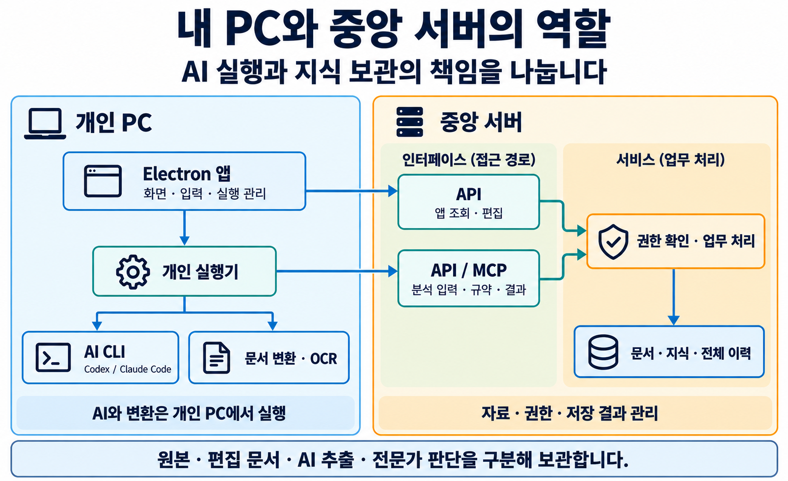
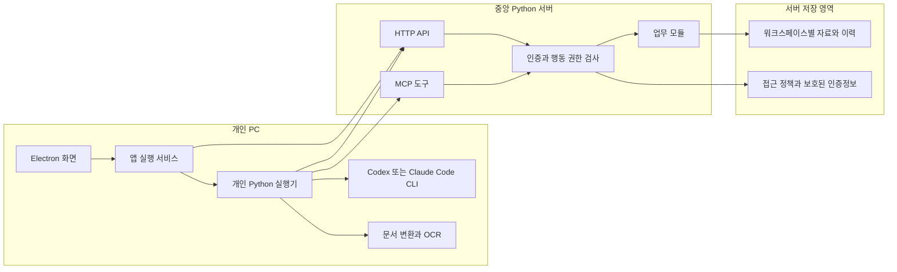
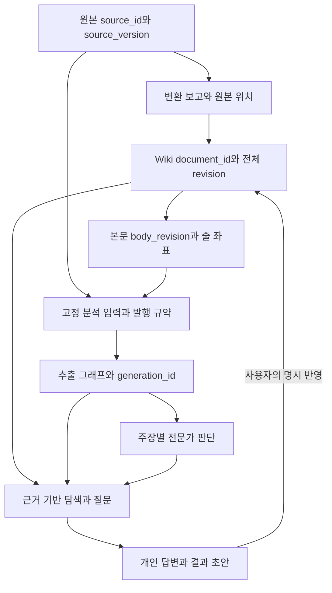

# LLM Wiki 시스템과 데이터 구조

기준일: 2026-10-30

LLM Wiki는 문서와 지식을 보관하는 중앙 서버, 사용자가 작업하는 데스크톱 앱, 개인 PC에서 AI와 파일 변환을 실행하는 실행기로 구성한다. 중앙 서버는 원문·판본·권한·검토·저장 결과를 관리하고, 개인 실행기는 서버가 고정한 입력으로 AI 작업을 수행한다.

## 1. 시스템 구성



앱은 조회·편집을 요청하고 개인 실행기는 AI CLI와 변환기를 실행한다. 두 경로 모두 서버의 권한·업무 검사를 거쳐 저장 영역에 접근한다. ‘개인 PC에서 실행’은 CLI와 변환기의 실행 위치이며 AI 모델 자체의 오프라인 구동을 뜻하지 않는다. 아래 도식은 같은 구조를 구성 요소별로 펼친 것이다.



서버는 업무별 모듈을 하나의 배포 단위로 묶은 구조다. HTTP API와 MCP는 같은 접근 정책과 업무 모듈을 호출한다. API는 `/api/v1`, 원격 MCP는 `/mcp`로 제공한다. MCP는 로컬 stdio 연결도 지원한다.

앱의 일반 조회·편집은 HTTP API를 사용한다. 개인 실행기는 작업 종류에 맞는 API 또는 MCP를 통해 입력을 받고 결과를 제출한다. 분석 실행기는 MCP의 규약·고정 입력·저장 계약을 사용하며, AI CLI의 출력은 검증을 거쳐 서버에 전달한다. 서버 프로세스가 AI CLI나 파일 변환기를 직접 실행하지 않는다.

### 코드의 책임

| 위치 | 책임 |
| --- | --- |
| `app/src/renderer/` | 화면, 입력, 탐색, 결과와 상태 표시 |
| `app/src/main/` | 서버 연결, OS 보호 저장, 개인 실행 관리, 창과 실행 수명 |
| `core/runtime/` | 서버 조립, 실행 설정, 데스크톱 브리지, 프로세스 관리 |
| `core/api/` | HTTP 요청·응답과 업무 라우팅 |
| `core/mcp/` | MCP 도구·입력 검증·응답과 업무 라우팅 |
| `core/modules/` | 도메인별 업무 규칙, 저장, 검증, 조회 |
| `core/client/` | 개인 PC의 서버 통신, AI 실행, 입력 조립, 파일 변환 |
| `core/common/` | 정규 JSON, 해시, 공통 경로 등 기술 도구 |
| `tools/` | 서버 준비·진단·분석·질문·변환·규약 발행의 실행 명령 |

진입점과 실행 방법은 [Python 코드 길잡이](../../core/README.md), [프로젝트 실행 안내](../../README.md), [앱 실행 안내](../../app/README.md)를 따른다.

## 2. 업무 도메인

| 도메인 | 소유 데이터와 역할 |
| --- | --- |
| access | 사용자, 워크스페이스 소속, 행동 권한, 인증, 접근 기준 |
| sources | 등록 원본, 원본 판본, 파일 특성, Wiki 문서 연결 |
| documents | 편집 가능한 Markdown, 문서 메타데이터, 전체 파일 이력, 작성 원장 |
| ontology | 문서 판본에 근거한 개체·관계·속성·후보와 추출 그래프 |
| reviews | 전문가 검토, 정정, 업무 정책, 관계 추가, 정리 표시, 되돌림 기록 |
| correspondences | 문서 사이의 명시적 대응과 그 근거·판단 |
| knowledge | 개념·맥락·문서 연결·변경 영향을 함께 조회하는 통합 계층 |
| extraction_rules | 발행한 추출 규약·스키마·의미 지침과 허용 정책 |
| analysis_jobs | 분석 접수, 진행 상태, 작업 소유권과 실행 사용권, 취소 |
| analysis_inputs | 원문·규약·맥락·검토 상태를 특정 판본으로 고정한 입력 |
| analysis_results | 제출 검증, 문서·그래프 저장, 저장 영수증과 진단 |
| analysis_plans·analysis_proposals | 명시적 고급 분석 계획, 저장 전 추출안의 검토·적용 |
| personal | 개인 대화·질문 실행·저장 결과·초안·비교와 지식 대조 기록 |

업무 모듈은 원본, 추출, 사람의 판단을 각각 관리한다. 예를 들어 전문가 정책은 원문 수정으로 취급하지 않으며, AI의 문서 간 유사성 후보는 확정된 대응 관계와 구분한다.

## 3. 데이터 계보와 식별자



| 값 | 의미와 사용처 |
| --- | --- |
| `tenant`·`workspaceId` | 자료가 속한 작업 공간의 안정 식별자. 표시 이름과 구분한다. |
| `user_id` | 서버가 검증한 사용자 식별자. 개인 기록 소유권의 기준이다. |
| `source_id`·`source_version` | 등록 원본과 특정 불변 판본. 같은 파일명도 별도 원본일 수 있다. |
| `document` | `주제/문서.md` 형태의 Wiki 상대 경로. 문서 조회·저장에 사용한다. |
| `document_id` | 서버가 관리하는 문서 ID. 그래프·검토 원장과 문서를 연결한다. |
| `revision` | Front Matter를 포함한 전체 파일 바이트의 SHA-256. 읽은 내용과 함께 받고 저장 충돌 검사에 사용한다. |
| `body_revision` | Front Matter를 제외한 본문 지문. 전체 파일의 저장 기준을 대신하지 않는다. |
| `source_revision` | 해당 그래프가 근거로 삼은 Wiki 전체 파일의 revision. 원본 파일의 version ID와 다르다. |
| `generation_id` | 그래프 추출 세대를 식별한다. 사람의 판단을 적용할 주장·세대와 현재성을 대조한다. |
| `job_id`·`request_id` | 분석 작업과 개별 접수·저장 요청을 구분한다. 동일 요청의 결과 확인과 중복 방지에 사용한다. |
| `bundle_revision`·규약 참조 | 분석 입력과 발행 규약의 정확한 판본을 식별한다. |
| `access_revision` | 본인의 소속·유효 권한·허용 조회 정의·인증 세대에 따른 접근 기준. 전체 정책 감사용 `policy_revision`과 구분한다. |

### Markdown의 내용과 메타데이터

관리 문서는 Front Matter와 본문을 한 파일에 보관한다. 메타데이터는 `schema_version`, `document_id`, `title`, `tags`와 선택적인 `source`, `description`으로 구성한다. 원본에서 만든 문서의 `source`에는 변환에 사용한 원본의 ID와 판본을 기록한다.

`title`, `tags`, `description`은 편집할 수 있다. 문서 ID와 원본 연결은 서버가 생성·검증한다. 작성자·권한·검토 상태·작업 진행 상태는 서버 기록으로 관리한다. 사용자가 편집할 수 있는 문서 메타데이터만으로 작성 신원을 판정하지 않는다.

분석 근거는 본문에서 찾는다. 근거 줄 번호와 앵커는 전체 파일의 1부터 시작하는 좌표를 사용하며, `body_start_line`으로 본문 시작 위치를 알 수 있다. 메타데이터가 없는 문서도 원문 그대로 읽을 수 있다.

현재 그래프는 근거 `source_revision`과 현재 문서 revision이 일치해야 한다. 서로 다르면 `stale`과 재추출 필요 상태를 반환한다. 문서가 바뀌었다는 이유로 옛 그래프나 전문가 판단을 새 본문에 자동 적용하지 않는다.

## 4. 파일 저장 구조

```text
data/<workspaceId>/
  wiki/<문서상대경로>
  _history/<문서상대경로>/
    <시각>-<고유값>.md
    changes.json
  _sources/<sourceId>/
    catalog.json
    versions/<versionId>/
      original
      manifest.json
  _knowledge/
    graphs/<documentId>.json
    reviews/<documentId>.json
    correspondences/<id>.json
  _personal/<userId>/
    analysis/<jobId>/
    conversations/
    question-runs/
    saved-results/
    result-drafts/
    comparisons/
    knowledge-comparisons/
    _requests/
```

위 구조는 자료별 대표 위치다. 문서 상대 경로는 `.md` 확장자를 포함한다. 잠금·입력·저장 확인에 필요한 내부 파일도 저장 상태의 일부다. 원본 판본은 불변으로 보관하며, `wiki/`에는 현재 편집 문서를, `_history/`에는 수정 전 전체 파일을 보관한다. `_knowledge/`는 문서에서 파생된 지식과 사람의 판단, `_personal/`은 사용자별 작업과 결과를 맡는다.

접근 정책과 보호된 인증정보는 자료 루트 밖 `.local/tenancy/`에 둔다. 규약 저장소와 허용 정책도 별도 설정으로 지정한다. 개인 PC에는 연결 설정, AI 실행 환경, 보호된 작업 파일과 세션 참조가 있으며 중앙 문서 저장소와 책임을 구분한다.

저장 경로는 검증된 식별자와 상대 문서 경로로 만든다. 자료 루트 밖 경로, 경로 순회, 심볼릭 링크를 통한 접근을 거부한다. 동일 자료가 둘 이상의 저장 위치에 발견되면 임의 합치기나 덮어쓰기를 수행하지 않고 충돌을 드러낸다.

## 5. 저장과 동시성 계약

문서 변경은 `WikiStore.read()`가 반환한 본문과 revision을 기준으로 작성하고, `WikiStore.save(expected_revision=...)`로 반영한다. 신규 문서에만 `expected_revision=None`을 사용한다.

저장은 다음 순서로 처리한다.

1. 대상 경로·크기·현재 권한을 확인하고 저장 잠금을 획득한다.
2. 읽은 기준 revision과 현재 파일을 비교한다.
3. 새 내용과 수정 전 전체 파일의 보존을 준비한다.
4. 전체 이력을 확정하고 작성 원장의 변경 의도를 기록한다.
5. 새 파일을 원자적으로 공개하고 작성 기록을 확정한다.
6. 새 revision, 이력 참조, 변경 여부, 정리·감사 상태를 반환한다.

이력 보존에 실패하면 현재 문서를 교체하지 않는다. 충돌 검사에 통과한 동일 내용은 불필요하게 다시 쓰지 않는다. 문서 한 개의 크기는 UTF-8 기준 1 MiB까지이며, 제한을 넘는 내용을 자동으로 자르지 않는다.

분석은 문서 저장과 그래프 저장을 별도 결과로 기록한다. 문서 저장 후 그래프가 실패할 수 있고, 추출 저장 후 기존 지식 대조가 실패할 수 있다. 각 단계의 실제 저장 영수증으로 완료를 판단하며 후속 실패 때문에 성공한 앞 단계를 다시 저장하지 않는다.

| 상태 | 처리 계약 |
| --- | --- |
| `conflict` | 최신 본문을 다시 읽고 변경 내용을 검토해 반영한다. 옛 내용의 버전값만 교체하지 않는다. |
| `storage_busy` | 동일 기준 revision을 유지한 채 나중에 재시도할 수 있다. |
| `cleanup_failures` | 저장 성공과 임시 파일 정리 문제를 구분한다. 정리 경고 때문에 쓰기를 자동 재시도하지 않는다. |
| `audit_status=pending_reconcile` | 본문 저장 성공과 작성 원장 확정 대기를 구분한다. |
| 저장 응답 유실 | 같은 요청의 영수증·서버 결과를 확인한다. 확인되지 않은 상태를 성공이나 실패로 단정하지 않는다. |
| `stale` | 근거가 된 문서 판본과 현재 판본이 다르다. 현재 본문으로 재추출할 대상으로 표시한다. |
| `truncated`·`skipped` | 검색·조회가 불완전하다는 정보를 결과에 유지한다. |

파일 단위 원자 공개와 업무별 확인 기록을 사용한다. 여러 파일을 하나의 데이터베이스 트랜잭션으로 일괄 커밋하는 구조는 아니므로, 부분 성공과 확인 대기를 정상적인 상태 모델에 포함한다.

## 6. 사용자와 권한

현재 인증은 최대 5명의 소규모 PoC를 위한 이름 기반 가입·로그인이다. 비밀번호·SSO·Access/Refresh Token 교환은 제공 범위에 포함하지 않는다. 사용자마다 하나의 토큰을 유지하며 재로그인은 같은 토큰을 반환한다. 없는 이름의 로그인 요청을 자동 가입으로 처리하지 않는다.

토큰 없이 허용하는 업무 경로는 정확한 `POST /api/v1/auth/signup`과 `POST /api/v1/auth/login`이다. 나머지 업무 API와 MCP는 인증을 요구한다. 토큰 해시는 정책에, 재로그인에 필요한 암호화 토큰과 키는 보호된 영역에 보관한다. 토큰 응답은 캐시하지 않는다.

| 권한 | 허용 작업 |
| --- | --- |
| `read` | 허용된 공간의 자료 조회 |
| `source_write` | 원본 등록과 관련 분석 접수 |
| `write` | Wiki 본문 변경 |
| `ontology_write` | 기계 추출 그래프 저장 |
| `ontology_review` | 전문가 검토·정정 등 검토 작업 |
| `ontology_policy` | 전문가 업무 정책 관리 |
| `conversation_write` | 개인 대화 기록 |
| `result_write` | 개인 결과와 초안 기록 |
| `comparison_write` | 개인 비교 기록 |

서버는 인증 사용자, 대상 워크스페이스, 요청 행동, 개인 자료의 소유권을 확인한다. AI 출력이나 요청 본문의 사용자 이름으로 권한을 정하지 않는다. 위키에 적힌 명령이나 링크도 권한 부여 지시로 취급하지 않는다.

PoC 앱은 허용된 워크스페이스의 기본 중립 조회를 사용한다. 화면에서 역할별 관점을 선택하는 기능은 제공하지 않는다. API/MCP의 `profile` 계약은 보존하지만 접근 권한을 대신하지 않으며, 원문 주장의 맥락 정보와도 구분한다.

앱은 연결 인증정보를 OS 보호 저장으로 보관하고 재시작 시 접근 기준을 확인한다. 로그아웃은 현재 PC의 활성 연결과 자동 복원을 해제한다. 이름과 서버 주소, 서버의 개인 토큰은 별도 수명을 갖는다.

## 7. 실행과 검증 범위

데스크톱 클라이언트의 지원 대상은 macOS와 Windows이며, 중앙 Python 서버는 macOS·Linux와 Windows 호스트의 WSL2 구성을 대상으로 한다. 개인 실행기는 Codex 또는 Claude Code를 선택한다. 제공자 로그인과 실행 권한은 개인 PC의 환경에 속한다.

실제 Codex의 추출·저장·동일 세션 대조와 Mac의 API/MCP·앱 조회는 검증된 범위다. Claude의 실제 전체 흐름은 제공자 사용량 제한으로 성공 검증이 남아 있으며, Windows 설치·WSL2 운영·별도 PC의 연결은 환경별 실제 검증이 필요하다. 어댑터 구현, 격리 시험, 실제 모델 실행, 설치 환경 검증을 각각 구분한다.

실행 명령과 준비 절차는 [README](../../README.md), 현재 검증 범위는 [플랫폼 계획](../domains/platform/PLAN.md)과 [분석 계획](../domains/analysis/PLAN.md)에서 확인한다.

## 8. 상세 계약과 구현 위치

- [서버 조립](../../core/runtime/application.py) · [HTTP 라우터](../../core/api/router.py) · [MCP tenant 서버](../../core/mcp/tenant.py)
- [공통 저장 경로](../../core/common/storage_layout.py) · [문서 저장](../../core/modules/documents/store.py) · [문서 메타데이터](../../core/modules/documents/metadata.py)
- [원본 저장](../../core/modules/sources/store.py) · [그래프 저장 위치](../../core/modules/ontology/storage.py) · [그래프 현재성](../../core/modules/ontology/snapshots.py)
- [개인 기록 저장](../../core/modules/personal/store.py) · [고정 분석 기준](../../core/modules/analysis_inputs/basis.py)
- [인증 정책](../../core/modules/access/policy.py) · [인증 서비스](../../core/modules/access/auth.py) · [접근 규칙](../domains/access/RULES.md)
- [문서 계약](../domains/documents/DECISIONS.md) · [원본 계약](../domains/sources/DECISIONS.md) · [분석 계약](../domains/analysis/DECISIONS.md)
