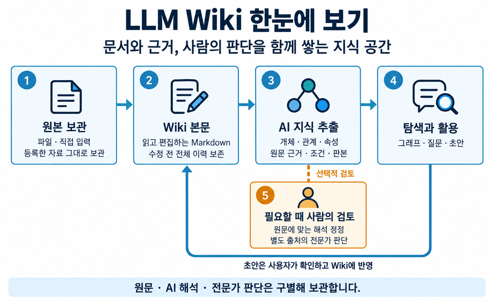
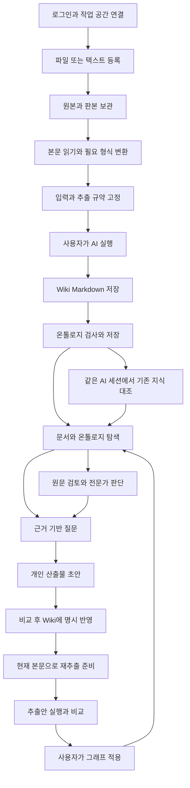
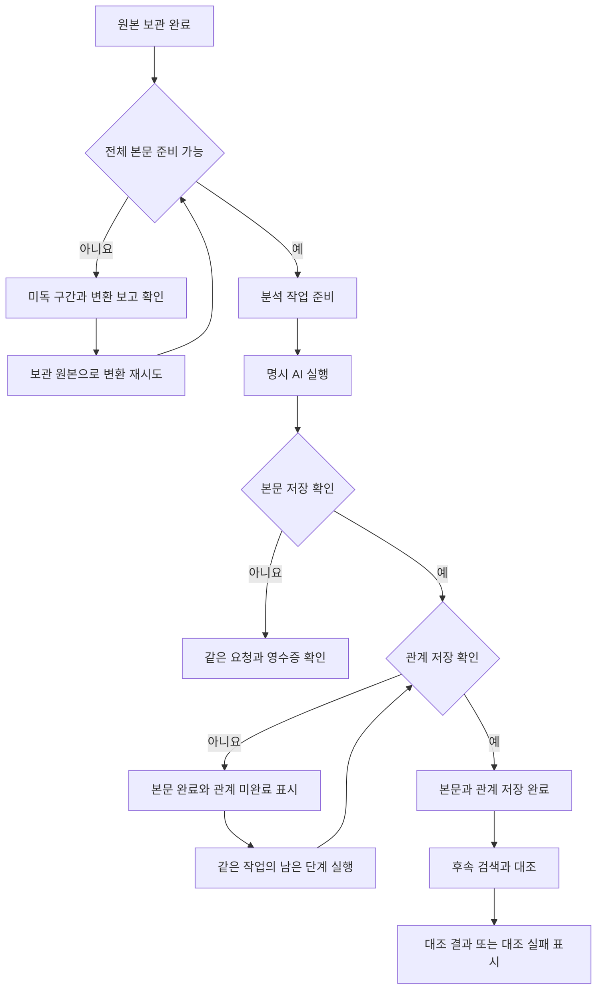
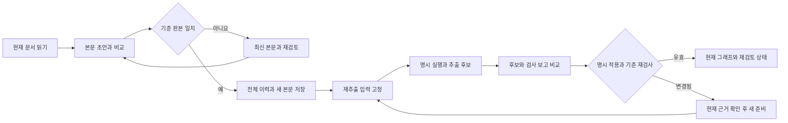
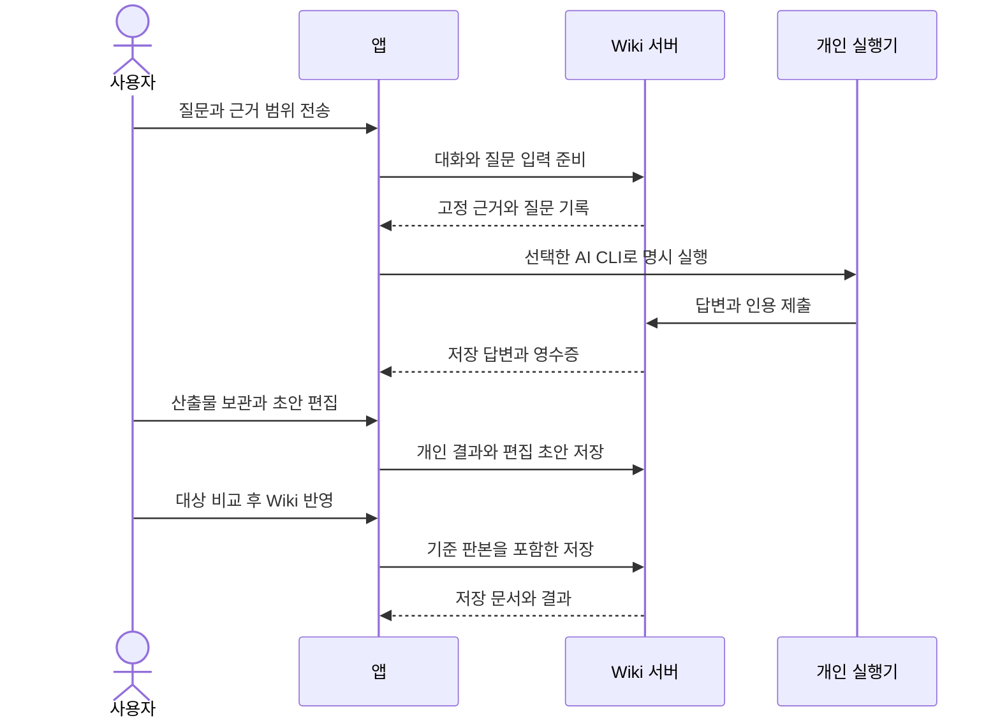

# LLM Wiki 기능 흐름

기준일: 2026-10-30

LLM Wiki의 작업은 자료 등록, 지식 추출, 사람의 검토, 질문·문서 활용으로 이어진다. 각 단계는 원본·본문·추출·판단의 출처와 판본을 유지한다. 화면을 여는 행동과 AI 실행, AI 결과 생성과 서버 저장, 개인 초안과 공유 Wiki 반영은 별도의 단계이다.

기능 ID와 제공 범위는 [기능 명세](FEATURES.md), 추출 단계의 의미 정책은 [추출 방침](EXTRACTION.md), 구성 요소와 데이터 책임은 [시스템 구조](ARCHITECTURE.md)를 따른다.

## 1. 전체 업무 흐름

위 그림은 제품의 개념 흐름이다. 실제 등록 준비·명시 실행·저장·재추출의 단계는 아래 도식과 각 절에서 구분한다.

이 흐름에서 검토는 사용자가 선택하는 업무이다. 모든 추출 결과를 사용하기 전에 사람의 승인을 의무화하지 않는다. 미검토 결과를 활용할 때는 그 상태와 원문 근거를 함께 제시한다.

## 2. 로그인과 실행 준비

관련 기능: F-01~F-04

1. 사용자는 서버 주소와 이름으로 가입하거나 로그인한다.
2. 앱은 서버가 허용한 사용자·작업 공간·업무 권한을 확인한다. 인증 완료 후 업무 화면을 표시한다.
3. 사용자는 설정에서 작업 공간과 개인 AI 실행 환경을 확인한다. 앱은 공간의 기본 조회를 사용하며 역할별 관점을 선택하지 않는다.
4. Codex 또는 Claude Code를 선택하고 실행 경로·모델·필요한 변환 환경을 진단한다. Wiki 계정과 AI CLI의 로그인 상태는 각각 확인한다.
5. 연결이 준비되면 문서 조회·편집을 사용할 수 있다. AI 작업은 사용자가 실행을 요청할 때 시작한다.

인증·권한 확인 실패는 접속 가능한 다른 공간으로 우회하지 않는다. 로그아웃은 오프라인에서도 연결을 무효화한다. 서버·계정·공간이 바뀌면 이전 범위의 화면과 늦은 응답을 새 범위에 표시하지 않는다.

**완료 결과:** 허용된 작업 공간과 현재 연결 상태. AI 환경 진단 완료는 특정 질문이나 추출의 성공을 의미하지 않는다.

## 3. 새 자료 등록과 추출

관련 기능: F-05~F-09

**시작 조건:** 허용된 작업 공간, 원본 등록·문서/온톨로지 저장에 필요한 권한, 사용할 추출 규약, 준비된 개인 실행 환경.

1. 문서 목록에서 자료 등록을 열고 제목과 파일 또는 텍스트를 입력한다.
2. 서버는 원본과 판본을 보관한다. 이 시점에는 원본 등록이 완료된 것이다.
3. 사용자가 ‘Markdown 준비 시작’을 선택한다. MD·TXT는 내용을 직접 사용하고 PDF·문서·스프레드시트·이미지는 개인 PC에서 변환해 보고와 원문 위치를 보관한다.
4. 완료로 보고된 변환 결과의 저장을 확인한 뒤 단일 Markdown 대상의 분석 작업을 준비한다. 변환 완료 상태가 원문 전체 포함과 의미 정확도를 보증하지는 않는다. 원본 판본·변환 참조·대상·규약을 고정한다.
5. 준비가 완료되면 사용자가 ‘AI 본문 준비·관계 추출 실행’을 선택한다. 개인 CLI는 고정 입력으로 Markdown을 준비하고 서버에 저장한 뒤 온톨로지를 추출·검사·저장한다.
6. 앱은 본문·관계의 실제 저장 영수증을 읽어 완료 여부를 표시한다. 생성 Wiki와 원본 판본, 분석 작업을 서로 연결한다.
7. 개인 CLI에서 새 추출의 저장이 확인되면 같은 AI 세션에서 기존 지식 검색·대조를 수행하고 결과를 별도로 보관한다. 일반 MCP 그래프 저장 자체가 이 후처리를 자동 실행하지는 않는다.

변환 일부 성공은 전체 입력 준비 완료가 아니다. 본문 저장 후 관계 추출이 실패하면 본문을 다시 쓰지 않고 남은 작업을 확인한다. 저장 응답이 유실됐으면 같은 요청을 조회해 결과를 확인한다. 대조 실패는 이미 저장한 추출을 실패로 바꾸지 않는다.

**완료 결과:** 원본·변환 보고와 연결된 Wiki, 해당 본문 판본의 온톨로지, 단계별 영수증. 추출된 관계의 초기 상태는 AI 추출·미검토이다.

## 4. 저장한 추출과 기존 지식의 대조

관련 기능: F-09~F-10, F-22

1. 개인 CLI는 저장한 대상 그래프의 표현을 검색 단서로 사용한다.
2. 같은 AI 세션이 검색 결과의 선택 주장·근거를 읽고, 필요한 문서 전체 읽기와 재검색을 요청한다.
3. 실행별 조회 한도는 첫 검색·추가 읽기·재검색을 합해 5회이다. 후보 수·응답 크기 등으로 빠진 범위는 결과에 남긴다.
4. 후보와 제외 이유, 사용한 근거 참조, 미확인점, 미판정 항목을 개인 실행 기록에 보관한다.
5. 사용자는 분석 작업 상세 또는 AI 세션에서 최신·이전 결과와 근거를 확인한다.
6. 원문이나 판단이 달라졌으면 재확인 필요 상태를 읽고, 원할 때 검색·대조 다시 실행을 요청한다. 새 실행은 현재 대상 자료를 같은 AI 세션에 전달한다.

재실행에는 실제 추출에서 보관한 로컬 세션 기록이 필요하다. 제공자·서버·사용자·작업 공간·대상 기준이 맞지 않거나 대상 그래프가 오래됐으면 모델 호출을 시작하지 않는다. 동일 세션에서 대조를 중복 실행하지 않는다.

**완료 결과:** 확인 범위와 한계를 가진 비교 결과. 이 결과는 문서 간 대응 후보를 검토하는 자료이며 개체 동일성, 확정 대응, 전문가 승인으로 자동 적용되지 않는다.

## 5. 본문 편집과 재추출

관련 기능: F-11~F-15

### 본문 편집

1. Wiki 상세에서 현재 본문·메타정보·판본을 읽고 편집을 시작한다.
2. 제목·설명·태그·본문을 한 초안으로 수정하고 저장 전 줄별 비교를 확인한다.
3. 서버는 읽은 기준 판본이 현재 파일과 같은지 검사한다. 수정 전 전체 파일을 보존한 다음 새 파일을 저장한다.
4. 앱은 저장한 문서와 작성 이력을 표시한다. 기존 온톨로지가 다른 본문 판본에 근거하면 오래됨 상태를 표시한다.

충돌 시 원래 초안을 보존하고 최신 본문과 대조한다. 사용자는 최신 본문을 기준으로 내용을 검토·재작성한 뒤 저장한다. 판본 번호만 교체해 옛 내용을 재전송하지 않는다. 줄별 비교는 파일의 원문과 줄바꿈을 바꾸지 않는다.

문서 이력에서 과거 전체 파일과 현재 본문을 비교한 뒤 ‘이 판본으로 복원’을 선택한다. 수정 권한과 미저장 초안 여부를 확인하고, 현재 기준 판본으로 복원을 요청한다. 복원 직전 파일을 이력에 남기는 새 저장이며 문서 ID는 유지한다. 등록형 판본은 당시 제목·태그·원본 판본도 복원하고, 문서 정보가 없는 구판은 현재 문서 정보를 유지한다. 충돌·응답 유실은 자동 재요청하지 않고 현재 본문을 다시 읽어 비교한다. 저장 성공 뒤 재조회만 실패한 경우에도 성공 영수증을 보존한다. 과거 온톨로지나 검토 승인을 함께 복원하지 않는다.

### 재추출안 실행과 적용

1. 저장된 Wiki의 AI 작업에서 새 추출 준비를 선택한다.
2. 서버가 현재 본문·그래프·검토 상태로 입력을 고정한다. 준비 단계는 모델을 실행하지 않는다.
3. 사용자가 개인 CLI 실행을 시작하고 추출 후보·검사 보고를 확인한다.
4. 추출안 화면에서 고정 기준과 후보를 비교하고 적용할 결과를 명시한다.
5. 서버는 현재 원문·검토 상태와 권한을 다시 검사한 뒤 전체 그래프를 저장한다.
6. 앱은 적용 결과를 표시한다. 과거 검토와 전문가 판단은 이력에 남고 새 근거에 대한 재검토 상태를 갖는다.

현재 후보와 정확히 연결된 진단은 경고·누락·미독 범위와 개별 의견의 이유·권고·질문으로 표시한다. 고정 원문의 줄·인용과 실제 후보 대상을 대조한 뒤 기존 전체 추출안 편집 위치로 이동할 수 있다. 이동은 제출이나 재추출을 시작하지 않는다. 오래된 보고·잘못된 인용·없는 대상은 현재 검토 행동에 연결하지 않고 원본 보고를 보존한다. 진단 의견을 사람 승인이나 현재 그래프의 주장 ID로 바꾸지 않는다.

**완료 결과:** 새 본문 판본, 보존된 전체 이력, 명시 적용한 그래프. 본문 저장과 그래프 갱신의 완료는 독립적으로 확인한다.

## 6. 관계 검토와 전문가 판단

관련 기능: F-16~F-20

1. 온톨로지 지도·목록에서 문서와 관계 또는 속성을 선택한다. 상세는 값·조건·범위·시점·근거·현재 판단을 읽는 상태로 열린다.
2. 사용자는 원문 근거 검토, 주장 정정, 전문가 업무 판단 중 목적에 맞는 작업을 선택한다.
3. 원문 근거 검토와 정정에서는 실제 인용과 전체 한정어를 대조한다. 전문가 업무 판단에서는 판단 내용·적용 범위·이유를 입력한다.
4. 서버는 작업 종류별 권한과 현재 상태를 검사하고 별도 검토 원장에 이벤트를 기록한다.
5. 앱은 현재 적용값과 출처, 검토 기록을 다시 읽는다. 미검토·기각·보류·과거 판단도 구분해서 확인한다.
6. 되돌림은 해당 최신 변경의 대상과 현재 기준을 확인한 뒤 새 이벤트로 기록한다.

| 작업 | 사용하는 근거 | 저장 결과 |
| --- | --- | --- |
| 원문 검토·정정 | 원문 인용, 조건·범위·출처 | 원문에 대한 해석 판단과 이력 |
| 전문가 업무 판단 | 사용자가 실제 정한 내용, 이유, 적용 범위 | 원문과 구별되는 정책 이벤트와 적용 상태 |
| 독립 관계 추가 | 한 문서의 기존 개체, 원문 인용 또는 전문가 이유 | 고유한 추가 관계와 출처·이력 |

독립 관계는 문서별 온톨로지의 새 관계 작성에서 만든다. 주어와 목적어는 해당 문서의 현재 개체에서 고른다. 새 개체 생성과 임의 문서 간 연결은 이 흐름에 포함하지 않는다. 추가한 관계를 변경하려면 되돌린 뒤 새 추가로 기록한다.

**완료 결과:** 원문·기계 추출을 보존한 현재 판단과 감사 이력. 인용 검사 통과와 권한 있는 저장만으로 의미의 진위나 실제 사람의 확인을 자동 증명하지 않는다.

## 7. Clean Up과 표시 정리

관련 기능: F-21

1. 문서별 온톨로지에서 Clean Up을 연다.
2. 서버 미리보기에서 정리 가능한 항목, 현재 판단, 근거, 처리할 수 없는 이유를 확인한다.
3. 사용자가 항목을 직접 선택하고 이유를 입력한다. 전체 문서의 관계를 자동 선택하지 않는다.
4. 서버는 미리보기 기준과 요청을 검사하고 현재 목록 표시의 정리를 기록한다.
5. 적용 영수증과 정리 이력을 확인한다. 되돌리기는 해당 선택을 복원하는 역이벤트로 남긴다.

정리는 원문·원시 주장·검토 이력의 삭제가 아니다. 기각 관계 정리는 사실의 논리적 부정을 추가하지 않으며 과거 판단 정리는 새 추출로 승인을 넘기지 않는다. 응답이 확인되지 않으면 같은 영수증을 조회하고 정리를 반복하지 않는다.

**완료 결과:** 정리된 현재 목록과 보존된 원장, 적용·되돌림 기록.

## 8. 문서 간 대응 관리

관련 기능: F-22~F-24. 이 절은 API·MCP의 업무 흐름이며 현재 앱에 별도 문서 간 관계 화면은 노출하지 않는다.

1. 허용된 공간에서 두 문서의 조건과 개념을 찾고 각각의 원문·판본·인용을 읽는다.
2. 두 표현의 존재와 그 둘을 연결하는 근거를 구별한다. 정의 문서 또는 실제 전문가 판단이 없으면 확인 질문을 가진 후보로 남긴다.
3. 대응을 준비하면서 양쪽 자료와 실제 의존하는 정의·그래프·판단의 기준을 고정한다.
4. 원문 근거 검토 또는 전문가 판단의 권한·근거로 수용·수정·거절·보류를 기록한다.
5. 질문에 사용할 때 현재 수용 상태, 근거 판본, 방향, 적용 범위, 조건과 예외를 다시 확인한다.
6. 근거가 변경되면 과거 판단을 보존하고 재검토 상태로 표시한다. 되돌림도 현재 기준을 검사한 새 이벤트이다.

예를 들어 “판매 가능 재고가 1개 이상 5개 이하이면 매진 임박”이라는 정의는 조건에서 개념으로 가는 방향을 가진다. 이 대응 하나를 수용해도 모든 매진 임박 상품의 재고 범위, 실제 상품의 현재 재고, 다른 문서의 출고 방침까지 함께 승인되는 것은 아니다.

**완료 결과:** 방향·범위·근거와 현재 적용 가능 상태를 가진 대응 판단. 개체 자동 병합이나 업무 실행은 수행하지 않는다.

## 9. 근거 기반 질문과 산출물

관련 기능: F-25~F-29

1. AI 채팅에서 질문을 작성하거나 문서 상세의 질문 행동으로 대상 문서를 질문 범위에 넣는다.
2. 전송하면 현재 허용 자료·판단·선택 근거를 확인하고 이번 질문의 입력을 고정한다. 후속 질문은 앞선 대화 턴을 문맥으로 함께 고정한다.
3. 선택한 개인 CLI에서 답변을 생성한다. 현재 검색 범위에서 관련 근거를 찾지 못하면 그 상태를 알린다.
4. 생성 중 답변과 서버에 저장된 답변을 구별한다. 사용자는 저장 답변의 인용과 해당 원문을 확인한다.
5. 답변을 산출물로 보관하면 원래 결과를 유지한 채 별도 개인 초안을 만든다.
6. 사용자는 제목·본문을 편집하고 반영할 Wiki와 비교한다. 명시 반영에서 서버가 기준 판본을 검사하고 전체 이력과 함께 저장한다.
7. 저장한 Wiki를 열어 결과를 확인한다. 본문이 달라진 경우 관계의 현재성을 확인하고 필요한 재추출을 준비한다.

이전 AI 답변은 지시 대상과 대화를 이해하기 위한 문맥이다. 이번 질문의 사실과 인용을 대신하지 않으며 사람의 승인으로 바뀌지 않는다. 산출물 보관·초안 저장·Wiki 반영도 각각 다른 결과이다.

Electron과 로컬 웹 테스트에서는 현재 산출물 본문을 Markdown으로 내려받을 수 있다. Electron 저장 창에서 새 이름·위치를 선택하며 기존 파일은 덮어쓰지 않는다. 취소·저장 실패는 편집 본문과 서버 저장 상태를 바꾸지 않는다. 범용 문서 파일 생성은 현재 제공하지 않는다. 원본 파일·변환 첨부 다운로드는 원본 상세의 별도 기능이다.

**완료 결과:** 근거가 연결된 저장 답변, 원래 결과와 분리된 편집 초안, 사용자가 반영한 경우의 Wiki 저장 결과.

## 10. 여러 작업과 앱 수명

관련 기능: F-30~F-33

- 질문·분석·재추출·대조를 서로 다른 작업으로 실행하고 AI 세션 목록에서 상태와 대상을 확인한다. 개별 중단은 선택한 실행에 적용한다.
- 다른 화면이나 대화로 이동해도 진행 중 실행과 입력을 유지한다. 다른 작업의 완료가 현재 화면을 자동으로 바꾸지 않는다.
- Electron 창 닫기는 창을 숨긴다. 앱을 명시 종료하면 진행 중 작업을 확인한 뒤 실행 정리와 종료를 수행한다.
- 복귀 시 이미 저장한 결과와 미확인 요청을 읽는다. 저장된 실행을 여는 것만으로 새로운 AI 호출이나 쓰기를 시작하지 않는다.
- 계정 한도는 제공자가 실제 반환한 값으로 표시한다. 실행 토큰, 실행 개수, 계정 잔여 한도는 서로 다른 값이다.

실행 중단 위치를 임의로 이어가는 자동 재개는 제공하지 않는다. 등록 분석은 같은 작업의 확인된 남은 단계로 재개하며, 지식 대조는 보호된 원래 AI 세션 조건을 충족할 때 재실행한다.

## 11. 실패와 부분 완료의 공통 처리

| 상황 | 사용자에게 보여 줄 상태 | 다음 행동 |
| --- | --- | --- |
| 원본 보관 후 변환 실패 | 원본 보관 완료, 미독·변환 실패 | 보관한 원본과 보고를 확인하고 변환만 재시도 |
| 본문 저장 후 관계 추출 실패 | 본문 완료, 관계 미완료 | 같은 작업의 영수증을 확인하고 남은 단계 실행 |
| 추출 저장 후 대조 실패 | 추출 완료, 대조 실패 | 저장한 그래프를 유지하고 대조 조건 확인 |
| 저장 응답 유실 | 저장 미확인 | 같은 요청 ID의 상태·영수증 조회 |
| 판본 충돌 | 입력 보존, 현재 기준과 불일치 | 최신 원문·판단과 대조해 작업 재준비 |
| 잠금 시간 초과 | 저장소 사용 중 | 원래 기준을 유지하고 나중에 재시도 |
| 저장 성공 후 임시 정리 실패 | 저장 완료와 정리 경고 | 같은 쓰기를 반복하지 않고 정리 문제 확인 |
| 권한·계정·공간 변경 | 기존 범위의 실행·결과 접근 중단 | 현재 접근 범위를 다시 확인 |
| 검색·대조의 한도 또는 누락 | 조회 범위 불완전 | 근거·누락 사유를 확인하고 필요한 범위 추가 조회 |
| 중단 또는 앱 명시 종료 | 중단과 저장된 결과 구별 | 보존한 기록을 읽어 재실행 가능 단계 판단 |

## 12. 구현 참조

- [등록·부분 완료·재개](../../app/src/renderer/features/import-document-content/model/ImportProcessingSession.ts)
- [본문 편집](../../app/src/renderer/features/manage-document-content/model/useDocumentEditing.ts), [문서 재추출](../../app/src/renderer/features/manage-document-content/model/useDocumentExtraction.ts), [추출안 화면](../../app/src/renderer/features/review-analysis-proposals/ui/AnalysisProposalWorkspace.tsx)
- [검토 규칙](../domains/reviews/RULES.md), [지식 조회 규칙](../domains/knowledge/RULES.md), [문서 간 대응 계약](../domains/correspondences/DECISIONS.md)
- [채팅 화면](../../app/src/renderer/features/chat-with-knowledge/ui/KnowledgeChat.tsx), [산출물 초안](../../app/src/renderer/features/create-document-artifact/model/useDocumentArtifact.ts)
- [대조 결과 화면](../../app/src/renderer/features/browse-ai-sessions/ui/KnowledgeComparisons.tsx), [AI 세션 이동](../../app/src/renderer/features/browse-ai-sessions/model/sessionPresentation.ts), [Electron 창 수명](../../app/src/main/windows/appLifetime.ts)
