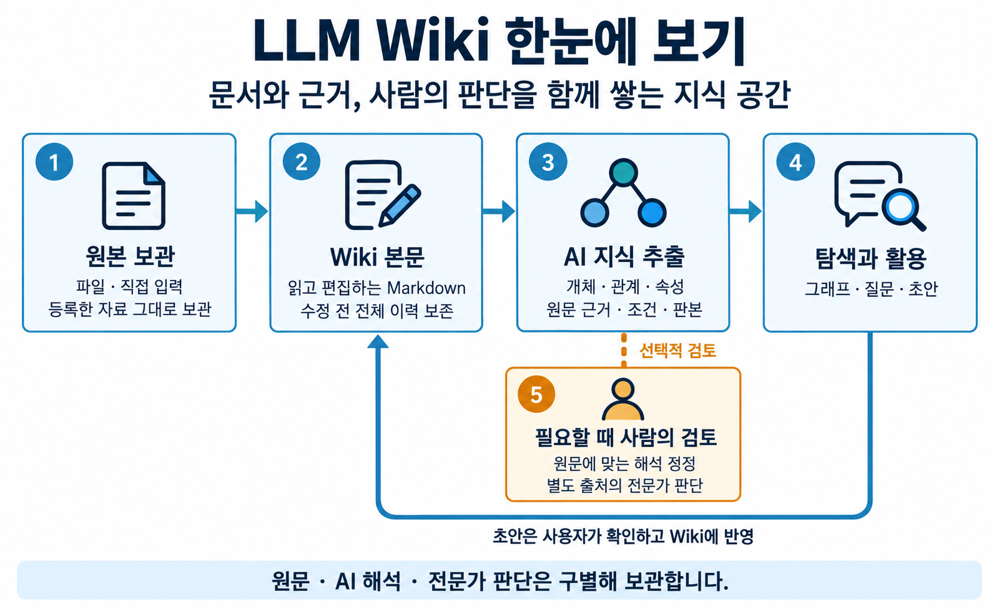
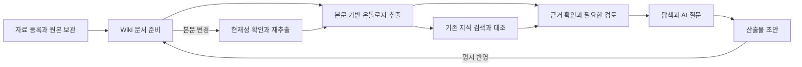

# LLM Wiki 제품 정의

기준일: 2026-10-30

## 제품 개념

LLM Wiki는 사람과 AI가 문서와 업무 지식을 함께 축적하고, 근거를 확인하며 활용하고, 필요한 내용을 갱신하는 공동 지식 공간이다. 문서 본문에 있는 개체·관계·속성·조건을 온톨로지로 표현하고, 사람이 검토한 해석과 업무 판단을 출처와 함께 관리한다.

대화나 AI 세션이 달라져도 허용된 자료와 적용 가능한 판단을 다시 찾을 수 있어야 한다. 답변은 그 근거와 판단 상태를 설명하며, 미검토·불확실·오래됨·조회 누락을 함께 드러낸다.

원본에서 편집 가능한 문서와 근거 있는 지식을 만들고, 활용한 초안은 사용자의 확인을 거쳐 Wiki에 반영한다. 사람의 검토는 필요한 대상에 수행하며 원문·AI 해석·전문가 판단의 출처를 구별한다.

## 해결하는 문제

| 업무에서 필요한 것 | 제품이 제공하는 수단 |
| --- | --- |
| 자료를 보관하고 다시 찾기 | 원본 판본, 편집 가능한 Wiki 문서, 목록과 검색 |
| 문서의 개념과 조건을 구조적으로 읽기 | 본문에 근거한 개체·관계·속성, 그래프와 상세 근거 |
| AI 해석을 사람이 바로잡기 | 원문 검토, 관계·속성 정정, 전문가 판단과 기록 |
| 여러 문서의 관련 내용을 찾기 | 개념 조회, 명시 링크와 연결 후보, 저장 후 기존 지식 대조 |
| 지식을 질문과 결과물에 사용하기 | 문서·온톨로지 기반 AI 대화, 근거 확인, 산출물 초안과 Wiki 반영 |
| 내용 변경 후에도 판단의 근거를 추적하기 | 전체 문서 이력, 기준 판본, 재추출, 과거 판단의 재검토 상태 |

## 사용자와 책임

아래 구분은 업무 책임을 설명한다. 앱의 역할별 화면이나 조회 관점을 뜻하지 않으며, 실제 접근과 작업 허용 여부는 서버 권한으로 결정한다.

| 참여자 | 주요 책임 |
| --- | --- |
| 자료 등록자 | 원본과 제목을 등록하고 변환 결과·미독 범위를 확인한다. |
| 지식 사용자 | 문서와 관계를 탐색하고 질문하며 답변의 근거와 상태를 확인한다. |
| 도메인 전문가 | 원문에 따른 해석 정정과 업무 정책 판단을 구별해 기록한다. |
| 운영 담당자 | 서버 연결, 사용자 접근, 추출 규약과 실행 환경을 관리한다. |
| 개인 AI 실행기 | 허용된 고정 입력과 규약으로 분석·질문·초안을 수행하고 검증된 저장 경로로 결과를 제출한다. |

## 핵심 개념

### 원본과 Wiki 문서

원본은 사용자가 등록한 파일 또는 최초 입력이다. 각 원본 판본은 불변으로 보관하며, 변환 결과와 읽지 못한 범위를 원본 판본에 연결한다.

Wiki 문서는 읽기와 편집에 사용하는 Markdown 문서다. 제목·설명·태그 등 관리 정보와 지식의 근거가 되는 본문을 구별한다. 사용자의 직접 편집과 AI 수정안 반영은 이 문서를 대상으로 한다. 문서를 저장할 때 수정 전 전체 파일을 이력으로 보존한다.

### 온톨로지

온톨로지는 문서 본문이 말하는 대상을 개체로, 대상 사이의 의미를 관계로, 대상의 값이나 설명을 속성으로 표현한 구조다. 각 주장은 근거와 판본을 가진다. 조건·부정·가능성·적용 맥락도 의미의 일부로 취급한다.

예를 들어 설명용 문장인 “냉각 장치는 센서 모듈을 포함한다”에서는 두 대상을 구별하고 포함 관계를 나타낼 수 있다. 같은 문서에 “과열 시 제어기가 냉각 장치를 작동시킨다”가 있으면 과열 조건도 함께 보존해야 한다. 이 예시는 개념 설명용이며 실제 저장 데이터나 승인된 업무 판단이 아니다.

### 원문 근거와 전문가 판단

| 지식의 종류 | 의미 | 근거 |
| --- | --- | --- |
| AI 추출 | AI가 본문을 해석해 구성한 주장 | 문서 본문과 그 판본의 인용 |
| 원문 검토·정정 | 본문에 맞는 해석인지 확인하거나 고치는 행위 | 원문 인용, 검토 이유, 대상 주장과 기준 상태 |
| 전문가 업무 판단 | 업무상 적용할 판단이나 정책 | 판단 이유와 서버가 기록한 행위 이력 |
| 독립 관계 추가 | 사람이 기존 개체 사이에 별도 관계를 명시 | 원문 인용 또는 전문가 판단 이유 |
| 후보 | 추가 확인이 필요한 관계 또는 문서 간 관련성 | 제안 근거와 불확실성 |

원문에서 추출한 주장과 전문가 정책은 출처를 유지한 채 함께 조회한다. 현재 유효 지식은 원문·그래프·검토 상태와 적용 범위를 함께 확인한 결과다. 과거 판단을 새로운 추출 결과에 자동 적용하지 않는다.

### 문서 간 연결과 대응

문서의 명시 링크, 이름·유형이 일치하는 공통 개념 후보, 사람이 판단한 문서 간 대응은 각각 다른 의미를 가진다. 이름이 같다는 이유만으로 두 문서의 개체를 하나로 합치지 않는다. 저장 후 지식 대조의 AI 결과도 전문가가 확정한 대응과 구별한다.

### 개인 작업과 공유 지식

질문, 대화, 분석 작업, 대조 결과, 산출물 초안은 소유자와 작업 공간의 경계를 갖는다. 산출물 초안의 보관과 공유 Wiki에 대한 반영은 별도 행동이다. 사용자는 반영 대상·본문·근거를 확인하고 명시적으로 저장한다.

## 제품 범위

| 영역 | 기본 제공 내용 | 범위의 경계 |
| --- | --- | --- |
| 자료 도입 | 제목 지정, 파일·텍스트 등록, 원본 판본, 변환과 분석 | 변환 완전성과 의미 정확성은 별도 확인 대상이다. |
| 문서 관리 | 목록·검색, 상세, Markdown 편집, 비교, 전체 이력과 복원 API | 앱의 이력 화면은 조회·비교를 제공한다. 업로드 원본 파일의 직접 편집기는 제공하지 않는다. |
| 지식 구조화 | 온톨로지 추출·재추출, 그래프, 관계·속성·후보와 근거 | 지원 스키마와 선택 규약의 표현 범위를 따른다. |
| 사람의 검토 | 원문 검토·정정, 전문가 정책, 독립 관계, 기록·되돌림, 관계 정리 | 독립 관계는 한 문서의 기존 개체 사이에 추가한다. |
| 지식 활용 | 근거 기반 질문, 대화 문맥, 산출물 초안, Wiki 반영 | 범용 파일 생성·편집·다운로드를 포괄하는 기능은 아니다. |
| 실행과 연결 | 서버 설정, 개인 AI CLI 선택, 세션별 상태·중단, 계정 사용량 | 서버 인증과 AI 제공자 로그인은 각각 관리한다. |

앱의 주요 탐색 영역은 문서·온톨로지·AI 채팅이며 설정과 AI 세션 목록을 함께 제공한다. 작업 공간의 기본 조회를 사용하고 역할별 관점 선택 화면은 제공하지 않는다. 문서 간 관계 전용 화면은 앱 메뉴에 노출하지 않으며, 관련 서버 계약과 지식 조회 기능의 범위는 [기능 명세](FEATURES.md)를 따른다.

## 지식의 생애주기

이 흐름의 각 단계는 독립적인 완료 상태를 갖는다. 문서 저장, 그래프 저장, 대조 완료, 사람의 승인 여부를 하나의 성공 표시로 합치지 않는다. 사람이 검토하지 않은 추출도 그 상태를 표시한 채 탐색할 수 있다.

## 상태를 읽는 기준

| 상태 | 사용자가 이해해야 하는 의미 |
| --- | --- |
| 최신 | 해당 결과가 현재 관측한 본문·그래프 등의 기준과 일치한다. 의미적 정확성의 보증은 아니다. |
| 오래됨 또는 stale | 결과가 근거로 삼은 본문이나 상태가 현재 기준과 다르다. |
| 미검토 | 해당 주장에 사람의 검토가 기록되지 않았다. |
| 재검토 필요 또는 pending | 보관된 판단이 현재 추출 세대나 범위에 바로 적용되지 않는다. |
| 일부 결과 | 조회 한도, 읽기 실패 또는 미독 범위 때문에 전체를 다루지 못했다. |
| 저장 확인 필요 | 실행 응답만으로 서버의 저장 여부를 확정할 수 없어 기존 요청의 영수증을 확인해야 한다. |

서로 다른 상태는 동시에 존재할 수 있다. 예를 들어 최신 그래프라도 미검토일 수 있고, 문서 저장은 완료했지만 후속 대조는 실패할 수 있다.

## 품질과 수용 기준

| 기준 | 제품에서 확인할 결과 |
| --- | --- |
| 근거 추적 | 주장과 답변에서 근거 문서·판본·인용 또는 전문가 판단 이력으로 이동할 수 있다. |
| 의미 보존 | 조건·부정·가능성·수치·적용 범위를 임의로 제거해 강한 사실로 만들지 않는다. |
| 데이터 보존 | 저장에 필요한 이력 보존이 실패하면 원본을 갱신하지 않는다. 과거 검토와 판단을 삭제하지 않는다. |
| 동시 편집 | 읽은 기준 판본으로 저장하고, 충돌 시 최신 내용과 사용자 입력을 비교할 수 있다. |
| 명확한 완료 | 원본 등록·본문 저장·추출 저장·대조·초안 반영의 결과를 각각 확인할 수 있다. |
| 권한 일관성 | 허용된 작업 공간과 사용자 소유 범위를 조회·실행·저장에 일관되게 적용한다. |
| 명시적 적용 | 후보, 초안, 대조 결과가 사용자 행동 없이 전문가 승인이나 Wiki 변경으로 전환되지 않는다. |
| 실행 지속성 | 화면 이동과 데스크톱 창 숨김 중 작업을 관측하며, 명시 종료·중단·저장 미확인 상태를 구별한다. |

품질 확인은 구조·인용 검사, 저장·권한 계약 검사, 실제 AI 실행, 의미 정확성 평가, 제품 화면 검증으로 나누어 수행한다. 한 종류의 통과로 다른 종류의 품질까지 확정하지 않는다. 상세한 처리 경계와 실패 시 행동은 [기능 흐름](FLOWS.md), 추출 품질 기준은 [추출 방침](EXTRACTION.md)을 따른다.

## 용어

| 용어 | 정의 |
| --- | --- |
| 작업 공간 또는 tenant | 서버가 접근 범위와 자료 루트를 구분하는 단위 |
| 원본 판본 | 등록한 원본의 불변 버전 |
| document_id | Wiki 문서를 식별하는 서버 관리 ID |
| revision | 읽은 전체 파일 또는 업무 상태를 식별하는 판본 값. 문서 저장 충돌 검사에 사용한다. |
| body_revision | 관리 정보를 제외한 Wiki 본문의 판본 값 |
| claim | 검토 대상으로 식별되는 관계·속성·후보 등의 주장 |
| graph generation | 특정 추출 실행이 만든 그래프의 세대 |
| effective_graph | 현재 세대의 원문 검토·정정, 적용 범위에 맞는 전문가 정책과 유효한 독립 관계를 반영한 그래프. 각 주장의 출처와 정책·재검토 상태도 함께 읽는다. |
| ruleset | 분석에 적용하는 발행된 공통 추출 규약 |
| 고정 입력 | 실행이 사용하는 원문·규약·근거·판단·접근 기준의 스냅샷 |
| 영수증 | 특정 요청의 저장 여부와 저장 결과를 확인하는 기록 |
| MCP | AI 실행기가 허용된 지식·추출 규약·저장 기능에 접근하는 도구 인터페이스 |

## 관련 계약

- 제품 목적과 범위: [workflow 결정](../domains/workflow/DECISIONS.md)
- 원문·판단·후보의 구별: [검토 규칙](../domains/reviews/RULES.md), [지식 조회 규칙](../domains/knowledge/RULES.md)
- 실제 화면과 제공 범위: [기능 명세](FEATURES.md)
- 데이터 식별자와 저장 경계: [시스템 및 데이터 구조](ARCHITECTURE.md)
