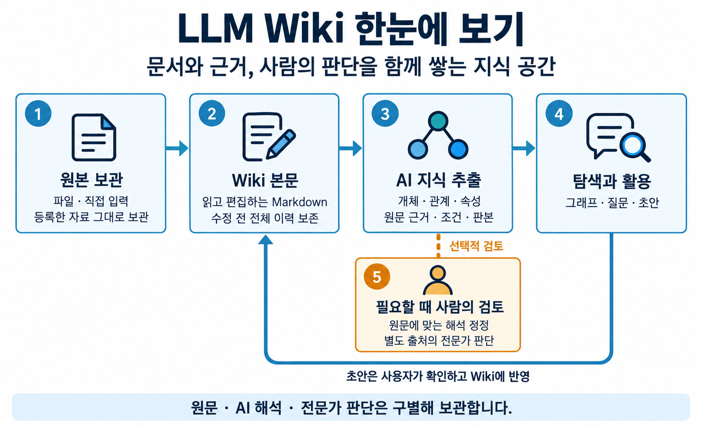

# LLM Wiki 제품 및 개발 명세

기준일: 2026-10-30

LLM Wiki는 문서와 문서에서 추출한 지식, 사람의 업무 판단을 함께 보관하고 AI 질문과 편집에 활용하는 공동 지식 공간이다. 원본의 보존, 근거가 있는 관계, 판단의 출처, 지식의 현재성을 제품의 기본 조건으로 삼는다.

이 문서 묶음은 기준일의 저장소 코드와 공개 계약을 바탕으로 제품을 정의한다. 제품 개념부터 기능과 처리 흐름, 추출 방침, 시스템 구조까지 순서대로 읽을 수 있다. 설치 환경별 제공 범위와 아직 제공하지 않는 기능은 해당 기능에 함께 명시한다.

처음 접하는 사용자는 제품의 목적과 동작을 설명하는 [LLM Wiki 이해하기](../INTRODUCTION.md)에서 시작한다. 앱을 화면으로 따라 하려면 [화면 가이드](../guide/index.html), 시작 설정과 기능별 상세 조작·오류 해결은 [사용자 가이드](../USER_GUIDE.md)에서 확인한다. 가이드의 기준일과 제공 범위는 해당 문서에 표시한다.

그림으로 먼저 살펴보려면 [추출 예시와 검사 흐름](assets/extraction-policy.png), [개인 PC와 중앙 서버의 역할](assets/system-architecture.png)을 함께 읽는다. [이미지 파일과 생성 요청문](assets/README.md)도 보관한다.

## 문서 구성

| 문서 | 다루는 내용 | 주요 독자 |
| --- | --- | --- |
| [제품 정의](PRODUCT.md) | 목적, 사용자, 핵심 개념, 제품 범위, 용어, 품질 기준 | 기획자, 개발자, 검토자 |
| [기능 명세](FEATURES.md) | 기능별 입력·처리·결과, 화면 제공 여부, 현재 제약 | 기획자, 프론트엔드·백엔드 개발자, QA |
| [기능 흐름](FLOWS.md) | 등록·추출·검토·편집·재추출·질문·산출물의 정상 및 실패 흐름 | 개발자, 디자이너, QA |
| [온톨로지 추출 방침](EXTRACTION.md) | 추출 대상, 의미 보존, 근거, 후보, 규약, 검사와 품질 판단 | AI·온톨로지 개발자, 도메인 전문가 |
| [시스템 및 데이터 구조](ARCHITECTURE.md) | 앱·개인 실행기·API·MCP, 업무 모듈, 데이터 계보, 권한과 저장 계약 | 개발자, 운영 담당자 |

처음 읽는 사람은 제품 정의에서 시작한다. 기능을 구현하거나 검증할 때는 기능 명세와 기능 흐름을 함께 읽는다. 추출 결과를 해석하거나 규약을 다룰 때는 추출 방침을, 저장·연결 경계를 다룰 때는 시스템 및 데이터 구조를 확인한다.

## 문서 적용 기준

- 본문은 제품의 현재 동작과 제약을 기술한다. 기능 상태는 출시·배포·모든 환경의 실제 실행 성공을 의미하지 않는다.
- 개별 계약의 상세 불변 규칙은 연결된 도메인 RULES와 코드에서 관리한다. 이 문서 묶음은 그 계약을 제품과 기능의 관점에서 설명한다.
- 실행·설치 방법은 [프로젝트 실행 안내](../../README.md), [앱 실행 안내](../../app/README.md), [서버 코드 길잡이](../../core/README.md)를 따른다.
- 개발 진행 상태와 검증 기록은 [도메인 색인](../PLAN.md)의 PLAN·HISTORY에서 관리한다.

## 범위의 경계

사용자는 Electron 앱에서 문서, 온톨로지, AI 채팅을 이용하고 설정에서 서버와 개인 AI 실행기를 연결한다. AI 세션 목록은 실행 중인 작업과 저장된 결과를 찾는 진입점이다. 문서 간 대응의 서버 기능, 로컬 웹 테스트 전용 내보내기, 제공자별 실제 실행 검증 범위는 [기능 명세](FEATURES.md)에 별도로 표시한다.
