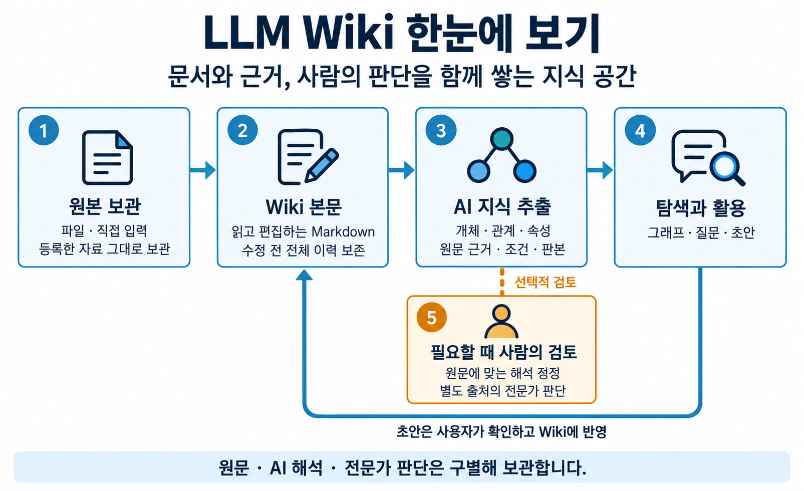

# LLM Wiki 제품 및 개발 명세

설명 기준: 2026-10-30. 현행 기능·정책·검증 상태는 아래 담당 도메인 문서를 따른다.

LLM Wiki는 문서·추출 지식·사람의 판단을 보관하고 AI 질문과 편집에 활용하는 공동 지식 공간이다. 이 문서 묶음은 제품 개념, 기능, 처리 흐름, 추출 방침, 시스템 구조를 설명한다.

처음 접하는 사용자는 제품의 목적과 동작을 설명하는 [LLM Wiki 이해하기](../INTRODUCTION.md)에서 시작한다. 앱을 화면으로 따라 하려면 [화면 가이드](../guide/index.html), 시작 설정과 기능별 상세 조작·오류 해결은 [사용자 가이드](../USER_GUIDE.md)에서 확인한다. 가이드의 기준일과 제공 범위는 해당 문서에 표시한다.

그림으로 먼저 살펴보려면 [추출 예시와 검사 흐름](assets/extraction-policy.png), [개인 PC와 중앙 서버의 역할](assets/system-architecture.png)을 함께 읽는다. [이미지 파일과 생성 요청문](assets/README.md)도 보관한다.

## 문서 구성

| 문서 | 다루는 내용 | 주요 독자 |
| --- | --- | --- |
| [제품 정의](PRODUCT.md) | 목적, 사용자, 핵심 개념, 제품 범위, 용어, 품질 기준 | 기획자, 개발자, 검토자 |
| [기능 명세](FEATURES.md) | 기능별 입력·처리·결과, 화면 제공 여부, 현재 제약 | 기획자, 프론트엔드·백엔드 개발자, QA |
| [기능 흐름](FLOWS.md) | 등록·추출·검토·편집·재추출·질문·산출물의 정상 및 실패 흐름 | 개발자, 디자이너, QA |
| [온톨로지 추출 방침](EXTRACTION.md) | 추출 대상, 의미 보존, 근거, 후보, 규약, 검사와 품질 판단 | AI·온톨로지 개발자, 도메인 전문가 |
| [시스템 및 데이터 구조](ARCHITECTURE.md) | 앱·개인 실행기·API·MCP, 업무 모듈, 데이터 계보, 권한과 저장 계약 | 개발자, 운영 담당자 |

## 문서 적용 기준

- 본문·그림은 설명 기준일의 개요이며 최신 기능 목록이나 배포 증명이 아니다. 현행 제공 범위·미완료 작업은 [담당 도메인 PLAN](../PLAN.md#도메인별-시작점), 검증·배포 결과는 각 HISTORY에서 확인한다.
- 상세 정책·한도·저장 계약은 연결된 도메인 RULES·DECISIONS에서 관리한다. 본문과 다르면 해당 계약을 따른다.
- 실행·설치 방법은 [프로젝트 실행 안내](../../README.md), [앱 실행 안내](../../app/README.md), [서버 코드 길잡이](../../core/README.md)를 따른다.
